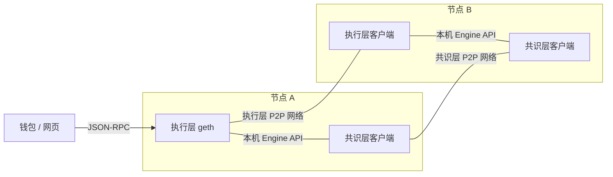
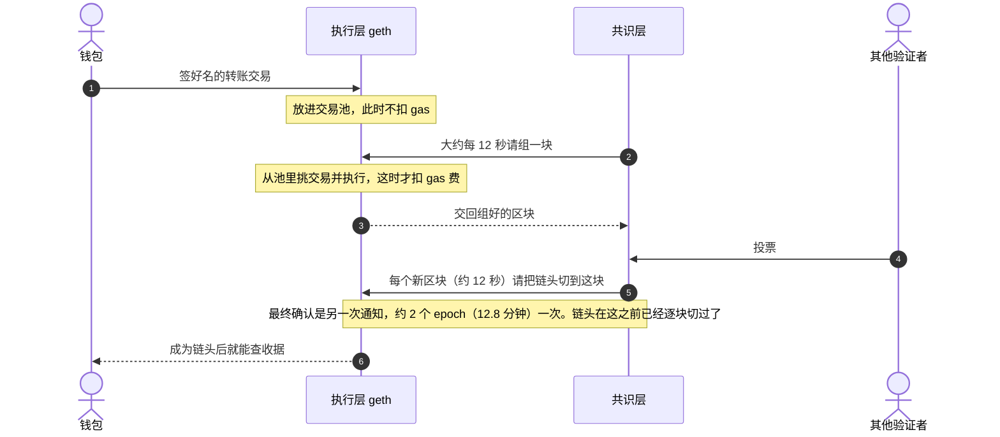
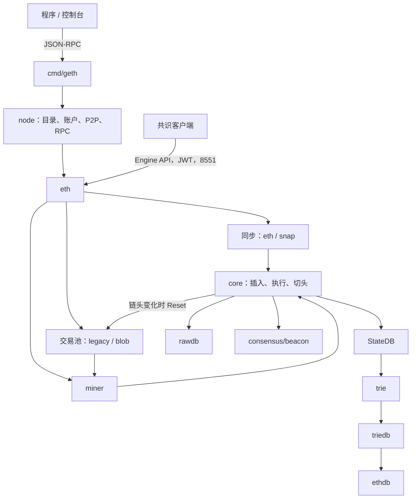

# go-ethereum 学习路线

## 以太坊现在长什么样

以太坊是一条公共区块链。用户看到的是钱包里的余额、转账，以及各种应用：兑换、借贷、NFT、链上游戏。这些应用的合约跑在以太坊上。钱包和网页不直接连「整条链」，它们通常连一个节点提供的接口，问余额、发交易、查收据。

2022 年合并之后，自己搭一台接入以太坊主网的节点，要同时跑**两个程序**，各干一件事：

- **执行层**客户端，例如本仓库编出来的 `geth`。它像一台计算机：收交易、跑合约、记下每个账户变成什么样。
- **共识层**客户端，例如 Lighthouse 或 Prysm。它像一组按规则投票的人：决定下一槽由谁提议区块、大家跟哪条链、哪一段历史已经不能随便翻掉。

两边用本机的 Engine API 说话（要 JWT 认证，默认端口 8551），不走公网。共识层不会自己跑合约；执行层也不会自己宣布「全世界都认这块」。

主网可以看成很多台这样的机器。每台机器上的两个程序「各自加入」一个 P2P 网络：`geth` 只和别的执行层客户端互相同步交易和区块数据；Lighthouse 这类程序只和别的共识层客户端交换提议与投票。同一台机器上的执行层和共识层不靠 P2P 找对方，只通过上面的本机接口配对（Engine API）。钱包、网页不是这种节点，它们只是连上某台节点的接口。只把两个程序跑起来，也还不等于验证者；验证者还要质押 ETH，才会去提议和投票。



横线是同一台机器内部的接口。两条跨节点的线是两张不同的公网：执行层只连执行层，共识层只连共识层。

一笔普通转账大致是这样走的：



1. 钱包用私钥签名，通过 JSON-RPC **直接把交易交给执行层**。交易不先经过共识层。
2. 执行层把它放进交易池。这时还没有执行成块。gas 用来限制计算量；手续费要等这笔交易被打进区块、真正执行时才结算：基础费销毁，小费付给这块的手续费接收地址（通常是提议者）。
3. 共识层按时间槽（大约 12 秒一块）选出提议者。提议者请执行层从交易池里挑交易并执行。gas 费在这一步结算：基础费被销毁，小费付给手续费接收地址，同时算出新的账户状态。
4. 其他验证者投票。共识层每来一个新区块（大约 12 秒）就通知执行层把链头切过去。钱包这时已经能查到收据。最终确认更慢：一个 epoch 是 32 个槽，约 6.4 分钟；再过一个 epoch，约 12.8 分钟，共识层才把「已最终确认、很难再回滚」的那个块另行告诉执行层。那一次不负责把链头往前推进。
5. 收据里有成败、花了多少 gas、合约打出了哪些日志。成为链头后就能查；最终确认是之后的加强保证。

验证者要质押 ETH 才能参与提议和投票。最少 32 ETH 才能激活一个验证者；启用复利凭证后，同一个验证者的有效余额可以高于 32 ETH，上限 2048 ETH。质押奖励和罚没由共识层管。执行层只负责把这些结果反映进账户余额（例如提款）。

生态里不只有这一个客户端，而且是用不同语言写的。同一套协议、多套实现，是**为了避免一家客户端出 bug 就把全网拖垮**。读本仓库时，记住你看的是执行层里用 Go 写的那一套。

| 层 | 客户端 | 语言 |
|----|--------|------|
| 执行层 | geth（本仓库） | Go |
| 执行层 | Nethermind | C# |
| 执行层 | Besu | Java |
| 执行层 | Erigon | Go |
| 执行层 | Reth | Rust |
| 共识层 | Lighthouse | Rust |
| 共识层 | Prysm | Go |
| 共识层 | Teku | Java |
| 共识层 | Nimbus | Nim |
| 共识层 | Lodestar | TypeScript |

很多人用的「二层网络 L2」是另外的链：大量交易先在二层执行，再把结果锚定回以太坊。钱包连二层时，连的往往不是这份 `geth`。学这份代码，先把一层的执行层看懂即可。

本地 `geth --dev` 不会去连主网，也不会真的启动上面那些共识客户端。它在进程里放了一个模拟的共识层，好让你单独练习执行。

## 执行层与共识层代码在哪

两套代码不在同一个仓库里。本目录是执行层客户端。

| | 规范 | 实现 |
|--|------|------|
| 执行层 | [ethereum/execution-specs](https://github.com/ethereum/execution-specs) | [ethereum/go-ethereum](https://github.com/ethereum/go-ethereum)（本仓库上游；入口 `cmd/geth`） |
| 共识层 | [ethereum/consensus-specs](https://github.com/ethereum/consensus-specs) | 不在本仓库。常见客户端：[sigp/lighthouse](https://github.com/sigp/lighthouse)、[OffchainLabs/prysm](https://github.com/OffchainLabs/prysm)、[Consensys/teku](https://github.com/Consensys/teku)、[status-im/nimbus-eth2](https://github.com/status-im/nimbus-eth2)、[ChainSafe/lodestar](https://github.com/ChainSafe/lodestar) |

用户的交易走 JSON-RPC，直接进入执行层的交易池，不经过共识层。两边在本仓库里的交界是 Engine API，代码在 `eth/catalyst`。这里传来传去的是**区块**，分两种场合：

- **本机这个槽轮到自己提议。** 大约每 12 秒全网只有一个提议者。共识层发现质押的验证者轮到这台机器时，才请本机执行层从交易池里组一块，然后把这块通过共识层的 P2P 发给别人。没有质押、或者这个槽没轮到自己的节点，不会干这件事。
- **收到别人组好的块。** 其余时间，共识层从自己的 P2P 网络收到别的提议者发出的块，交给本机执行层再执行一遍，核对状态是否算对，并告诉它哪一块是当前链头。每台节点都做这件事，提议者自己的机器在广播之后也会把链头切到刚发出的那块。

先把这一页读完。各目录里的 `LEARNING.md` 是第二遍的笔记，里面是函数和调用链。第一遍不要把它们全部打开。

大家日常说的 `geth`，就是这里的 `cmd/geth`。上面已经说过它在生态里的位置。协议细节以源码和 [执行层规范](https://github.com/ethereum/execution-specs) 为准。当前代码树还包含 Amsterdam、Bogota 等较新的分叉，读到具体函数时以你打开的文件为准。贡献约定在 [AGENTS.md](AGENTS.md)。产品文档在 [geth 文档](https://geth.ethereum.org/docs/)。

## 开始之前

会写 Go 就够起步：能读结构体、接口、goroutine。下面几个词先有个印象，后文会反复用到。

| 词 | 在这里是什么意思 |
|----|------------------|
| 交易 | 一笔已签名的操作：转账，或调用 / 创建合约 |
| 状态 | 所有账户的余额、nonce、合约代码和存储。可以想成一张会变的大表 |
| 状态根 | 这张表的指纹。块头里带着它，用来证明执行结果一致 |
| EVM | 执行合约字节码的虚拟机，代码在 `core/vm` |
| 交易池 | 还没被打进区块的交易，在内存（blob 交易主要在磁盘）里排队 |
| JSON-RPC | 外部程序调用节点的方式，例如 `eth_getBalance`、`eth_sendRawTransaction` |
| 执行层 / 共识层 | 见文首。执行层算交易、记状态，并和别的执行层交换交易。共识层用质押和投票决定链头，并从别的共识节点接收它们广播的新区块 |
| peer | 网络上的另一个节点 |

不需要先把黄皮书读完。跑通下面的下午练习之后，再按阶段打开源码。

## 第一天下午

目标只有三个：编出 `geth`，在本机走出几块，知道区块号会变。

需要 Go 1.25 或更新（见 `go.mod`）以及一个 C 编译器。在仓库根目录：

```sh
make geth
./build/bin/geth --dev --dev.period 2 --http --http.api eth,net,web3 console
```

这几件事同时发生：

- `--dev` 打开一条 Chain ID 为 1337 的开发链，创世用 `AllDevChainProtocolChanges`，时间分叉开到 Bogota。Amsterdam、UBT、BPO1、BPO2 没有写入，所以不启用。不写 `--datadir` 时，链放在内存里，进程退出数据就没了。
- `--dev.period 2` 大约每 2 秒出一个块。改成 `0` 则只有出现待处理交易时才出块。
- `console` 附带一个 JavaScript 控制台，连的是本进程，不是公网。

在控制台里试：

```javascript
eth.blockNumber
eth.accounts
eth.getBalance(eth.accounts[0])
eth.sendTransaction({from: eth.accounts[0], to: eth.accounts[0], value: 1})
eth.blockNumber
```

`--dev` 会预先放进一个有余额、已解锁的账户，所以上面的转账可以发出去。过一两秒再看 `eth.blockNumber`，数字变大，说明块已经接上了。

此时还不用读源码。你已经看到：有账户、有余额、交易被收进去、链在长。

`Ctrl-D` 退出控制台后进程会停。`tests/testdata` 和 `tests/evm-benchmarks` 是测试向量子模块，这一步不用克隆。

做完应能回答：

- `geth` 这条命令启动的是执行层，不是「整个以太坊」。
- `--dev` 是本机练习链。主网要另接共识客户端。
- 控制台能查余额、发交易，是因为节点开了 RPC。

## 之后怎么读

每一阶段先看「你会得到什么」和「先打开的文件」。文件控制在几个以内。阶段末尾的笔记链接是同一主题的详解，卡住了再点。

<mark>**推荐顺序是 1 → 2 → 3。阶段 4 到 6 可以按你想改的地方跳。例如只想看合约怎么执行，阶段 3 之后可以直接读 core/vm 的笔记。**</mark>

### 阶段 1：进程是怎么起来的

你会得到什么：从 `main` 走到「链已经建好，端口开始听」。

先打开：

1. `cmd/geth/main.go` 里的 `geth`。这是默认子命令。
2. `cmd/geth/config.go` 里的 `makeFullNode`。命令行参数在这里汇成一份配置。
3. `node/node.go` 里的 `Start`。先启动网络和 RPC，再启动各个后台服务。

`node` 包本身不懂区块链。它像一个外壳：管数据目录、账户、P2P 和 RPC。真正的链在 `eth.New` 里创建，然后作为后台服务挂到这个外壳上。

可以先不管：TOML 配置文件、GraphQL、轻客户端。默认的 `geth --dev` 用不到它们。

详解：[cmd/LEARNING.md](cmd/LEARNING.md)、[node/LEARNING.md](node/LEARNING.md)。

做完应能回答：为什么 HTTP 默认是关的，而控制台却能调用 `eth_*`。

`--http` 不写时，`cmd/utils/flags.go` 的 `setHTTP` 不会给 `HTTPHost` 赋值。`node.startRPC` 看到 `HTTPHost` 为空，就不去听 8545。控制台是另一条路：`cmd/geth/consolecmd.go` 的 `localConsole` 调 `stack.Attach()`，也就是 `rpc.DialInProc`。进程内这个 handler 在 `startInProc` 里把全部 API 都注册上了，不看 `--http`，也不看 `--http.api`。所以没开 HTTP，控制台里的 `eth.blockNumber` 照样能用。

### 阶段 2：一笔交易怎么被执行

你会得到什么：一块里的一笔交易，如何改账户、如何判定成功或失败。

用开发链在脑子里走一遍即可。`--dev` 把「共识层来要一块」这件事藏掉了，所以这条线比主网短：

1. 控制台把交易交给节点。
2. 交易进入交易池，等着被打包。
3. 模拟的共识层周期性地要求「按这个父块组一块」。`miner` 从池里取出交易。
4. `core` 逐笔执行。每笔最终进入 EVM。
5. 执行结果写进数据库，这块成为当前链头。池按新链头更新。

先打开：

1. `core/state_processor.go` 的 `Process`。它处理**一整块**：系统调用、逐笔交易、提款。
2. `core/state_transition.go` 的 `ApplyMessage`。它处理**一笔**：检查 nonce 和余额、扣 gas、调用 EVM。
3. `core/vm/interpreter.go` 的 `Run`。真正的字节码循环在这里，一步一条指令。

两个结果要分开记：

- 单笔失败（例如合约 revert、gas 不够）时，这笔收据是失败的，**整块仍然可以有效**。
- 这笔根本不该进块（nonce 错、余额不够付 gas）时，**整块无效**。

`eth_call` 走同一套 `ApplyMessage`，用来模拟，不进交易池，也不落盘。

详解：[core/LEARNING.md](core/LEARNING.md)、[core/vm/LEARNING.md](core/vm/LEARNING.md)、[core/txpool/LEARNING.md](core/txpool/LEARNING.md)。

做完应能回答：`Process`、`ApplyMessage`、`Run` 各管哪一层。

- `StateProcessor.Process`（`core/state_processor.go`）管一整块：分叉相关的系统调用、按顺序处理块里每一笔交易、块末的提款，最后 `Finalize`。某一笔在 `ApplyMessage` 里返回 error（nonce 错、余额不够付 gas）时，整块失败。
- `ApplyMessage`（`core/state_transition.go`）管一笔：检查 nonce、预扣 gas、转账，再交给 EVM。合约 revert、gas 用完这类虚拟机错误写在 `ExecutionResult.Err` 里，函数本身仍返回 nil，所以收据是失败的，块还可以有效。`eth_call` 也走这里。
- `EVM.Run`（`core/vm/interpreter.go`）管字节码：准备栈和内存，从程序计数器开始一条指令一条指令执行。预编译合约不进这个循环。

### 阶段 3：状态放在哪

你会得到什么：分清「执行时改内存」和「出块时写入磁盘」。

执行过程中，EVM 改的是内存里的 `StateDB`。一笔交易中途失败，就按日志把内存改回去。一整块都合法之后，才把变更收成状态树，再交给数据库。

先打开：

1. `core/state/statedb.go` 里的 `SetState` 和 `Commit`。
2. `trie/trie.go` 里的 `Commit`。它只收集改过的树节点，这一下还不写磁盘。
3. `triedb/database.go`。这里才选择节点怎么持久化。

磁盘上其实是几套不同的数据：

- 区块头、区块体、收据：`core/rawdb`，旧块会搬进只追加的 freezer。
- 账户和存储：状态树。树节点由 `triedb` 写入键值库（默认 Pebble）。
- 两者靠块头里的状态根连在一起。

空数据目录默认用 path 方案：磁盘上每个位置一份当前节点，最近的历史用差量保存。hash 方案按节点哈希存储，适合归档节点。第一遍记住「有两种存法」就够了。

详解：[core/state/LEARNING.md](core/state/LEARNING.md)、[trie/LEARNING.md](trie/LEARNING.md)、[triedb/LEARNING.md](triedb/LEARNING.md)、[ethdb/LEARNING.md](ethdb/LEARNING.md)。

做完应能回答：合约存储槽在执行时改的是 `StateDB`，不是直接 `db.Put`。

`SSTORE`（`core/vm/instructions.go` 的 `opSstore`）调的是 `StateDB.SetState`。它把新值写进这个账户对象的 `dirtyStorage`，并在 journal 里记一笔，这笔交易中途失败时按日志把内存改回去。这一步不碰键值库。一整块合法之后，`StateDB.Commit` 才把脏数据收成树节点（`trie.Commit` 只收集节点），再经 `state.Database.Commit` 交给 `triedb.Update`。hash 模式下这一步只放进内存里的脏节点缓存（`hashdb.dirties`），写磁盘要再等 `triedb.Commit`。

### 阶段 4：主网和 `--dev` 差在哪

你会得到什么：看懂合并之后「谁建块、谁把块定成链头」。

`--dev` 里内置了一个模拟信标，所以你感觉 geth 自己在出块。主网上有一个独立的共识客户端，通过本机一个要 JWT 认证的接口跟 geth 说话（默认端口 8551）。三句就够：

| 共识层说的话 | geth 做什么 |
|--------------|-------------|
| 请按这些属性组一块 | `miner` 打包交易，先交一块空的保证不丢槽，再在后台换成手续费更高的版本 |
| 把这块给我 | 把已经组好的块交出去。组块在上一句里已经开始 |
| 这是我收到的块，请执行 | 执行并写入数据库，**先不改链头** |
| 请把链头切到这块 | 这块才成为规范链头，交易池跟着更新 |

对应代码在 `eth/catalyst/api.go` 的 `forkchoiceUpdated`、`getPayload`、`newPayload`。第一遍把上表读熟，再打开这个文件。

`miner` 不是在算工作量证明。旧的 ethash、clique 封印函数在当前生产路径上会直接 panic。

详解：[consensus/LEARNING.md](consensus/LEARNING.md)、[miner/LEARNING.md](miner/LEARNING.md)。

做完应能回答：块执行成功，为什么还不等于它已经是链头。

主网上共识层先调 `newPayload`。它走 `BlockChain.InsertBlockWithoutSetHead`：执行、校验、把块和状态写入数据库，但 `insertChain` 的 `setHead` 是 false，`ExecuteConfig.WriteHead` 也是 false，所以不改规范链头。链头要等下一次 `forkchoiceUpdated`：请求的块已经在本地、又不是当前链头时，才 `SetCanonical`。`newPayload` 返回 `VALID`，只说明这块能执行、已经落库；钱包要等链头切过去，才能在链头上查到它。

### 阶段 5：节点怎么连上别人、怎么补历史

你会得到什么：P2P 只负责「找到对方并连上」；区块内容是连上之后的子协议，或者由共识层推过来。

先打开：

1. `p2p/server.go` 的 `Start`。监听、发现、拨号、准入。
2. `eth/handler.go` 的 `runEthPeer`。和对方核对网络、创世块，然后才能交换数据。
3. `eth/downloader/downloader.go` 里同步模式分叉的注释。

两种同步：

- **full**：下载区块并逐块执行。
- **snap**：历史区块和收据也会下，但靠近链顶的一个支点之前**不执行**，状态靠对方提供的账户叶子重建。支点之后的几十个块才执行。

发现协议（DNS、DHT）只给你节点地址，不传区块。

详解：[p2p/LEARNING.md](p2p/LEARNING.md)、[eth/LEARNING.md](eth/LEARNING.md)。

做完应能回答：为什么刚启动、还在同步时，别人发来的交易不会进池。

`handler.synced` 默认是 false。eth 协议收到交易广播或交易公告时，`handleTransactions`、`handlePooledTransactions`、`handleNewPooledTransactionHashes` 先看 `AcceptTxs()`，也就是这个标志。没同步完就直接返回，不把交易交给池。同步结束时 downloader 会回调 `enableSyncedFeatures`；共识层的 `forkchoiceUpdated` 也会调 `SetSynced`。两处都是 `synced.Store(true)`，之后才收交易。

### 阶段 6：外部程序怎么调用节点

你会得到什么：一个 HTTP 请求怎样变成一次 Go 方法调用。

先打开：

1. `rpc/doc.go`。方法如何被注册成 `eth_getBalance` 这种名字。
2. `internal/ethapi/api.go` 里的 `SendRawTransaction` 和 `Call`。
3. `eth/api_backend.go`。API 层通过接口回到链和交易池，不直接依赖具体的节点类型。

`eth_sendRawTransaction` 收到的是已经签好的交易，节点不会再帮你签名。`eth_call` 只模拟。

公开的 HTTP 默认只开放 `eth`、`net`、`web3`。`debug`、`admin` 在本机 IPC 上。HTTP 不能做 `eth_subscribe`，订阅用 WebSocket 或 IPC。

账户密钥在 `accounts/keystore`。本仓库没有 `personal_unlockAccount` 这个 RPC。`--dev` 能发交易，是因为启动时已经把开发账户解锁了。

详解：[rpc/LEARNING.md](rpc/LEARNING.md)、[internal/ethapi/LEARNING.md](internal/ethapi/LEARNING.md)、[accounts/LEARNING.md](accounts/LEARNING.md)。

做完应能回答：为什么在代码里加了一个导出方法，用 curl 打 HTTP 却找不到。

HTTP 只挂 `--http.api` 里列出的命名空间，不挂全部导出方法。`node.RegisterApis` 按这份名单过滤；geth 的默认名单是 `eth`、`net`、`web3`（`defaultNodeConfig` 在 `net,web3` 后面补了 `eth`）。`debug`、`admin`，以及你新注册的命名空间，不在名单里时，curl 打 8545 就找不到。本机 IPC（`StartIPCEndpoint`）和进程内控制台会注册全部命名空间，所以同一方法在 IPC 上可能能调到。

导出本身也不够。`rpc.suitableCallbacks` 会跳过未导出的方法，以及返回值不符合约定的方法：最多一个结果再加一个 error，error 必须在最后。方法名是「命名空间 + 首字母小写」，例如 `GetBalance` 变成 `eth_getBalance`。`--http.api` 填的是命名空间，不是这个方法名。加在已经开放的 `eth` 服务上、签名也合法的方法，不用改 `--http.api` 就能在 HTTP 上看到。

## 节点里谁和谁说话

读完阶段 2 再看这张图。箭头是数据大致怎么走，不是启动顺序。启动顺序是：外壳先起来，然后才是链的后台循环。



主网上，共识客户端走图里那条 Engine API，不走公开的 8545。`--dev` 用进程里的模拟信标代替它。

## 基础类型放在哪

这些包小，适合在读阶段 2 时随手翻，不必单独做一轮。

| 想了解 | 打开 | 笔记 |
|--------|------|------|
| 这条链在哪个高度启用哪套规则 | `params/config.go` 的 `ChainConfig`、`Rules` | [params](params/LEARNING.md) |
| 区块、交易在网络上的二进制格式 | `rlp/doc.go` | [rlp](rlp/LEARNING.md) |
| 哈希、地址、签名 | `crypto/crypto.go` | [crypto](crypto/LEARNING.md) |

`common.Address` 是 20 字节，`common.Hash` 是 32 字节。RPC 里的 `0x` 十六进制在 `common/hexutil`，和 RLP 不是同一套编码。详解在 [common](common/LEARNING.md)。进程内的链头和日志通知在 [event](event/LEARNING.md)。

## 拆开的第二遍笔记

第一遍按上面的阶段读。下面这些包各自有一篇，父目录笔记里也能点到。

| 包 | 笔记 |
|--|--|
| 地址、哈希、`0x` 编码 | [common](common/LEARNING.md) |
| 进程内订阅 | [event](event/LEARNING.md) |
| Engine API 的载荷类型、信标轻客户端 | [beacon](beacon/LEARNING.md) |
| 用 Go 调一个节点 | [ethclient](ethclient/LEARNING.md) |
| 4 字节选择器、EIP-712 | [signer](signer/LEARNING.md) |
| 状态测试、区块测试 | [tests](tests/LEARNING.md) |
| 区块、交易、收据 | [core/types](core/types/LEARNING.md) |
| 磁盘上的键和 freezer | [core/rawdb](core/rawdb/LEARNING.md) |
| ABI 编解码、abigen | [accounts/abi](accounts/abi/LEARNING.md) |
| eth / snap 线协议 | [eth/protocols](eth/protocols/LEARNING.md) |
| 同步 | [eth/downloader](eth/downloader/LEARNING.md) |
| Engine API 入口 | [eth/catalyst](eth/catalyst/LEARNING.md) |
| `debug_trace*` | [eth/tracers](eth/tracers/LEARNING.md) |
| pathdb 的 diff layer 和历史 | [triedb/pathdb](triedb/pathdb/LEARNING.md) |
| 统一二叉树、迁移门面、迁移进度 | [trie/bintrie](trie/bintrie/LEARNING.md)、[trie/transitiontrie](trie/transitiontrie/LEARNING.md)、[core/overlay](core/overlay/LEARNING.md) |
| snap/2 状态同步 | [eth/protocols/snap](eth/protocols/snap/LEARNING.md) |
| 日志索引和 `eth_getLogs` | [core/filtermaps](core/filtermaps/LEARNING.md)、[eth/filters](eth/filters/LEARNING.md) |

## 准备改代码时

能从 `ApplyMessage` 跟到 `Run` 之后，再看这一节。

日常：

```sh
gofmt -w <改过的文件>
goimports -w <改过的文件>
go test ./<包> -count=1
```

提交前还要 `make all`、`go run ./build/ci.go test`（开发中可先加 `-short`）、`lint`、`check_generate`、`check_baddeps`。完整说明在 [AGENTS.md](AGENTS.md)。产物在 `./build/bin`。

提交说明和 PR 标题用 `<包路径>: 小写简述`，例如 `core/vm: fix stack overflow in PUSH instruction`。PR 基于 `master`。

`gen_*.go` 是生成的，手改会被检查打回。改了结构体就跑旁边的 `go:generate`。工具用 `make devtools` 安装。

适合第一次动手的改动：给 `core/vm`、`rlp`、`params` 补一个表驱动测试；把和代码不一致的注释改准。先别改区块插入、pathdb 刷盘和 snap 同步，这三处出错会表现为链分叉或状态根对不上。

一条新硬分叉通常会碰到：`params`（何时启用）、`core/vm`（指令和 gas）、`core`（单笔规则和整块校验）、`core/types`（块头或交易字段）、`consensus`（块头校验）、`eth/catalyst` 和 `miner`（组块时填新字段）、`core/txpool`（新交易能不能进池）。各篇笔记的「扩展点」写了具体文件。

离线看「一块执行完状态变成什么样」，用 `evm` 的 `t8n`，不必启动节点：

```sh
make evm
./build/bin/evm t8n --help
```

## 第二遍可以用来对照的结论

这些句子在当前代码里成立。第一遍没读懂可以跳过，读对应阶段时再回来。

- `InsertChain` 会推进链头。Engine API 的 `newPayload` 只执行并落库，链头要等 `SetCanonical`。
- 预编译合约在 `EVM.Call` 里直接用 Go 执行，不进字节码循环。
- `StateDB.Commit` 把树节点交给 `triedb`。hash 模式下它们可能还在内存缓存里，尚未写入磁盘。
- 合并之后，新区块不是靠 eth 协议广播进来的。`NewBlock`（`0x07`）和 `NewBlockHashes`（`0x01`）的消息编号还在，`eth69` 到 `eth72` 的分发表里都没有它们。收到会当成非法消息号断开。新块从共识层经 `eth/catalyst` 进来。
- Snap 同步会下载历史块和收据。支点之前不执行交易。
