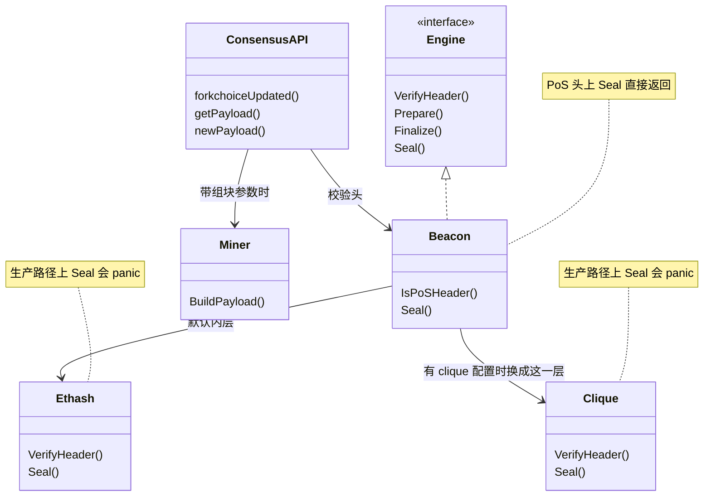

# consensus：共识引擎与 Engine API

[返回学习总览](../LEARNING.md) · 上一篇 [core/txpool](../core/txpool/LEARNING.md) · 下一步 [miner](../miner/LEARNING.md)

合并之后，执行层自己不封印区块。`consensus.Engine` 仍保留 `Seal` / `CalcDifficulty`，生产路径上 ethash 和 clique 的 `Seal` 会 panic。真正出块从 `eth/catalyst` 进入 [miner](../miner/LEARNING.md)。

## 建议阅读顺序

1. `consensus/consensus.go`：`Engine` 接口。
2. `consensus/beacon/consensus.go`：`VerifyHeader`、`Prepare`、`Finalize`、`Seal`。
3. `eth/ethconfig/config.go` 的 `CreateConsensusEngine`。
4. `eth/catalyst/api.go`：`forkchoiceUpdated`、`getPayload`、`newPayload`。详解 [eth/catalyst](../eth/catalyst/LEARNING.md)。
5. `eth/catalyst/queue.go`：payload ID 到 `*miner.Payload`。
6. `consensus/misc/eip1559`、`consensus/misc/eip4844`：base fee 与 blob gas。
7. `beacon/engine`：payload 类型和 `ExecutableDataToBlock`。轻客户端在 `beacon/light`，由 `cmd/blsync` 使用。详解 [beacon](../beacon/LEARNING.md)。

## 三种引擎

`CreateConsensusEngine` 用 `beacon.New` 包住内层引擎。有 clique 配置则内嵌 clique，否则内嵌 `ethash.NewFaker()`。没有 `terminalTotalDifficulty` 会拒绝启动。禁止 beacon 再包 beacon。

| 引擎 | 现在的职责 |
|------|------------|
| ethash | 预合并头规则。`NewFaker` 跳过真实 PoW。`Seal` panic |
| clique | PoA 投票与签名。`Seal` panic |
| beacon | `Difficulty > 0` 委托内层；`== 0` 走 PoS 头规则 |

PoS 头常量：difficulty 0、nonce 0、uncle hash 为空、禁止 uncle、extra 不超过 32 字节、时间戳必须大于父块。`Prepare` 把 difficulty 写成 0。`Finalize` 对 PoS 头是空操作，没有出块奖励。`Seal` 直接返回，封印交给共识层。

判定依据是 difficulty 是否为 0（EIP-3675），不再在线累加 TTD。beacon 不验证提议者签名或 attestation。

## Engine API 三条路径

版本入口都在 `eth/catalyst/api.go`，公共实现是三个私有方法。

**`forkchoiceUpdated`**

1. head 为全零则 `INVALID`。
2. 本地没有完整块：已判无效则 `INVALID`；header 还不在缓存且 `GetHeader` 失败则只返回 `SYNCING`；header 已在或 `GetHeader` 成功才 `BeaconSync` 并返回 `SYNCING`。
3. 本地有块且不在规范链上则 `SetCanonical`。`maxReorgDepth` 只限制往更低的规范祖先回退。
4. 非空的 finalized / safe 哈希必须已在规范链上，然后 `SetFinalized` / `SetSafe`。
5. 带 `payloadAttributes` 时调用 `Miner.BuildPayload`，放进 `payloadQueue`（最多 10 个，`maxTrackedPayloads`），返回 `VALID` 和 payload ID。

**`getPayload`** 校验版本字节，然后 `Payload.Resolve()`。有完整块就交完整块（含 blob sidecar 和 requests），否则交已经同步造好的空块。`Resolve` 会停掉后台构建。

**`newPayload`**

1. 按分叉检查 withdrawals、blob gas、beacon root、execution requests、slot、block access list 是否该出现。
2. `ExecutableDataToBlock` 还原区块。
3. 已有该哈希则直接 `VALID`，不重执行。
4. 缺父块或仍在 snap sync：块头进远程队列并返回 `SYNCING`。父块在库里但状态不在时返回 `ACCEPTED`。
5. `InsertBlockWithoutSetHead`：`beacon.verifyHeader`、`ValidateBody`、`Process`、`ValidateState`。
6. 成功返回 `VALID`。规范头要等下一次 `forkchoiceUpdated` 的 `SetCanonical`。失败记入 `invalidTipsets`。

`verifyHeader` 在 difficulty 为 0 时检查常量字段、时间戳、gas、`eip1559.VerifyEIP1559Header`、Shanghai 的 withdrawalsHash、Cancun 的 `eip4844.VerifyEIP4844Header` 和 parentBeaconRoot、Amsterdam 的 slot 与 block access list hash。

## 头字段写在哪

生产时 [miner.prepareWork](../miner/LEARNING.md) 填写。验证时 `beacon.verifyHeader` 调用 `consensus/misc`。Shanghai withdrawals、Cancun parentBeaconRoot、Prague requests、Amsterdam slot 的有无检查在 beacon 和 catalyst 的版本方法里。

## 头里的 gas 数字

`consensus/misc` 不算交易，只检查头字段和给出下一头该填的数。`beacon.verifyHeader` 在 PoS 头上调用它们。

| 文件 | 作用 |
|------|------|
| `eip1559.CalcBaseFee` | 用父块的 `GasUsed` 相对 `GasLimit / ElasticityMultiplier` 算出下一头的 base fee。父块还不是 London 时返回 `InitialBaseFee` |
| `eip1559.VerifyEIP1559Header` | 核对 gas limit 的涨跌幅和 base fee。第一块 London 的父 gas limit 先乘上 elasticity |
| `misc.VerifyGaslimit` | 与父块的差必须小于 `parent / GasLimitBoundDivisor`，且不低于 `MinGasLimit` |
| `eip4844.CalcExcessBlobGas` | 由父块的 excess 和 blob gas 用量得到下一块的 excess。Osaka 的算法在 `calcExcessBlobGas` 里分叉 |
| `eip4844.CalcBlobFee` | 用 excess 做伪指数，得到 blob base fee |
| `eip4844.VerifyEIP4844Header` | 头上必须有 `ExcessBlobGas` 和 `BlobGasUsed`，用量不超过该时刻的 blob 配置，excess 必须等于算出来的值 |
| `dao.go` | 只服务 DAO 分叉的 extra-data 和余额迁移 |

组块时 [miner](../miner/LEARNING.md) 调用同一套 `Calc*` 填头，验证走对应的 `Verify*`。改计算公式时填头和校验要一起改。

## 读的时候记住

- `beacon` 包里的共识包装是执行层检查器。提议者选举在共识客户端。
- `NewPayload` 成功表示块已执行落库。它成为链头要再经过 `SetCanonical`。
- `GetPayload` 不建块。建块在带 `payloadAttributes` 的 `forkchoiceUpdated` 里已经开始。
- 主网节点不会 PoW 挖矿。`miner` 是 payload 构造器。
