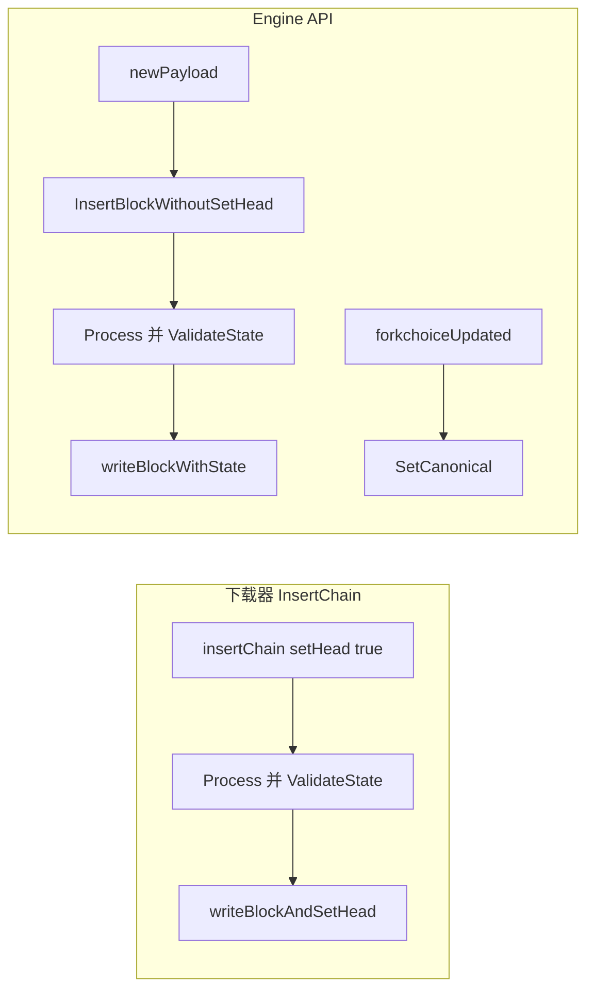
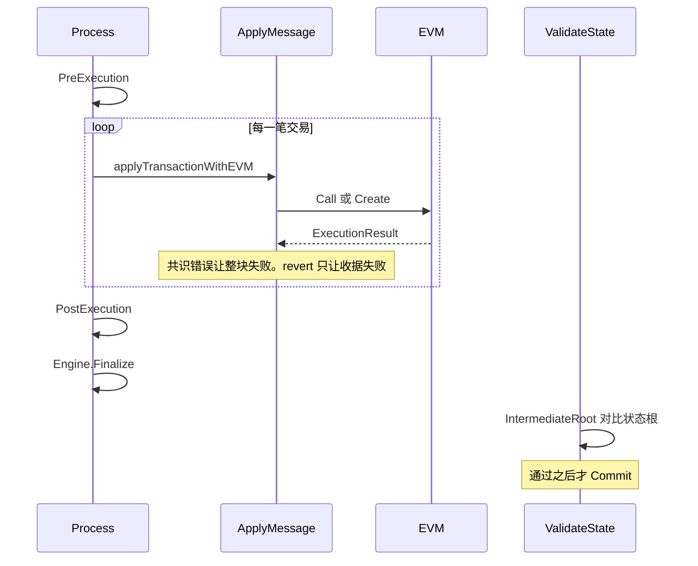

# core：区块链与区块执行

[返回学习总览](../LEARNING.md) · 上一篇 [node](../node/LEARNING.md) · 下一步 [core/vm](vm/LEARNING.md)

`core` 管「区块如何变成规范链上的状态」。EVM 指令在 [core/vm](vm/LEARNING.md)，交易池内部在 [core/txpool](txpool/LEARNING.md)，共识引擎只在头校验和 `Finalize` 交接。块、交易、收据的形状在 [core/types](types/LEARNING.md)，落盘的键在 [core/rawdb](rawdb/LEARNING.md)。

## 建议阅读顺序

1. `core/types/block.go`、`transaction.go`、`receipt.go`：数据长什么样。详解 [core/types](types/LEARNING.md)。
2. `core/rawdb/schema.go` 与 `accessors_chain.go`：链数据的 key 和 freezer。详解 [core/rawdb](rawdb/LEARNING.md)。
3. `core/genesis.go`：`SetupGenesisBlockWithOverride`、`Commit`。
4. `core/types.go` 的 `Validator` / `Processor`，然后 `core/block_validator.go`。
5. `core/evm.go`，`core/state_processor.go` 的 `Process`，`core/state_transition.go` 的 `ApplyMessage`。
6. `core/blockchain.go`：`InsertChain`、`ProcessBlock`、`writeBlockAndSetHead`、`reorg`、`SetCanonical`。

## 数据模型

`types.Header` 的共识字段包括 `ParentHash`、`Root`（状态根）、`TxHash`、`ReceiptHash`、`Bloom`、`GasLimit`、`GasUsed`、`Time` 等。按分叉以 `rlp:"optional"` 出现的还有 `BaseFee`、`WithdrawalsHash`、`BlobGasUsed`、`ExcessBlobGas`、`ParentBeaconRoot`、`RequestsHash`、`BlockAccessListHash`、`SlotNumber`。`Hash()` 是 header RLP 的 keccak256。

`types.Body` 含交易、叔块和提款。`types.Block` 在此之上缓存 hash。Amsterdam 的区块访问列表另存，协议编码 `extblock` 不含它。

`types.Transaction` 是外壳加 `inner TxData`。类型常量：Legacy `0x00`、AccessList `0x01`、DynamicFee `0x02`、Blob `0x03`、SetCode `0x04`。进块的 blob 交易不能带 sidecar。

`types.Receipt` 的共识部分是类型、`PostState` 或 `Status`、累计 gas、Bloom、日志。`TxHash`、合约地址、有效 gas 价格等留在实现侧。落盘的 `storedReceiptRLP` 不存 Bloom。

## 从插入到规范头

两条入口，都拿 `chainmu`。

**`InsertChain`（下载器、部分管理 API、测试）** 调用 `insertChain(..., setHead=true)`：

1. 批次内高度连续，且父哈希接得上。
2. `engine.VerifyHeaders` 校验头；`ValidateBody` 核对 body 与 header 里的根。
3. 已知块可以 `writeKnownBlock`，跳过执行。
4. `ProcessBlock`：按父状态根建 `StateDB`，`processor.Process`，`ValidateState`，然后 `writeBlockAndSetHead`。
5. 父块不是当前头时 `reorg`，再 `writeHeadBlock`。后者同一 batch 写下 header 头、fast 头、canonical hash、交易查找和 block 头。

**Engine API** 拆成两步，见 [consensus](../consensus/LEARNING.md)：

- `newPayload` → `InsertBlockWithoutSetHead` → `WriteHead=false`，只 `writeBlockWithState`。
- `forkchoiceUpdated` → `SetCanonical`，必要时 `reorg`，然后 `writeHeadBlock`。

## 一块到一笔

`StateProcessor.Process` 管整块：Amsterdam、区块自带访问列表、没有 tracer、没有 witness、也没有 `DisableParallelExecution` 时走 `processParallel`，否则顺序执行。顺序路径先 `PreExecution`（例如 EIP-4788 的 beacon root），再逐笔 `TransactionToMessage` 和 `applyTransactionWithEVM`，然后 `PostExecution`（提款、deposit 等），最后 `Engine().Finalize`。

`ApplyMessage` 进入 `stateTransition.execute`：设交易上下文、`preCheck`（nonce、余额、买 gas）、`IntrinsicGas`、`StateDB.Prepare`，然后 `To == nil` 走 `evm.Create`，否则 `evm.Call`。`settleGas` 里退还剩余 gas；返回之后，London 起把 effective tip 加给 coinbase。

`preCheck` 等共识错误让整块失败。`ExecutionResult` 里的 revert、out of gas 只让该笔收据失败。

`eth_call` 也走 `ApplyMessage`，可以跳过 nonce 检查。见 [internal/ethapi](../internal/ethapi/LEARNING.md)。

## 规范链不变量

规范链是「高度 → hash」，库里有的块可以是侧链。`GetBlockByNumber` 走 `ReadCanonicalHash`。

内存里有四套指针：已执行的 `currentBlock`、收据同步的 `currentSnapBlock`、`currentFinalBlock`、`currentSafeBlock`。头链可以高于已执行块。

`reorg` 找到共同祖先，把旧链日志以 `Removed=true` 发出，把新链除最终头外的块逐个 `writeHeadBlock`。它不重新执行，依赖这些块此前已经 `writeBlockWithState`。

`SetHead` 向下删到仍有状态的块，用来回滚修复。snap 的 `InsertReceiptChain` 不跑状态根，直接把收据链写成规范数据。

## rawdb 与 freezer

`rawdb` 是 schema 和读写函数。热数据在 KV 里，前缀包括 header（`h`）、body（`b`）、receipt（`r`）、区块访问列表（`j`）、交易查找（`l`）、合约代码（`c`）。path 方案的 trie 键前缀也写在 `schema.go`，读写策略在 [triedb](../triedb/LEARNING.md)。完整的表在 [core/rawdb](rawdb/LEARNING.md)。

Freezer 是只追加的按高度编号的平坦文件。chain freezer 把远离头部的规范段迁到 `ancient/chain/`，表为 headers、hashes、bodies、receipts、bals。path 方案的历史状态在另一套 state freezer。

`writeBlockWithState` 写区块和收据，并调用 `statedb.Commit`。hash 模式再按内存和时间刷 trie；path 模式把节点 GC 留给 pathdb。

## 扩展点

- 新分叉的系统调用放 `PreExecution` / `PostExecution`。单笔规则放 `stateTransition`。header 字段放 `types.Header`，并在 `ValidateState` 对根。
- 头的共识校验留在 `engine.VerifyHeaders`。`BlockValidator` 核对 body 和执行结果。
- 测试可以 `SetBlockValidatorAndProcessorForTesting`。

## 读的时候记住

- state root 在 `ValidateState` 里用 `IntermediateRoot` 比对。`Commit` 在校验通过之后。
- 并行执行仍要让访问列表哈希等于 header。它是快路径，共识检查还在。
- freezer 搬的是区块冷数据。账户和存储槽在 trie。
