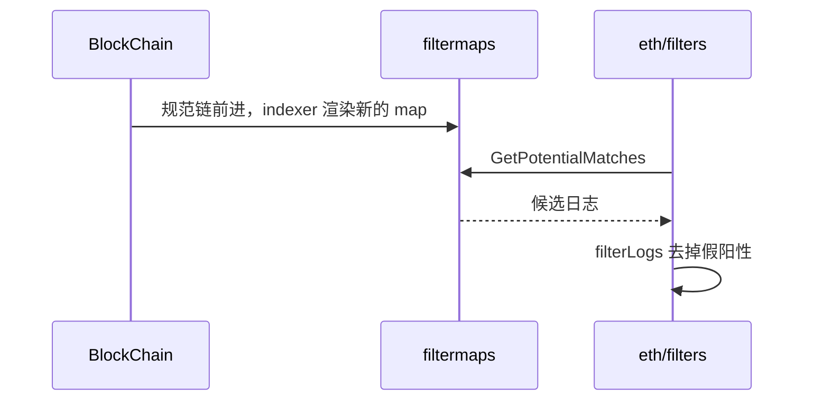

# core/filtermaps：日志索引

[返回学习总览](../../LEARNING.md) · 查询入口 [eth/filters](../../eth/filters/LEARNING.md)

`eth_getLogs` 的加速结构在这里。它实现 [EIP-7745](https://eips.ethereum.org/EIPS/eip-7745) 的 filter map：把一段日志值映射到若干行上，查询时读行、得到候选，再回区块里核对。本包不做那份 EIP 里的树哈希，也不把索引放进共识。

## 建议阅读顺序

1. `math.go` 的 `Params`、`DefaultParams`。
2. `filtermaps.go`：`FilterMaps`、`NewFilterMaps`、按 log value 下标找到 map。
3. `indexer.go`、`map_renderer.go`：跟着规范链渲染 map、裁掉过老的 epoch。
4. `matcher.go`：`GetPotentialMatches`、`ErrMatchAll`。
5. `chain_view.go`：索引所对应的链视图。重组后视图变了，匹配结果要按共享区间裁掉。

## 一张 map 里有什么

主网参数是 `DefaultParams`：

| 参数 | 值 | 含义 |
|------|----|------|
| `logMapHeight` | 16 | 一张 map 有 2^16 行 |
| `logValuesPerMap` | 16 | 一张 map 收 2^16 个日志值 |
| `logMapsPerEpoch` | 10 | 一个 epoch 有 2^10 张 map |
| `baseRowLengthRatio` | 8 | 第 0 层行长相对平均行长的倍数 |
| `logLayerDiff` | 4 | 层数每加 1，行长上限左移 4 位 |

日志值按顺序铺进 map。一行放不下时，超出 `baseRowLength` 的部分进扩展层。地址和 topic 用来选行。命中只说明「可能在这段日志值里」。`eth/filters` 取出这些日志后再用 `filterLogs` 按地址和 topic 去掉假阳性。

`databaseVersion` 是 2。磁盘上的版本对不上就重建索引。

## 谁在写、谁在查

索引器跟着规范链跑，把已索引区间记在 `indexedRange`，并保持一份与索引一致的 `ChainView`。历史长度由 `Config.History` 决定。`--history.logs.disable` 把 `disabled` 设上，索引器不再写；`eth/filters` 会改走逐块扫描。

`MatcherBackend` 是查询用的窄接口：行、log value 指针、按指针取日志、以及 `SyncLogIndex`。`ErrMatchAll` 表示这个过滤条件等于匹配全部日志。filtermaps 不为它做特殊扫描，调用方应改用逐块路径。

尾部 epoch 可以被卸掉。卸掉之后的高度仍要能查，只是不再走索引。

## 读的时候记住

- 改 `DefaultParams` 会使已有索引失效，需要换 `databaseVersion` 或接受重建。
- 索引命中不是最终结果。漏掉收据核对会把假阳性返回给 RPC。
- 索引落后于链头时，落后的那段要逐块扫。查询代码在 `eth/filters` 的 `searchSession`。
- 这个索引和区块头里的 bloom 是两套结构。bloom 仍在收据和头里，给没有 filtermaps 的客户端用。
