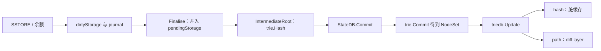

# core/state：执行期状态机

[返回学习总览](../../LEARNING.md) · 上一篇 [core/vm](../vm/LEARNING.md) · 下一步 [trie](../../trie/LEARNING.md)

EVM 改的是内存里的 `StateDB`。Merkle 根在区块边界才算。磁盘布局在 [trie](../../trie/LEARNING.md) 和 [triedb](../../triedb/LEARNING.md)。

## 建议阅读顺序

1. `statedb.go`：`SetState`、`Finalise`、`IntermediateRoot`、`Commit`。
2. `journal.go`：`journalEntry`、`snapshot`、`revert`。
3. `state_object.go`：一个账户的 `dirtyStorage`、`pendingStorage`、`uncommittedStorage`。
4. `database.go`、`database_mpt.go`、`database_ubt.go`：`OpenTrie` 与提交。
5. 回到 `core/blockchain.go` 的 `writeBlockWithState`，看 `Commit` 之后谁刷盘。

## 一次 SSTORE 或余额变更

**余额。** `AddBalance` 找到或创建 `stateObject`，`SetBalance` 先 `journal.balanceChange` 记下旧值，再改内存里的 `data.Balance`。账户 trie 此时不动。

**SSTORE。** `SetState` 发现新旧不同才 `journal.storageChange`，并写入 `dirtyStorage`。新值等于 origin 时从 dirty 里删掉。回滚调用 `revert`，把槽设回 `prev`。

`StateDB.Snapshot()` 返回 journal 的 revision，给 EVM `RevertToSnapshot` 用。它和 `core/state/snapshot` 那棵扁平加速树不是一回事。

## 交易结束与出根

`Finalise` 遍历本交易的 mutations。自毁或 EIP-158 空账户走删除；否则 `finalise()` 把 `dirtyStorage` 并入 `pendingStorage`，并用 `uncommittedStorage` 记下上次 commit 以来的原始值。然后 `journal.reset()`，跨交易不能再 revert。

`IntermediateRoot` 先 `Finalise`。MPT 下对每个未应用的账户更新存储 trie，再把账户写入账户 trie，最后 `trie.Hash()`。这个哈希就是收据和 header 要对的 state root。UBT 没有每账户一棵存储树，存储直接写在统一二叉树上。

`Commit` 再跑一次 `IntermediateRoot`，然后：

- 账户 trie `Commit(true)` 收集脏节点。
- 每个账户 `commit()`：MPT 再 `storageTrie.Commit`。UBT 跳过这一步，因为统一树已经收过节点。
- 代码写入 code 库（key 前缀 `c`，叶子里只存 `CodeHash`）。
- `triedb.Update(newRoot, originRoot, ...)`。MPT 若挂了 snapshot，还会 `snap.Update`。

`trie.Commit` 不写磁盘，它返回 `NodeSet`。`triedb.Update` 在 hash 模式下把节点放进脏缓存，在 path 模式下堆一个 diff layer。真正的 KV 写入发生在之后的 `Cap`、`Commit` 或 pathdb buffer flush。见 [triedb](../../triedb/LEARNING.md)。

`BlockChain.writeBlockWithState` 把写区块和 `statedb.Commit` 分开。path 模式到 `statedb.Commit` 就返回。hash 模式的 archive 节点每块 `triedb.Commit`；修剪中的 full 节点保住最近约 128 个根，超内存再 `Cap`。

## 扁平读

hash 方案下 `core/state/snapshot.Tree` 用 `accountHash → 账户`、`accountHash+slotHash → 槽` 避免多层 trie 查找，并给同步做有序迭代。`StateReader` 先问这层，未覆盖再落到 trie。共识根仍然只来自 trie。path 方案的扁平数据在 pathdb 里，不走这个包。

## 扩展点

- 新的可回滚字段：加 `journalEntry`，并在 `Finalise` 里决定它是否进入 mutations。只进 journal 的变更不会进 trie。
- 换树：实现 `state.Trie`，在 `state.Database` 的 `OpenTrie` / `Commit` 接上。UBT 已经是这条路。
- 加快读：在 `StateReader` 链前面加一层，失败时落到 trie。

## 读的时候记住

- Journal 服务 EVM 回滚。进 trie 的是 `Finalise` 之后还留在 mutations 里的结果。
- `StateDB.Commit` 返回根，表示节点集已经交给 triedb。hash 模式下它们可能仍在脏缓存。
- 合约字节码不在 trie 叶子里。区块头体不在 trie 里。两边用 state root 关联。
