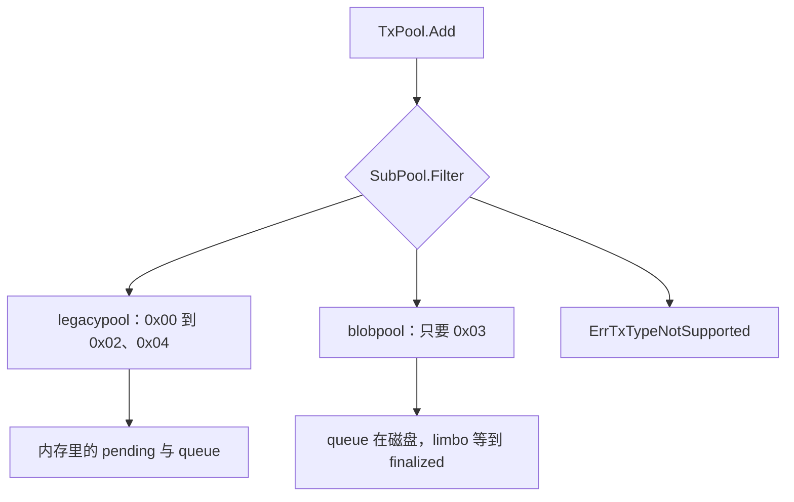
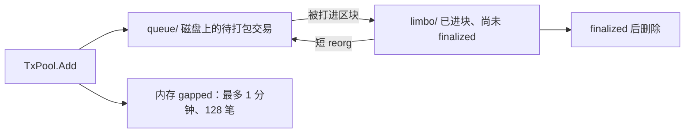

# core/txpool：交易池

[返回学习总览](../../LEARNING.md) · 上一篇 [ethdb](../../ethdb/LEARNING.md) · 下一步 [consensus](../../consensus/LEARNING.md)

`TxPool` 按交易类型把交易分给子池。它不认识 peer。网络侧的去重和限流在 [eth/fetcher](../../eth/LEARNING.md)。出块时由 [miner](../../miner/LEARNING.md) 调用 `Pending`。

## 建议阅读顺序

1. `core/txpool/subpool.go`：`SubPool` 接口。
2. `core/txpool/txpool.go`：`Add`、`Pending`、`loop` 里的 `Reset`。
3. `core/txpool/validation.go`：无状态与有状态校验。
4. `core/txpool/legacypool/legacypool.go`：pending 与 queue。
5. `core/txpool/blobpool/blobpool.go`、`limbo.go`：磁盘队列和 reorg 暂存。

组装点在 `eth/backend.go`：`[]SubPool{legacyPool, blobPool}`。`Init` 由 `TxPool.New` 用同一链头和共享的地址预留依次调用。

## 一笔交易如何进池

1. `eth_sendRawTransaction` 或 P2P 的 fetcher 调用 `TxPool.Add`。
2. `SubPool.Filter` 分流。legacy 接受 Legacy、AccessList、DynamicFee、SetCode。blob 池只接受 `BlobTxType`。都不认则 `ErrTxTypeNotSupported`。
3. 无状态校验 `ValidateTransaction`：类型、大小、分叉、intrinsic gas、tip、签名、blob sidecar。
4. 有状态校验 `ValidateTransactionWithState`：nonce、余额、累计花费、账户槽位。legacy 另有 EIP-7702 的 `validateAuth`。
5. 新地址先 `reserver.Hold`。同一地址不能同时出现在两个子池。

legacy 先入 queue。nonce 连续且余额够再提升到 pending。链头变化时每个子池 `Reset`。

`eth_sendTransaction` 在交易是 blob 类型时直接拒绝。带 sidecar 的 blob 交易走 `eth_sendRawTransaction`。

## 为什么 blob 单独成池

单笔 blob 大约 128KiB，一笔可以带多个。blobpool 用 billy 把队列放在磁盘 `queue/`，内存里只留 `blobTxMeta`（哈希、nonce、费用上限、驱逐用的 fee jump）。legacy 池把整笔交易放在内存里按 gas price 驱逐，扛不住这个体积。

其它约束：

- 驱逐同时看执行 gas tip 和 blob fee。容量不够时，丢掉「整段 nonce 里出价最低的那个账户」的最高 nonce，避免把序列中间拆出洞。
- 每账户最多 16 笔，避免用后续交易取消已经传播的 blob。
- nonce 有洞的交易留在内存里的 `gapped` 表，大约 `gappedLifetime`（1 分钟）后丢掉，全局最多 `maxGapped`（128）笔。这和 legacy 的长期 queue 不同。
- 还在排队的 blob 落在数据目录的 `queue/`。交易进块后 sidecar 不在区块 body 里，blob 改放 `limbo/`，直到 finalized 才丢，短 reorg 才能捞回来。
- `Pending` 在 `filter.BlobTxs == false` 时直接返回空。miner 要分两次取。

## 出块时怎么被取走

`fillTransactions` 调两次 `Pending`：一次要普通交易，一次 `BlobTxs=true`。过滤条件包括最小 tip、base fee、blob fee、Osaka 的 gas 上限。本地优先地址先打包，其余按有效 tip 和 nonce 交叉选取（`txorder`）。

`commitBlobTransaction` 放进区块的是 `WithoutBlobTxSidecar()`。sidecar 单独放进 payload。

## 扩展点

新交易类型实现一个 `SubPool`（至少 `Filter`、`Add`、`Pending`、`Reset`），在 `eth/backend.go` 放进 `txpool.New` 的切片。账户独占用现成的 `Reserver`。排序策略改 `fillTransactions` 或 `txorder`，不要在 catalyst 里选交易。

## 读的时候记住

- 池满等临时拒绝，且开了 local tracker 时，RPC 可能对用户返回成功并稍后重放。
- 初始同步完成前，handler 会丢掉交易公告，它们进不了池。
- 主网路径上 eth72 的 blob 交易体和 cell 分两路到达，拼好再 `Add`。
