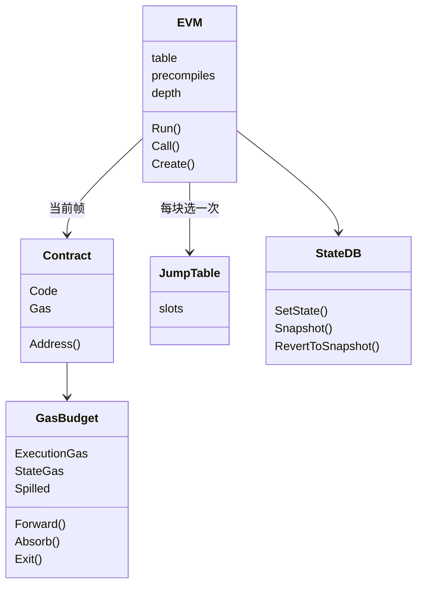
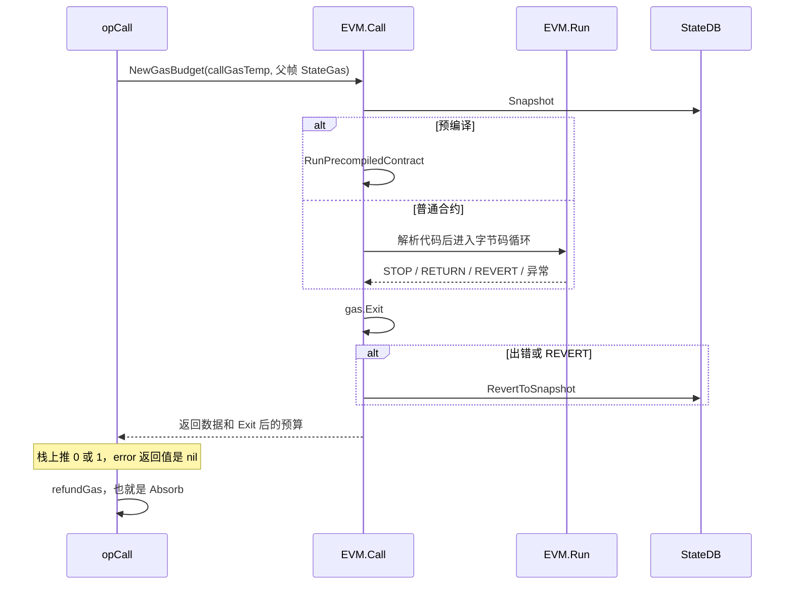

# core/vm：EVM

[返回学习总览](../../LEARNING.md) · 上一篇 [core](../LEARNING.md) · 下一步 [core/state](../state/LEARNING.md)

解释循环是 `(*EVM).Run`。硬分叉在 `NewEVM` 里按 `params.Rules` 选定一张 256 槽的 jump table。CALL 再递归进 `EVM.Call` / `Create`。本树有 Amsterdam / Bogota / UBT，以及 EIP-8037/8038 的 execution / state 二维 gas（`GasBudget`）。

## 建议阅读顺序

1. [params 的 Rules](../../params/LEARNING.md)，再看 `evm.go` 的 `NewEVM`。
2. `jump_table.go` 从最新分叉回溯到 `newFrontierInstructionSet` 的继承链。
3. `interpreter.go` 的 `Run`。这是唯一的执行节拍。
4. `instructions.go` 里的 `opCall`、`opCreate`、`opSload`、`opSstore`、`opReturn`、`opRevert`。
5. `gascosts.go` 的 `GasBudget`：`Charge`、`Forward`、`Exit`、`Absorb`。
6. `contract.go`、`stack.go`、`memory.go`。
7. `eips.go` 里挑两个 `enable*`，对照 `gas_table.go`。
8. `contracts.go` 的 `activePrecompiledContracts`。
9. 交易入口在 `core/state_transition.go` 的 `executeCall` / `executeCreate`。`core/vm/runtime` 是 `cmd/evm` 用的无链环境。

## 一次调用

1. `executeCall` 做 nonce 等检查后 `ForwardAll`，再 `evm.Call`。创建交易走 `evm.Create`。
2. `EVM.Call`：深度超过 `params.CallCreateDepth`（1024）失败；余额不足失败；`StateDB.Snapshot()`。
3. 普通 `CALL` 先转账（系统调用除外），再决定走预编译还是普通合约。预编译走 `RunPrecompiledContract`，不进 `Run`。
4. 否则解析代码（Prague 起最多跟一层 EIP-7702 委托），然后 `NewContract`、`evm.Run`。
5. `Run` 里 `depth++`。循环：取 opcode（越界当 `STOP`）→ `jumpTable[op]` → 栈深检查 → 扣 constant gas → 若有动态 gas 先算内存上界再扣费 → tracer → `Memory.Resize` → `operation.execute`。无错则 `pc++`。
6. `opCall` 用 `callGasTemp` 建子预算。value 非 0 时再加上 `CallStipend`（2300），不从父帧扣，再调 `evm.Call`。子调用 revert 或失败时 `opCall` 都返回 nil 错误，栈上推 0。只有成功或 `REVERT` 才把数据写入内存和 `returnData`，其它失败不留 revert 数据。成功则栈上推 1。
7. `STOP` / `RETURN` 变成成功返回。`REVERT` 返回 `ErrExecutionReverted`。回到 `Call` 后 `gas.Exit`。出错则 `RevertToSnapshot`。

`CallCode` 的执行地址是 caller 自己，代码取自目标地址。`DelegateCall` 沿用父帧的 caller 和 value，代码取自目标地址。`StaticCall` 把 `readOnly` 设上：禁止转账、`SSTORE`、`LOG`、`CREATE`、`SELFDESTRUCT`。

## gas、栈、内存、存储

`GasBudget` 分开记 `ExecutionGas` 和 `StateGas`。State 不够时从 execution 透支，记在 `Spilled`。解释循环的 constant gas 只扣 execution。`GAS` opcode 只把 `ExecutionGas` 压栈。

子调用交预算有三条路：

- `CALL` / `CALLCODE` / `DELEGATECALL` / `STATICCALL`：动态 gas 已经把 `callGasTemp` 从父帧 execution 里扣掉。opcode 用 `NewGasBudget(callGasTemp, 父帧.StateGas)` 做子预算，不调用 `Forward`。`CALL` 和 `CALLCODE` 在 value 非 0 时再把 `CallStipend`（2300）加进子预算，不从父帧扣。返回时 `refundGas` 调用 `Absorb`：先用子帧剩余 `StateGas` 替换父帧，再按父帧尚未还清的 `Spilled` 把一部分 state gas 还回 execution。
- `CREATE` / `CREATE2` 走 `forwardGas`，也就是 `GasBudget.Forward`：扣掉指定的 execution，并把整个 state 水库交出去。
- 交易最外层的 `executeCall` / `executeCreate` 用 `ForwardAll`，没有「留 1/64」。

EIP-150 的留 1/64 在 `callGas`、`opCreate`（EIP-150 之后）和 `opCreate2`，不在主循环里重算。

每帧一个 `Stack`，底层共用 `EVM.arena` 里的 `uint256.Int`。1024 是调用深度。操作数栈上限由 `minStack` / `maxStack` 相对 `params.StackLimit` 计算。

每帧一块 `Memory`。先按 `memory_*` 算出字节上界并扣 gas，再 `Resize`。

存储不在 Memory 里。`opSload` / `opSstore` 调 `StateDB`。冷热与净计量在 gas 函数里（`gasSLoadEIP2929`、`gasSStoreEIP2200`，Amsterdam 还有 `gasSStore8037And8038`）。瞬态存储是 `TLOAD` / `TSTORE`。下一笔交易进入 `execute` 时，`StateDB.Prepare` 换成一张空表，上一笔的瞬态值从这里消失，不是在上一笔 `Finalise` 里清。见 [core/state](../state/LEARNING.md)。

## Jump table

`NewEVM` 对 `Rules` switch 一次，把 `evm.table` 指到包级表。更新的分叉写在更前面的 `case`。表是拷贝上一张再改槽。`Config.ExtraEips` 会 `copyJumpTable` 再 `EnableEIP`，避免改全局表。

例子：

- Shanghai `enable3855` 把 `PUSH0` 从 `opUndefined` 换成 `opPush0`。同叉 `enable3860` 改 `CREATE` 和 `CREATE2` 的动态 gas。
- Cancun `enable1153` 装上 `TLOAD` / `TSTORE`。`enable6780` 把 `SELFDESTRUCT` 的执行函数换成 `opSelfdestruct6780`。
- London `enable3198` 新增 `BASEFEE`。`enable3529` 替换 `SSTORE` 和 `SELFDESTRUCT` 的 `dynamicGas`。
- Berlin `enable2929` 把 `SLOAD` 的常量 gas 改为 0，动态 gas 改为冷热计价。执行函数不变。
- Merge 把 `0x44` 的执行函数换成 `opRandom`（`PREVRANDAO` 与 `DIFFICULTY` 同字节）。
- Amsterdam `enable7843` 装 `SLOTNUM`；`enable8037And8038` 替换 SLOAD / SSTORE / CALL / CREATE 的动态 gas。

Petersburg 没有自己的表。预编译也不走这张表。

## 预编译

`PrecompiledContract` 有 `RequiredGas`、`Run`、`Name`。每叉一份 `map[common.Address]PrecompiledContract`。`activePrecompiledContracts(rules)` 按分叉返回对应 map。`NewEVM` 把它放进 `evm.precompiles`。调用点在 `Call` 里、`Run` 之前。`RequiredGas` 扣 execution gas。

## Tracing

钩子类型是 `core/tracing.Hooks`，挂在 `vm.Config.Tracer`。帧边界在 `Call` / `Create` 的 `captureBegin` / `captureEnd`。每条 opcode 在 `Run` 里扣完 gas、扩内存之前发出。交易级 `OnTxStart` / `OnTxEnd` 不在 `Run` 里，由 `runtime` 和调用方自己调。tracer 怎么注册见 [eth/tracers](../../eth/tracers/LEARNING.md)。

加 opcode 或改二维 gas 时，漏一个钩子，跟踪结果会和真实执行不一致。触发顺序：

| 钩子 | 何时 |
|------|------|
| `OnBlockStart` / `OnBlockEnd` | 整块处理前后 |
| `OnSystemCallStart` / `OnSystemCallEnd` | 系统调用。这一段不发 `OnTxStart` / `OnTxEnd`，中间仍有 `OnEnter` / `OnExit` 和状态钩子 |
| `OnTxStart` / `OnTxEnd` | 一笔普通交易的前后 |
| `OnEnter` / `OnExit` | 一次 `Call` 或 `Create` 的帧。设了 `OnEnterV2` / `OnExitV2` 就走 V2，否则 V1 只看到 execution gas |
| `OnOpcode` | `Run` 里本条指令执行前。同样是 V2 优先 |
| `OnGasChange` | gas 变化。设了 `OnGasChangeV2` 时带上完整的 execution / state 向量；只设 V1 时参数是 `old.Execution` 和 `new.Execution` |
| `OnBalanceChange`、`OnNonceChange`、`OnCodeChange`、`OnStorageChange`、`OnLog` | 状态真的改了的时候 |

Amsterdam 的二维 gas 只改 `GasBudget`、不填 `OnGasChangeV2`，旧 tracer 仍能跑，但看不到 state gas。

## 加一个 opcode 的落点

1. `opcodes.go`：常量、名字、反查表。
2. 执行函数，签名为 `func(pc *uint64, evm *EVM, scope *ScopeContext) ([]byte, error)`。
3. 碰内存就在 `memory_table.go` 加函数；非常量 gas 就在 `gas_table.go` 或 `operations_acl.go`。
4. `eips.go` 的 `enableNNNN` 填 `operation` 各字段，并登记 `activators`。
5. `jump_table.go` 的 `new*InstructionSet` 调用它。新分叉还要在 `NewEVM` 的 switch 里加上。
6. `params.ChainConfig` 与 `Rules`。gas 数字放 `params`。
7. `jump_table_test.go` 和对应 EIP 测试。

新预编译是新地址进 `contracts.go` 的 map，并挂到 `activePrecompiledContracts`。

## 读的时候记住

- 全仓库的解释循环就是 `(*EVM).Run`，没有单独的 `Interpreter` 类型。
- Jump table 每个区块选一次。循环里用的是 `evm.table`。
- `opCall` 在子调用 revert 或失败时 error 返回值都是 nil，栈上推 0。只有成功或 `REVERT` 才把数据留在 `returnData`。父帧靠栈上的 0/1 区分成败。
- `cmd/evm` 经 `runtime.Call` / `Create`。真实打包路径以 `state_transition.go` 为准。
