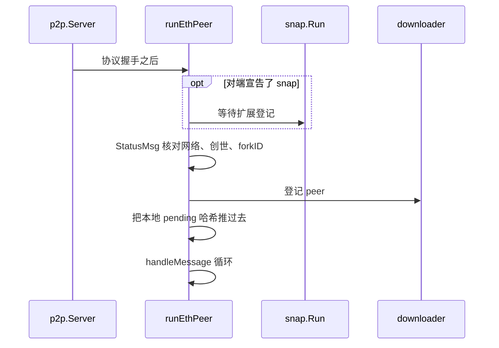
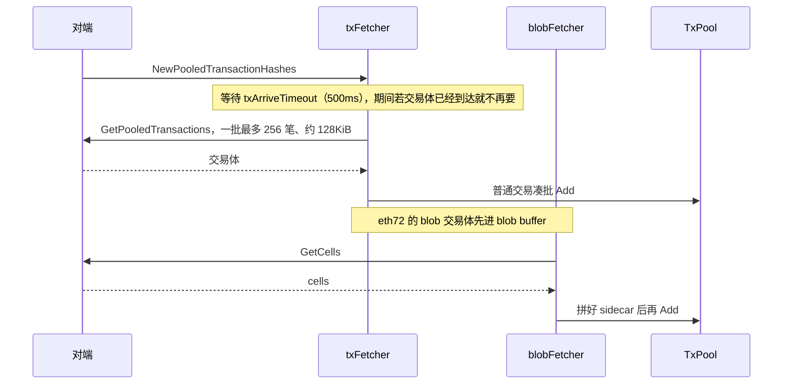

# eth：全节点、同步与交易广播

[返回学习总览](../LEARNING.md) · 上一篇 [p2p](../p2p/LEARNING.md) · 下一步 [rpc](../rpc/LEARNING.md)

`eth` 把链、交易池、子协议和同步装在一起，并作为 `Lifecycle` 交给 [node](../node/LEARNING.md)。合并后的规范头由共识层经 `eth/catalyst` 推动。见 [consensus](../consensus/LEARNING.md)。线协议、同步、Engine API 和执行跟踪各自有一篇：[protocols](protocols/LEARNING.md)、[downloader](downloader/LEARNING.md)、[catalyst](catalyst/LEARNING.md)、[tracers](tracers/LEARNING.md)。

## 建议阅读顺序

1. `eth/backend.go`：`New`、`Protocols`、`Start`、`setupDiscovery`。
2. `eth/handler.go`：`runEthPeer`、交易广播。
3. `eth/protocols/eth/protocol.go`、`handler.go`、`handlers.go`。
4. `eth/downloader/downloader.go`、`beaconsync.go`、`skeleton.go`。
5. `eth/protocols/snap/sync.go`（snap/1）、`syncv2.go`（snap/2）。
6. `eth/fetcher/tx_fetcher.go`、`blob_fetcher.go`。
7. `eth/catalyst/api.go`：live 插块。
8. `core/history/historymode.go`：历史保留，不是第三种同步模式。

## 启动之后

`eth.New` 打开 chaindata，建 `BlockChain` 和 `txpool`（legacy + blob），再 `newHandler`。handler 里创建 downloader、交易 fetcher 和 blob fetcher。`Protocols` 始终包含 eth；`SnapshotCache > 0` 时再加 snap。这些协议在 `eth.New` 里注册到 node。`(*Ethereum).Start` 启动发现、handler 和 filtermaps。

`runEthPeer`：

1. 对端也宣告了 snap 时，先等 snap 扩展登记。
2. `StatusMsg` 核对 networkID、genesis、forkID、区块范围。
3. 登记 peer，交给 downloader。
4. `syncTransactions` 把本地 pending 哈希推给新 peer。
5. 进入 `handleMessage` 循环。

snap 的 `Run` 只跑消息循环。断开和槽位由 eth handler 管。

## 区块从哪进来

eth/69–72 的 handler 不再分发 `NewBlock` / `NewBlockHashes`。消息号还留在 `protocol.go` 里。live 块来自 catalyst。

本地没有这个头、且 header 已在缓存或 `GetHeader` 成功时，`forkchoiceUpdated` 才把 `BeaconSync` 交给 skeleton：从可信 head 向后拉 header，接到本地已有 header 或创世后回填 body、receipt、靠近头部的 BAL。

- full：`importBlockResults` → `InsertChain`，执行交易。
- snap：见下一节。

信标回填成功时 downloader 回调 `enableSyncedFeatures`。本地已有该头时，`forkchoiceUpdated` 调用 `SetSynced`。两处都会打开收交易。

已经跟上时，`newPayload` 在父块和状态都在的情况下 `InsertBlockWithoutSetHead`（执行，不改规范头）。随后 `forkchoiceUpdated` 走 `SetCanonical`。

## Snap 不逐块执行历史

`SyncMode` 只有 `FullSync` 和 `SnapSync`。`HistoryMode`（`KeepAll`、`KeepPostMerge`、`KeepPostPrague`、`KeepPostOsaka`、`KeepCustom`）决定从哪一高度开始保留 body 和 receipt，downloader 在 cutoff 之前跳过它们。它不决定要不要执行。

Snap 仍然下载 header、body、receipt。pivot 在 head 往回 `fsMinFullBlocks`（64）处：

- pivot 之前：`InsertReceiptChain`。校验头链，把块和收据写入 ancient/kv，推进 `currentSnapBlock`，不调用 `insertChain`。
- 状态：`snapSyncer.Sync`。snap/1 按账户哈希区间拉叶子再 heal trie。snap/2 先拉扁平账户、存储和字节码，再在本地生成 trie。已经 complete 之后 pivot 再动，只靠 BAL 前滚，不再生成 trie。
- pivot 本身：`SnapSyncComplete` 把它设为 head，然后切到 full。
- pivot 之后的约 64 个块：`InsertChain`，这些才执行。

状态正确性来自 snap 叶子，不来自重放全部历史交易。用户选了 full 时，下面三种情况仍会改回 snap：上次 snap 没做完（已执行头还停在创世，snap 头已经往前）、当前头的状态不在本地、运行中头高度掉到上次记下的 pivot 之下。刚初始化、创世状态还在的空库不会因此改成 snap。

## eth 与 snap

| | eth | snap |
|--|-----|------|
| 链数据 | headers、bodies、receipts、access lists | 不传区块 |
| 状态 | 不传 trie 叶子 | account/storage range、bytecode；snap/1 还有 trie nodes；snap/2 用 access lists |
| 交易 | 广播、哈希公告、拉池内交易；eth72 还有 cell | 不涉及 |

## 交易广播

出站：`SubscribeTransactions` → `txBroadcastLoop`。小交易按约 sqrt(peers) 直接发送，其余以及 blob、过大的交易只发哈希公告。

入站走 `eth/fetcher`，不在协议 handler 里直接入池。`synced == false` 时这些包被丢掉。

`maxTxAnnounces` 是 4096。标成 underpriced 的哈希放进一个最多 32768 条、保留约 5 分钟的集合，避免立刻再要。`eth/fetcher` 里没有区块 fetcher。日志和 `newHeads` 在 [eth/filters](filters/LEARNING.md)，订的是 `core.BlockChain` 的 feed。

## 读的时候记住

- Snap 会下载历史块和收据。不执行的是 pivot 之前那一段。
- Snap 不能单独存在。没有 snap 扩展的 peer 在 snap sync 时会被槽位限制。
- 新的链上请求走 eth 的 request id 和 dispatcher。新的状态批量拉取走 snap 的 range 和 `snap.Syncer`。
- 协议 handler 里直接 `txpool.Add` 会绕过 fetcher 的去重和限流。
