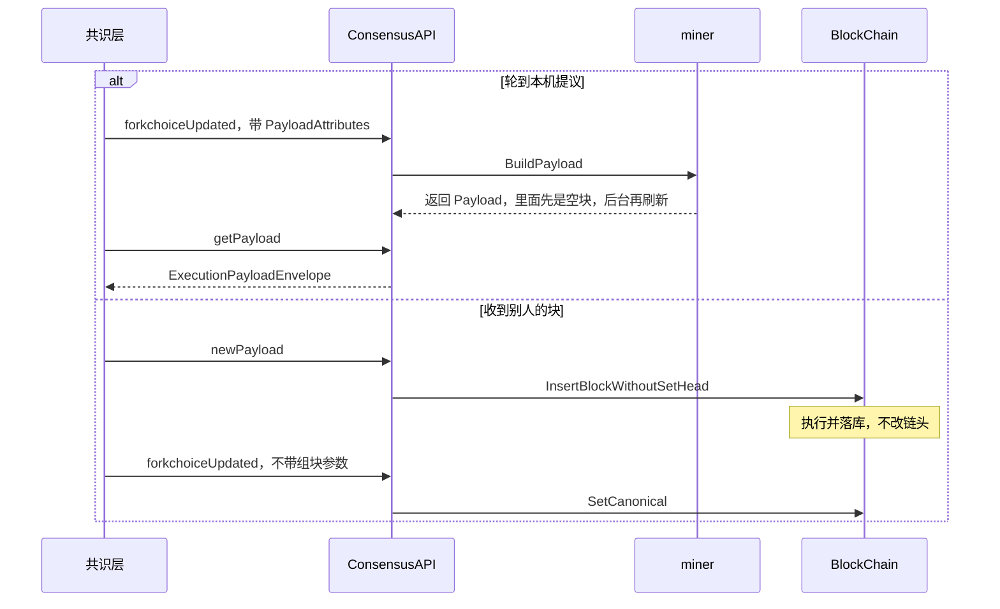

# eth/catalyst：Engine API

[返回 eth](../LEARNING.md) · [返回学习总览](../../LEARNING.md) · 相关 [consensus](../../consensus/LEARNING.md)、[miner](../../miner/LEARNING.md)、[beacon](../../beacon/LEARNING.md)

`eth/catalyst` 是本机共识客户端调用的 JSON-RPC。命名空间是 `engine`，注册时 `Authenticated: true`，走 JWT，不走公开的 8545。载荷的 Go 类型在 [beacon/engine](../../beacon/LEARNING.md)。组块在 [miner](../../miner/LEARNING.md)。把头写成规范链在 `BlockChain.SetCanonical`。

## 建议阅读顺序

1. `eth/catalyst/api.go` 的 `Register`、`ConsensusAPI`。
2. `ForkchoiceUpdatedV1` 到 `V4`，然后私有方法 `forkchoiceUpdated`。
3. `GetPayloadV1` 到 `V6`，以及 `getPayload`。
4. `NewPayloadV1` 到 `V5`，以及 `newPayload`。
5. `eth/catalyst/queue.go`：payload ID 对应的正在组的块。
6. `eth/catalyst/simulated_beacon.go`：`--dev` 用的进程内信标。

## 谁在什么时候调用

共识客户端每个 slot 做两件不同的事。

**自己要提议这块时：** `forkchoiceUpdated` 带上 `PayloadAttributes`。执行层还没有在这个父块上组块，就调用 `Miner().BuildPayload`，返回 `PayloadID`。共识层随后 `getPayload`，拿走 `ExecutionPayloadEnvelope`，签进信标块，再广播给其他共识节点。

**听到别人的信标块时：** 共识层把里面的执行载荷用 `newPayload` 交给本机执行层。父块和状态都在时，`newPayload` 调用 `InsertBlockWithoutSetHead`：执行、校验、落库，不改规范头。接着 `forkchoiceUpdated` 只带 `ForkchoiceState`（没有组块参数），调用 `SetCanonical`，链头、安全点和最终点在这一步更新。

本地没有这个头时，先取 header。缓存里已有或 `GetHeader` 成功才让 [downloader](../downloader/LEARNING.md) `BeaconSync`；`GetHeader` 失败只返回 `SYNCING`；无效祖先返回 `INVALID`。这条路径不执行该块。

## 版本

公共方法按分叉加参数，最后都进同一个私有函数。

| 方法 | 比上一版多出来的 |
|--|--|
| `ForkchoiceUpdatedV1` | 头、安全点、最终点，以及可选的组块参数 |
| V2 | 组块参数里可以有提款 |
| V3 | 父信标块根 |
| V4 | payload 属性里的 slot。另有独立参数 `custodyColumns`，用来更新 blob custody，不是组块属性里的字段 |
| `NewPayloadV1` | 执行载荷 |
| V2 | 提款 |
| V3 | versioned hashes、beacon root |
| V4 | execution requests。Prague、Osaka，以及 BPO1、BPO2。拒绝 slot 和区块访问列表 |
| V5 | slot 和区块访问列表。Amsterdam、Bogota，以及 BPO3 到 BPO5 |
| `GetPayloadV1` | 只返回 `ExecutableData`，要求 `PayloadV1` |
| V2 | 返回 `ExecutionPayloadEnvelope`，接受 `PayloadV1` 或 `PayloadV2` |
| V3 / V4 / V5 | 都要求 `PayloadV3`。V3 是 Cancun，V4 是 Prague，V5 是 Osaka 以及 BPO1、BPO2。V5 起 blob 证明换成 cell 证明 |
| V6 | 要求 `PayloadV4`。Amsterdam、Bogota，以及 BPO3 到 BPO5 |

`ExchangeCapabilities` 让双方告诉对方自己实现了哪些方法。`GetClientVersionV1` 交换客户端名称和版本。`GetBlobsV1` 到 `V4` 按版本哈希把 blob 或 cell 交还给共识层。`GetPayloadBodiesByHash` / `ByRange` 给共识层补历史执行体。

`heartbeat` 在启动后若迟迟没有共识层更新，会打日志。超时常数在 `api.go` 顶部：启动等待 30 秒，之后 2 分钟没有更新视为共识客户端不在。

无效块会记在祖先表里。同一块被引用太多次（`invalidBlockHitEviction`）才会再试一次，避免一个坏块把执行层卡住。

## --dev

`simulated_beacon.go` 在进程里按周期调用和真实共识客户端相同的 Engine API：要 payload、再 `newPayload`、再 `forkchoiceUpdated`。所以开发链上也能走到 `BuildPayload` 和 `SetCanonical`，只是没有独立的共识进程，也没有质押投票。

## 读的时候记住

- `newPayload` 执行并落库。规范头要等 `forkchoiceUpdated` 里的 `SetCanonical`。
- 带 `PayloadAttributes` 的 `forkchoiceUpdated` 是在要本机组块。不带的是在切换链头。
- 这些方法挂在认证过的 `engine` 命名空间。公开 HTTP 默认没有它。
- 类型转换 `ExecutableDataToBlock` 在 `beacon/engine`，不在这个文件里。
