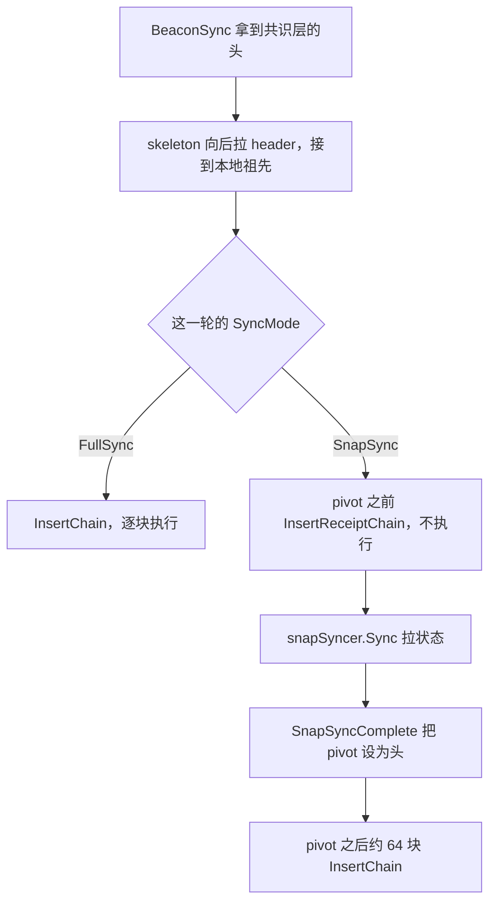

# eth/downloader：跟上链头

[返回 eth](../LEARNING.md) · [返回学习总览](../../LEARNING.md) · 相关 [eth/protocols](../protocols/LEARNING.md)、[core](../../core/LEARNING.md)

`downloader` 在本地链和共识层给出的头之间补齐缺的区块。合并之后的入口是 `BeaconSync`。它不决定哪一块是规范头，规范头由 [catalyst](../catalyst/LEARNING.md) 的 `forkchoiceUpdated` 设置。

## 建议阅读顺序

1. `eth/downloader/downloader.go`：`New`、`fsMinFullBlocks`、`syncToHead`。
2. `eth/downloader/beaconsync.go`：`BeaconSync`、`BeaconExtend`、`findBeaconAncestor`。
3. `eth/downloader/skeleton.go`：`skeleton.Sync`。从可信头向后拉 header，直到接到本地已有的头。
4. `eth/downloader/downloader.go` 的 `processFullSyncContent` 和 `processSnapSyncContent`。
5. `eth/protocols/snap/sync.go` 与 `syncv2.go`：状态叶子怎么落地。downloader 通过 `snap.Syncer` 调用它们。snap/2 的阶段见 [snap](../protocols/snap/LEARNING.md)。

## 两种同步

`ethconfig.SyncMode` 只有 `FullSync` 和 `SnapSync`。`downloader.SyncMode` 这个名字已标成废弃，实际类型是 `ethconfig.SyncMode`。

## 历史保留

`core/history.HistoryMode` 决定 body 和收据从哪一高度开始留。它不决定 pivot 之前执不执行，那是 `SyncMode` 的事。

| 模式 | 保留点 |
|------|--------|
| `KeepAll` | 默认。一直留到创世 |
| `KeepPostMerge` | 该网络内置的合并块 |
| `KeepPostPrague` | Prague 激活块 |
| `KeepPostOsaka` | Osaka 激活块 |
| `KeepCustom` | 配置里的 `块号:块哈希` |

`HistoryPolicy.Resolve` 按创世哈希填上内置切点。网络没有对应切点时拒绝这种模式。downloader 在 `New` 里读 `HistoryPruningCutoff`，同步时跳过切点之前的 body 和收据。切点之前的 header 仍然可以写入；`BlockChain` 启动时允许 snap 头落在没有 body 的 header 上。查询已经剪掉的高度会得到 `PrunedHistoryError`。

状态历史是另一套开关，在 [pathdb](../../triedb/pathdb/LEARNING.md) 的 `StateHistory`，不由 `HistoryMode` 控制。

`New` 根据配置选择 `snap.NewV2Syncer` 或 `snap.NewV1Syncer`，放在 `snapSyncer`。

`BeaconSync(head, final)` 把共识层给的头交给 skeleton。skeleton 向后要 header，接到本地库里的祖先或创世后，downloader 再向前填 body、收据，以及靠近头部的区块访问列表。

## Full

`importBlockResults` 组装区块，调用 `BlockChain.InsertChain`。每一块都会执行。父块状态必须已经在本地。

## Snap

`fsMinFullBlocks` 是 64。pivot 在当前头往回 64 块：

- pivot 之前：`commitSnapSyncData` 调用 `InsertReceiptChain`。头链要能接上，块和收据写入 ancient 或键值库，推进 `currentSnapBlock`。这里不调用 `InsertChain`。
- 状态：`snapSyncer.Sync`。snap/1 拉账户区间再 heal trie。snap/2 先拉扁平状态，再在本地生成 trie。已经 complete 之后 pivot 再动，只靠访问列表前滚，不再生成 trie。
- pivot 这一块：`commitPivotBlock` 再 `SnapSyncComplete`，把它设为头，然后切到 full。
- pivot 之后的约 64 块：`InsertChain`，这些才执行。

`movePivotIfStale` 在头跑得太远时把 pivot 向前挪，避免永远在追。状态正确性来自 snap 叶子和 pivot 之后的执行，不来自重放全部历史交易。

用户选了 full 时，`syncModer` 仍会在这一轮改用 snap 的情况是：上次 snap 没做完（已执行头还停在创世，snap 头已经往前）、当前头的状态不在本地、或者运行中头高度掉到 `ReadLastPivotNumber` 记下的 pivot 之下。刚初始化、创世状态还在的空库保持 full。

图是依赖顺序。拉历史 body 和拉状态在实现里会重叠，pivot 之前仍然不执行交易。

## 读的时候记住

- 入口是 `BeaconSync`。旧的「向对等节点要总难度最高的头」已经不在这条路径上。
- Snap 会下载历史块和收据。不执行的是 pivot 之前那一段。
- skeleton 只保证 header 骨架连到本地。body 和状态是后面的阶段。
- `InsertReceiptChain` 写出的是规范链数据，不跑 EVM，也不检查状态根。
