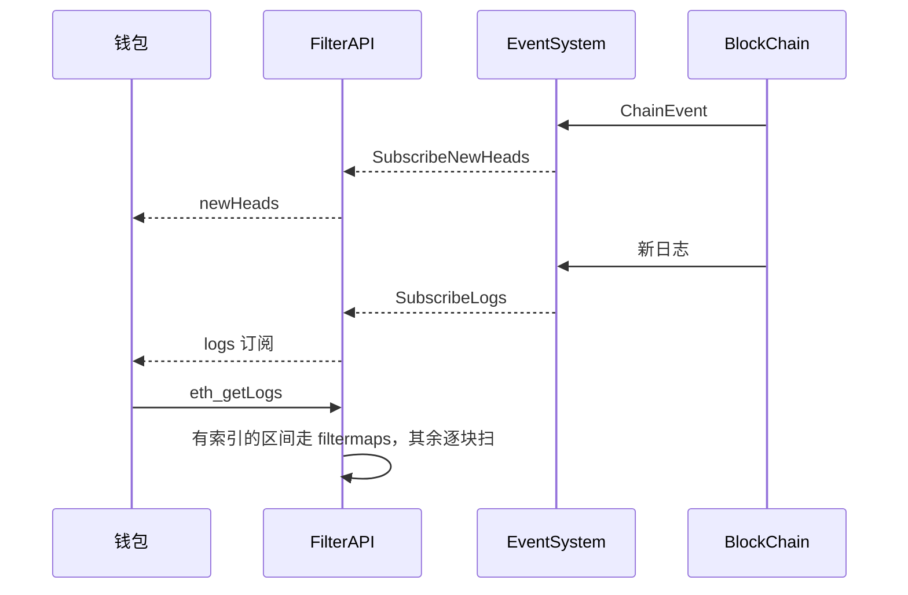

# eth/filters：日志查询和链上订阅

[返回 eth](../LEARNING.md) · [返回学习总览](../../LEARNING.md) · 索引 [core/filtermaps](../../core/filtermaps/LEARNING.md)

`eth_getLogs`、`eth_newFilter`、`eth_subscribe` 的 `newHeads` 和 `logs` 在这个包。索引结构在 `core/filtermaps`。本包负责把 RPC 条件变成一次查询或一条订阅，并订 `BlockChain` 的 feed。

## 建议阅读顺序

1. `filter_system.go`：`Config`、`Backend`、`NewEventSystem`。
2. `api.go`：`GetLogs`、`NewHeads`、`Logs`、`NewFilter`、`GetFilterChanges`。
3. `filter.go`：`Logs`、`searchSession`、`indexedLogs`、`unindexedLogs`。

## eth_getLogs

`FilterAPI.GetLogs` 构造 `Filter`，再 `Filter.Logs`。

单块查询直接读那一块的日志。区间查询走 `rangeLogs`：先 `NewMatcherBackend`，再由 `searchSession` 分段。

- 区间和已索引块有交集：`indexedLogs` 调用 `filtermaps.GetPotentialMatches`，再用 `filterLogs` 去掉假阳性。
- 索引还没覆盖、尾部索引已被裁掉、或者过滤条件触发 `ErrMatchAll`：`unindexedLogs` 按块扫描，用 bloom 缩小范围，再读日志。
- 查询过程中链头变了，`ChainView` 的共享区间决定哪些已返回的匹配还有效。

`begin` 或 `end` 是 pending 时返回 `errPendingLogsUnsupported`。起始高度低于 `HistoryPruningCutoff` 时返回 `history.PrunedHistoryError`。

## 订阅

`NewEventSystem` 向后端订四条 feed：新交易、新日志、被移除的日志、`ChainEvent`。`newHeads` 来自 `SubscribeNewHeads`，源头是链的 `ChainEvent`，不是 eth 协议里的 `NewBlock`。`eth_subscribe` 的 `logs` 走 `SubscribeLogs`，条件在进程里过滤后再推给 RPC。

轮询型的 `eth_newFilter` 把同一条日志订阅放进一张表，`eth_getFilterChanges` 取走累积结果。过滤器默认保留 `Config.Timeout`（5 分钟）。日志缓存默认 `LogCacheSize` 32 个块。

这些订阅要有通知能力的连接。HTTP 短请求拿不到 `rpc.NotifierFromContext`，`NewHeads` 返回 `ErrNotificationsUnsupported`。

## 读的时候记住

- 加上 `--history.logs.disable` 之后，查询仍在。索引不再更新，新区间退回逐块扫描。
- `newHeads` 的块是已经进本地规范链的头。它和共识层的最终确认不是同一次通知。
- 改地址或 topic 的匹配规则要同时看 `filtermaps` 的行选择和这里的 `filterLogs`。只改一边，索引候选和最终结果会不一致。
