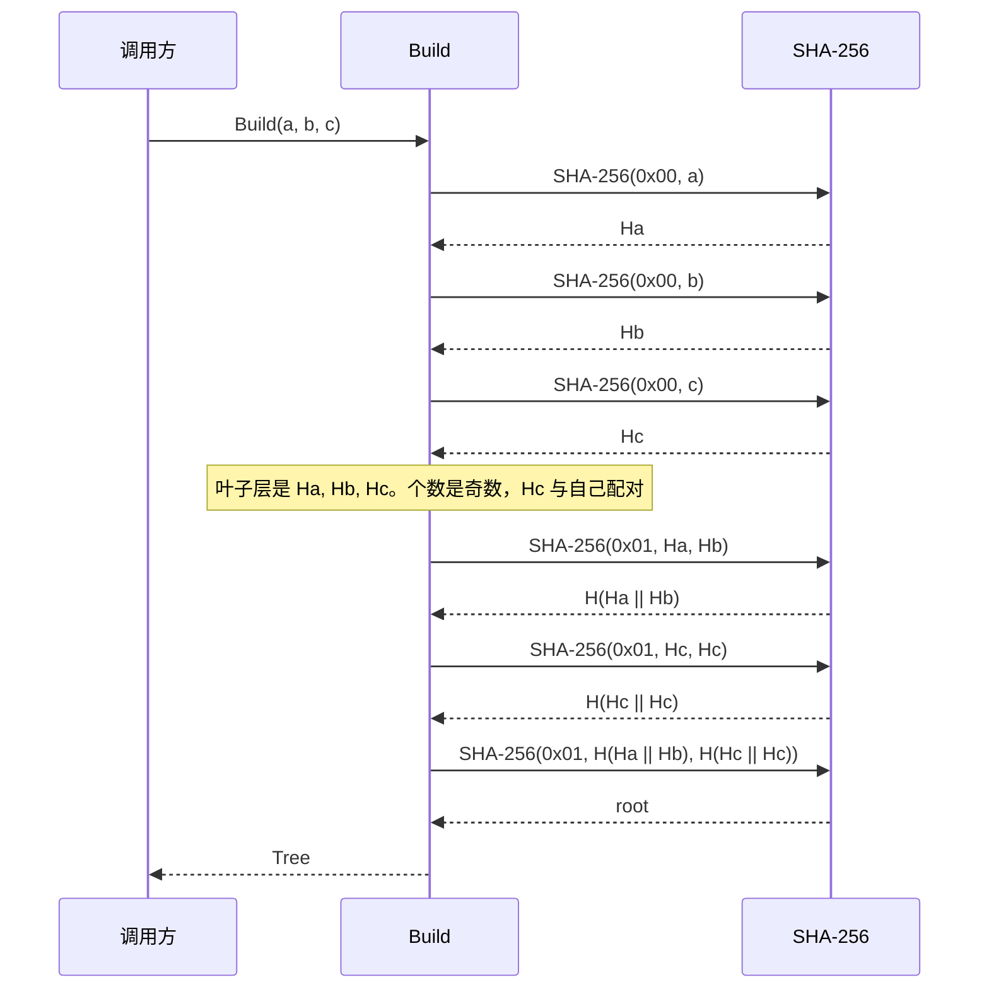
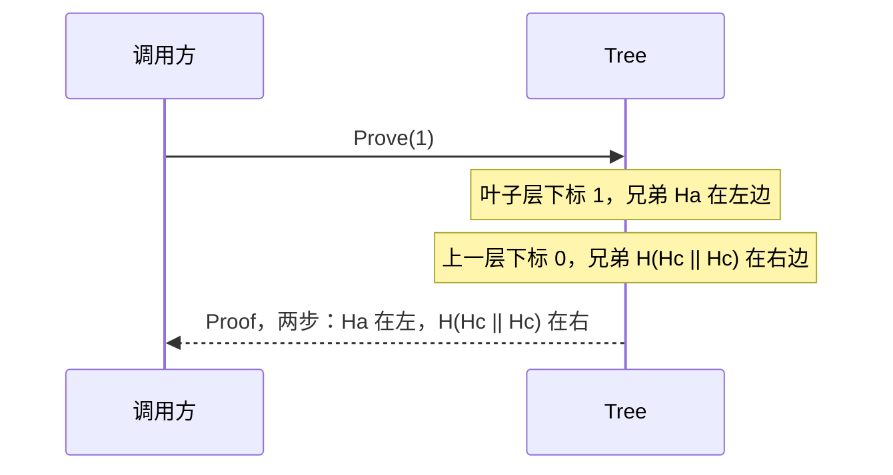
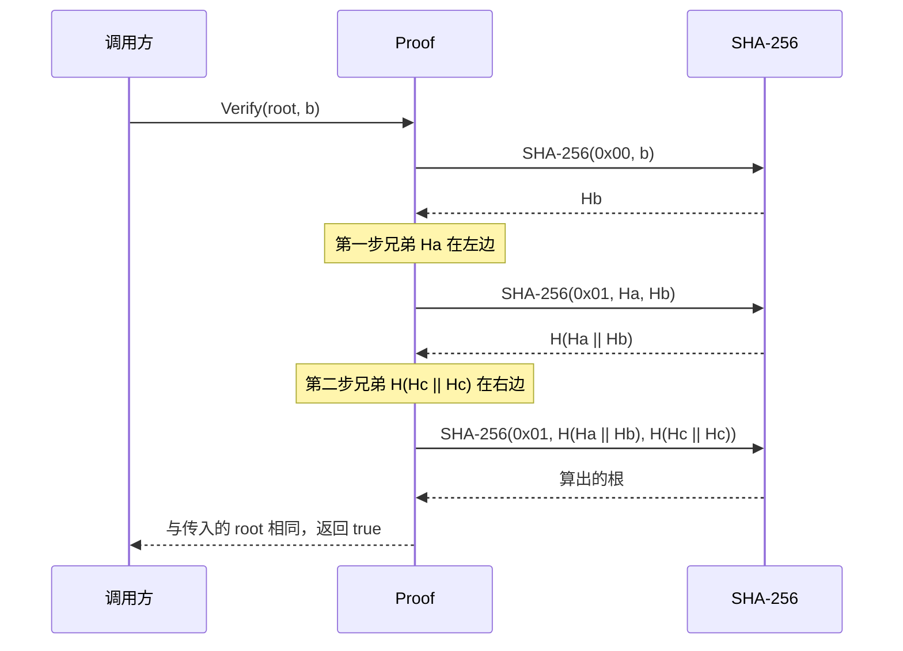

# 二叉 Merkle 树

一组数据先各自哈希成叶子，再两两合成父节点，直到只剩一个树根。之后要证明「某片数据在这组里」，只需带上从叶子走到根的兄弟节点，不必把整组数据发出去。

只用标准库 `crypto/sha256`。在本目录执行：

```sh
go test
```

## 哈希

叶子和内部节点用不同前缀，避免把中间节点当成一片叶子：

| 节点 | 计算 |
|---|---|
| 叶子 | `SHA-256(0x00 \|\| data)` |
| 内部 | `SHA-256(0x01 \|\| left \|\| right)` |

某一层节点数是奇数时，最后一个节点与自己配对，再进入上一层。只剩一个节点时它就是根，不再和自己配对。空数据仍是一片合法叶子；一片叶子都没有时，`Build` 返回 `ErrEmpty`。

三片数据 `a`、`b`、`c` 的形状：

```text
                              root
                             /    \
           H(H(a) || H(b))         H(H(c) || H(c))
            /           \           /           \
         H(a)          H(b)      H(c)          H(c)
```

`H(a)` 是 `SHA-256(0x00 || a)`，`H(b)`、`H(c)` 同样。内部节点的 `H(左 || 右)` 是 `SHA-256(0x01 || 左 || 右)`。右边多出来的 `H(c)` 是叶子哈希的副本，用来凑成一对，不占新的叶子下标。交换叶子顺序会得到另一个根。

## 用法

```go
tree, err := merkletree.Build([][]byte{
    []byte("a"),
    []byte("b"),
    []byte("c"),
})
if err != nil {
    return err
}

root := tree.Root()
// len(proof.Steps) == ceil(log2(叶子数))。三片叶子是 2。
// 同一棵树里每片叶子一样长，跟下标无关。
// Steps 里只有沿途的兄弟哈希，没有根，也没有叶子自己的哈希。
proof, err := tree.Prove(1) // 第 1 片叶子
if err != nil {
    return err
}

ok := proof.Verify(root, []byte("b"))
```

`len(proof.Steps)` 是从叶子配对到根要走的层数，只跟叶子个数有关：`ceil(log2(叶子数))`。这里有 3 片叶子，证明长度是 2。换一个下标，长度不变。

证明不含根。根由 `Root()` 单独给出，调用 `Verify` 时再传进去，用来和算出来的结果比较。叶子自己的哈希也不在证明里，`Verify` 用原始数据现算。

`Prove(1)` 证明的是 `b`。验证者没有整棵树，只拿到 `b` 和沿途每个兄弟的哈希。只知道哈希还不够，还要知道这个兄弟站在哪一边：`H(左 || 右)` 和 `H(右 || 左)` 不是同一个值。

`proof.Steps` 按从叶子往根的顺序记下这两件事。`b` 有两步：

1. 兄弟是 `H(a)`，站在左边。当前是 `H(b)`，父节点算 `SHA-256(0x01 || H(a) || H(b))`。
2. 兄弟是 `H(H(c) || H(c))`，站在右边。父节点算 `SHA-256(0x01 || 上一步的结果 || 兄弟)`。

方向记在 `Step.OnRight`。`true` 表示兄弟在右边，拼接时当前节点在前；`false` 表示兄弟在左边，拼接时兄弟在前。

算到顶，结果和调用方传来的根相同，`Verify` 才返回 true。叶子、兄弟或根有一个被换掉，结果就对不上。下标超出叶子范围时，`Prove` 返回 `ErrIndex`。只有一片叶子时没有兄弟，`Steps` 是空的，根就是这片叶子自己的哈希。

## 时序

下面三条都用 `a`、`b`、`c`，并证明第 1 片叶子 `b`。

`Build` 先给每片数据算叶子哈希。这一层有 3 个节点，`Hc` 与自己配对。两层父节点算完后，最上面那个就是根。



`Prove(1)` 不重新哈希。它从叶子下标 1 往上走，每一层只记下兄弟在哪一边。`b` 的左边是 `Ha`，再上一层的右边是 `H(Hc || Hc)`。



`Verify` 手里没有整棵树。它从 `b` 重新起算，按证明里的左右顺序拼兄弟，最后和调用方拿来的根比较。



## 测试

`tree_test.go` 里的期望根用测试自己的哈希函数算，不调用实现里的内部函数。覆盖这些情况：

- 空输入返回 `ErrEmpty`
- 单叶子、两叶子、三叶子的根
- 交换顺序后根改变
- 1 到 5 片叶子，每个下标的证明都能通过，换成另一片数据则失败
- 篡改兄弟节点、换一棵树的根、下标越界
