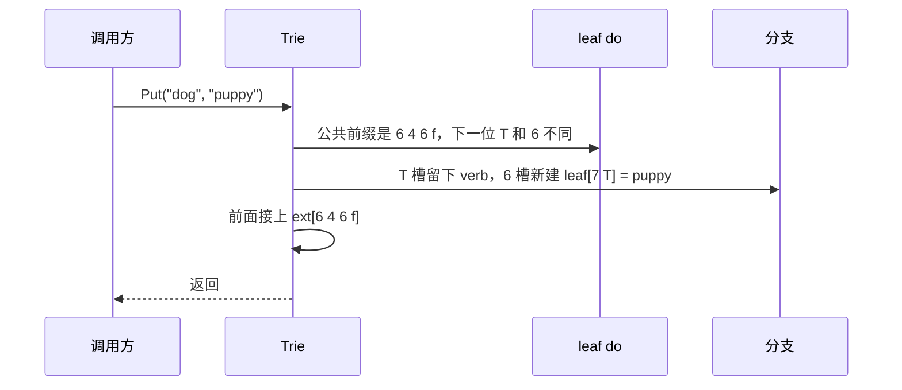
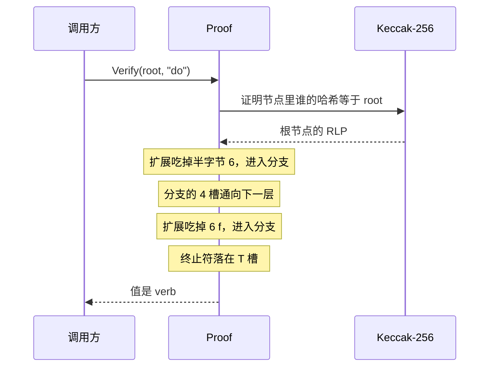

# Merkle Patricia Trie

以太坊用它给**一大组**「键值」算出一个 32 字节的根。块头里的 `stateRoot`、`transactionsRoot`、`receiptsRoot` 都是这棵树的根。轻客户端手里只有块头时，只要再拿到沿途的节点，就能核对某一个账户、某一笔交易，不必下载整棵树。

同一个「键值集合」，不管先放哪个，根都相同。改一个值，只重算这个键走到根的那些节点。

本目录是一棵内存里的树，节点编码和以太坊一致。下面的根哈希可以直接和 go-ethereum 的 `trie.Trie` 对照。零值是一棵空树，可以直接调用方法。

旁边三个 demo 各拿了它的一块：

| 目录 | 这块负责什么 |
|---|---|
| `../trie` 字典树 | 一个码点一条边，共享前缀 |
| `../patricia` 压缩前缀树 | 没有分叉的路径收成一条边 |
| `../merkletree` 默克尔树 | 节点带哈希，证明可以单独验证 |
| `mpt` | 半字节路径、压缩、Keccak-256，三块合在一起 |

二叉 Merkle 树的证明是从叶子往上的兄弟哈希。MPT 的键本身就是路径，证明带的是从上往下经过的节点。

## 键先拆成半字节

分支如果按整个字节分叉，一个节点要留 256 个槽。这里每个字节拆成高 4 位和低 4 位，槽只有 16 个，树会深一倍，节点小很多。

`do` 的字节是 `0x64 0x6f`：

```text
d = 0x64 = 0110 0100  →  半字节 6, 4
o = 0x6f = 0110 1111  →  半字节 6, f
```

内存里的路径还要在末尾加一个终止符 `16`。它不占半字节的 0 到 15，只表示「键到这里结束」。

```text
do    6 4 6 f T
dog   6 4 6 f 6 7 T
```

`T` 就是终止符。没有它，`do` 只是 `dog` 的前半段，树无法在中间再放一个值。有了它，两条路径在第 5 个半字节分开：一边是 `T`，一边是 `6`。

终止符只活在内存里。写进节点时，它变成首字节里的一个标志位，磁盘上的键里找不到字节 `0x10`。

## 三种节点

空树没有节点。有数据之后只有三种：

| 节点 | 什么时候出现 | 里面有什么 |
|---|---|---|
| 叶子 | 剩下的路径不再分叉，并且键在这里结束 | 紧凑键（带终止符）和值 |
| 扩展 | 剩下的路径有一段公共前缀，后面还会分叉 | 紧凑键（不带终止符）和唯一的孩子 |
| 分支 | 下一个半字节有两种以上走法，或者这里既是某个键的结尾、后面又还有键 | 16 个孩子槽，再加第 17 槽放「正好在这里结束」的值 |

16 个槽对应半字节 `0` 到 `f`。第 17 槽对应终止符，不是第 17 个孩子。

放入 `do=verb`、`dog=puppy`、`doge=coin`、`horse=stallion` 之后，树长这样：

```text
ext[6]
└─ branch
   ├─ 4: ext[6 f]
   │     └─ branch
   │        ├─ 6: ext[7]
   │        │     └─ branch
   │        │        ├─ 6: leaf[5 T] = coin      doge
   │        │        └─ T: puppy                 dog
   │        └─ T: verb                           do
   └─ 8: leaf[6 f 7 2 7 3 6 5 T] = stallion      horse
```

四条键的第一个半字节都是 `6`（`d` 和 `h` 的高 4 位都是 `6`），所以根是一条只有一个半字节的扩展。下一层按第二个半字节分叉：`d` 是 `4`，`h` 是 `8`。

`do` 的值放在分支的 `T` 槽，不单独占一个叶子。它和 `dog` 的分叉就发生在这个终止符上。

## 紧凑键

黄皮书把这段半字节叫 hex-prefix。第一个字节的高 4 位是标志，低 4 位要么是 0，要么是奇数长度时的第一个半字节。

高 4 位里只用了两个比特：bit 4 表示半字节个数是奇数，bit 5 表示这是叶子。

| 节点 | 半字节个数 | 高 4 位 | 首字节 |
|---|---|---|---|
| 扩展 | 偶 | `0000` | `0x00`，后面接成对的半字节 |
| 扩展 | 奇 | `0001` | `0x1k`，低 4 位就是第一个半字节 |
| 叶子 | 偶 | `0010` | `0x20`，后面接成对的半字节 |
| 叶子 | 奇 | `0011` | `0x3k`，低 4 位就是第一个半字节 |

一整条键都落在一个叶子上时，半字节个数一定是偶数（终止符被标志位拿走了），紧凑键就是 `0x20` 接上原始键。`do` 写成：

```text
6 4 6 f T
→ 去掉 T，剩下 4 个半字节，偶数，叶子
→ 0x20 || 0x64 || 0x6f
```

路径被上面的节点吃掉一段之后，剩下的可能是奇数。`doge` 最后那个叶子只剩半字节 `5` 和终止符，首字节是 `0x35`：高 4 位 `0011`，低 4 位就是 `5`。

根上那条扩展只有半字节 `6`，没有终止符，首字节是 `0x16`。

## 哈希

节点先做成 RLP，再决定父节点里放整段字节还是放哈希。

RLP 在这里只用到字节串和列表：

| 内容 | 写法 |
|---|---|
| 一个小于 `0x80` 的字节 | 原样这一个字节 |
| 0 到 55 字节的串 | `0x80+长度`，再接内容。空串是 `0x80` |
| 更长的串 | `0xb7+长度占几字节`，再接长度，再接内容 |
| 列表 | 同样的规则，起点换成 `0xc0` / `0xf7` |

叶子和扩展是两项的列表：`[紧凑键, 值或孩子]`。分支是 17 项的列表，空槽写成 `0x80`。

孩子的编码短于 32 字节时，父节点把这串 RLP 直接嵌进去。达到 32 字节时，父节点只留它的 Keccak-256，也就是 32 字节再套一层 RLP 字符串。根无论多短，最后都再哈希一次。

空树没有节点。空根是 `Keccak-256(0x80)`：

```text
56e81f171bcc55a6ff8345e692c0f86e5b48e01b996cadc001622fb5e363b421
```

`0x80` 是 RLP 的空字节串。空根是这 32 字节，不是 32 个 0。

哈希函数是 Keccak-256，也就是 `sha3.NewLegacyKeccak256`。NIST 标准化时改过填充，所以 SHA3-256 对同一段字节会得到另一个结果。以太坊用的是改之前的 Keccak。

只有 `do → verb` 时，整棵树就是一个叶子。把它的 RLP 摊开：

```text
键的 RLP    83 20 64 6f          3 字节：0x20 0x64 0x6f
值的 RLP    84 76 65 72 62       4 字节："verb"
列表        c9 83 20 64 6f 84 76 65 72 62
```

这 10 字节再做 Keccak-256，就是根：

```text
014f07ed95e2e028804d915e0dbd4ed451e394e1acfd29e463c11a060b2ddef7
```

四条经典键值的根是：

```text
5991bb8c6514148a29db676a14ac506cd2cd5775ace63c30a4fe457715e9ac84
```

## 插入

先放 `do`。路径没有分叉，整段就是一个叶子：`leaf[6 4 6 f T] = verb`。

再放 `dog`。两条路径共享 `6 4 6 f`，下一个半字节一个是 `T`，一个是 `6`。共享的前缀留成扩展，分叉处变成分支。



放完是：

```text
ext[6 4 6 f]
└─ branch
   ├─ 6: leaf[7 T] = puppy
   └─ T: verb
```

再放 `doge` 时，`leaf[7 T]` 和 `6 5 T` 只共享开头，这个叶子再拆开。`puppy` 落到新分支的 `T` 槽，`coin` 成为 `leaf[5 T]`。先放 `doge` 再放 `dog`，收束之后是同一棵树，根也相同。

## 删除

删掉一个键之后，只剩一个槽的分支要收掉，否则同样的键值会因为「曾经有过分叉」留下另一种形状，根就跟插入顺序有关了。

从上面的四键树删掉 `doge`：最里面的分支只剩 `T: puppy`，收成叶子，再和上面的 `ext[7]` 接成 `leaf[7 T]`。

```text
ext[6]
└─ branch
   ├─ 4: ext[6 f]
   │     └─ branch
   │        ├─ 6: leaf[7 T] = puppy
   │        └─ T: verb
   └─ 8: leaf[...] = stallion
```

再删掉 `dog` 和 `horse`，最后只剩 `leaf[6 4 6 f T] = verb`。这时的根和「从来只放过 do」的那棵树相同。

键不在树上时 `Delete` 返回 false，树不动。`Put` 一个空值等价于删除，这是以太坊的规则：空字节串不占一个键。

## 证明

`Prove` 从根往下走，收集经过的节点编码。短于 32 字节、又不是根的节点已经嵌在父节点里，证明里不再单列。根再短也会放进去，因为验证者是从根哈希开始查的。

验证者没有树。他拿到根哈希和这些节点，按键的半字节往下走：

1. 用 Keccak-256 找到根对应的那一段 RLP。对不上，证明作废。
2. 叶子：紧凑键还原出来必须和剩下的路径相同，第二项就是值。键不同，说明这个键不在树上。
3. 扩展：前缀对得上就进入孩子。孩子若是嵌进来的列表，直接解码；若是 32 字节，就按哈希再找下一段。前缀对不上，键不存在。
4. 分支：下一个半字节选槽。槽是空的，键不存在。走到终止符，第 17 槽就是值。

四键那棵树里，`do`、`dog`、`doge` 的证明都是 4 个节点。再往下的叶子短于 32 字节，嵌在最后一个分支里。`horse` 的叶子嵌在上面那个大分支里，证明是 2 个节点。

`dot` 这个键不存在。它一路跟到存放 `verb` 的那个分支，下一个槽是空的。所以同一份证明既能说明没有 `dot`，也能读出 `do` 的值 `verb`。证明多带了沿途节点，读出来的仍是原来的值，因为这些字节被父节点的哈希盖住了。

`cat` 在更靠上的分支就走进了空槽，下面那棵子树不在证明里。拿这份证明去查 `do`，会在缺少的哈希处失败。

把证明里任何一个字节改掉，这个节点的 Keccak-256 就变了。父节点里写的还是旧哈希，验证对不上。

空树没有节点可带。`Verify` 看到空根配上空证明，就认定任何键都不存在。go-ethereum 的 `VerifyProof` 仍会去证明库里找根节点，空证明因此报缺节点；空根本身已经是「什么都没有」的承诺，这里把它当作合法的缺席证明。非空树上，根哈希和证明里的节点字节与 go-ethereum 的 `trie.Trie` 一致，测试用同一组键值对过。



## 状态树还会先哈希键

上面这棵树的键就是调用方传入的原始字节。交易树、回执树用的就是这种：键是序号的 RLP，`0`、`1`、`2` 按顺序排下去。

状态树和合约存储树多一步。键先做 Keccak-256，再放进 MPT：

| 树 | 块头或账户里的字段 | 键 | 值 |
|---|---|---|---|
| 状态树 | `stateRoot` | `Keccak-256(地址)` | 账户的 RLP |
| 存储树 | 账户里的 `storageRoot` | `Keccak-256(槽位)` | 槽里的值 |
| 交易树 | `transactionsRoot` | 序号的 RLP | 交易的 RLP |
| 回执树 | `receiptsRoot` | 序号的 RLP | 回执的 RLP |

先哈希有两个效果。原始键里的公共前缀被打散，攻击者没法靠精心挑选的键把树拉成一条深链。同时，从证明节点看不出两个原始键是否相邻。验证时调用方仍要提供原始键，验证者自己算 Keccak-256，再按这个新键走证明。本包只做里面那棵 MPT，这一层由调用方在 `Put` 之前完成。

## 方法

| 方法 | 作用 |
|---|---|
| `Put(key, value)` | 写入或覆盖。`value` 长度为 0 时删除这个键 |
| `Get(key)` | 读取。不存在时 `ok` 为 false。返回的是副本 |
| `Delete(key)` | 删除。键不存在时返回 false，树不变 |
| `Len()` | 键的个数 |
| `Hash()` | 根哈希。空树是 `EmptyRoot` |
| `Prove(key)` | 这个键的证明。键不存在时，证明停在能说明缺席的那一层 |
| `Proof.Verify(root, key)` | 用根重放证明 |

`Verify` 有三个结果。`found` 为 true 时，`value` 是这个键的值。证明能说明键不存在时，`found` 为 false，`err` 为 nil。节点接不到根、中间缺了哈希，或者 RLP 不合法，返回 `ErrBadProof`。

`err == nil` 只表示证明本身站得住，键在不在要看 `found`。

## 用法

```go
tr := mpt.New()
tr.Put([]byte("do"), []byte("verb"))
tr.Put([]byte("dog"), []byte("puppy"))

root := tr.Hash()
got, ok := tr.Get([]byte("do")) // verb, true

proof := tr.Prove([]byte("dog"))
value, found, err := proof.Verify(root, []byte("dog"))
// found 为 true，value 是 puppy

missing := tr.Prove([]byte("dot"))
value, found, err = missing.Verify(root, []byte("dot"))
// found 为 false，err 为 nil：证明了 dot 不在这棵树里

tr.Delete([]byte("dog"))
```

`Put` 和 `Get` 用的是值的副本。改调用方手里的切片，不会改到树上的值。

## 常见面试题

### MPT 解决什么问题？为什么不把整份状态做一次哈希？

状态是一组会改的键值。整份哈希每次都要重读全部账户。MPT 让每个键沿着自己的半字节走下去，改一个账户只重算这条路径上的节点，根仍然承诺整棵树。块头只存这 32 字节，轻客户端用证明核对其中一个键。

### 它和字典树、压缩前缀树、二叉 Merkle 树各是什么关系？

字典树按符号分叉，共享前缀。压缩前缀树把没有分叉的路径收成一条边。二叉 Merkle 树给节点做哈希，证明靠兄弟节点往上拼。MPT 按半字节分叉，没有分叉的一段收成叶子或扩展，每个节点的 RLP 再做 Keccak-256。证明带的是路径上的节点，验证者顺着键往下走。

### 为什么是 16 叉，不按字节做 256 叉？

一个字节一个槽，分支节点要留 256 个引用，大部分是空的。拆成半字节之后槽只有 16 个，深度大约变成两倍，节点小很多，证明里带上的空槽引用也少很多。以太坊选的就是这套 16 叉。

### 叶子、扩展、分支怎么区分？

看路径还分不分叉，以及键是不是在这里结束。不再分叉、键在这里结束，是叶子，紧凑键带终止符。有一段公共前缀、后面还有分叉，是扩展，紧凑键不带终止符，只有一个孩子。下一个半字节有多种走法，是分支，16 个槽再加一个值槽。`do` 和 `dog` 分叉时，`verb` 就放在分支的值槽里，它自己没有叶子节点。

### 终止符是干什么的？编码后的节点里能找到 `0x10` 吗？

它让一个键可以是另一个键的前缀。`do` 的路径在 `dog` 的中间结束，终止符给这次结束一个独立的槽。内存里它的值是 16。写进 RLP 时，叶子用首字节的 bit 5 表示「带终止符」，半字节 16 不会出现在紧凑键里。

### hex-prefix 的第一个字节怎么读？

高 4 位：bit 4 为 1 表示半字节个数是奇数，bit 5 为 1 表示叶子。所以扩展是 `0x0` 或 `0x1`，叶子是 `0x2` 或 `0x3`。偶数时低 4 位是 0，后面每字节放两个半字节。奇数时低 4 位就是第一个半字节。整条原始键单独成一个叶子时，编码是 `0x20 || 键`。上面已经吃掉若干半字节之后，剩下的叶子可以是奇数，例如 `doge` 最后的 `5` 编码成 `0x35`。

### 小于 32 字节的节点为什么嵌进父节点？空树的根是什么？

短节点再套一层哈希会多 32 字节，还多一次查找。编码不到 32 字节就直接放进父节点的 RLP。根始终是 Keccak-256，这样根的长度固定。空树没有节点，空根是 `Keccak-256(0x80)`，也就是 `56e81f17…b421`。`0x80` 是空字节串的 RLP。全 0 哈希不是空树。

### 改一个账户，要重算多少？

重算这个键从叶子走到根的那些节点。没走过的槽原样留着，里面是另一棵子树的哈希，或者一段嵌进去的短节点。所以改一个余额会得到新的 `stateRoot`。

### 为什么插入顺序不影响根？

同一组键值的分叉点由半字节决定，不由谁先插入决定。删除时如果分支只剩一个槽，会收成叶子或扩展，树回到唯一的形状。上面的四条键正序、反序放入，根都是 `5991bb8c…9ac84`。

### 存在证明和不存在证明有什么不同？

存在证明走到叶子或分支的值槽，读出值，并且每一跳的哈希都对得上根。不存在证明走到对不上的那一层就停：叶子的键不同、扩展的前缀不同，或者分支里这个槽是空的。`dot` 的证明停在 `verb` 所在的分支，空槽说明没有 `dot`；这份证明里同时带有 `do`，所以也能读出 `verb`。`cat` 在更早的空槽停下，用不了它去证明 `do`。

### 篡改证明里的一个字节会怎样？

这个节点的 Keccak-256 变了。父节点的 RLP 里写着旧哈希，验证者按根找下来会对不上，`Verify` 返回 `ErrBadProof`。攻击者想换一个值，就得同时换掉直到根的每一层，最后的根不再是块头里的那个。

### 状态树为什么先对键做 Keccak？交易树为什么不做？

状态树的键是 `Keccak-256(地址)`，存储树的键是 `Keccak-256(槽位)`。原始键的公共前缀被打散，树的形状不跟着地址的规律走，证明里也看不出两个地址是否相邻。交易树和回执树的键是序号 `0, 1, 2…` 的 RLP，顺序就是键，不再哈希。验证状态证明时，要自己对地址做 Keccak-256，再拿结果去走节点。

### Keccak-256 和 SHA3-256 是同一个函数吗？

对不上。NIST 把 Keccak 收成 SHA3 时改了填充。以太坊从一开始用的是原来的 Keccak-256。用标准库里的 SHA3-256 去算空根，得不到 `56e81f17…`。Go 里对应的是 `golang.org/x/crypto/sha3.NewLegacyKeccak256`。

### 删除之后为什么必须收拢节点？

分支本来表示「这里至少有两种走法」。删到只剩一个槽还留着分支，同样的键值就会有两种编码，根依赖删除历史。收拢之后，只放过 `do` 的树，和「四条都放过再删掉另外三条」的树，根相同。

### MPT 的证明为什么偏大？

分支节点要把没走过的槽一起编码。那些槽里往往是别的子树的哈希。证明得带上这个完整节点，验证者才算得出父哈希。键越长、分叉越多，沿途要带的分支越大。Verkle tree 用向量承诺把一个分支收成一次短的打开，想把这份见证变小。以太坊的状态树、交易树、回执树用的仍是这里这棵 MPT。

## 测试

在本目录执行：

```sh
go test .
```

带覆盖率：

```sh
go test -cover .
```

`trie_test.go` 把根和节点字节钉在以太坊的规则上：

- 空根等于 `Keccak-256(0x80)` 的已知值
- `a → b`、`do → verb` 的叶子 RLP 按手写字节核对，根是这段字节的 Keccak-256
- `do`、`dog`、`doge`、`horse` 的树形与正序、反序的根
- 删除之后分支被收拢，最后和单键树的根相同
- 存在证明、`dot` 的缺席证明、`cat` 的证明覆盖不到 `do`、篡改一个字节后失败
- 值的切片在 `Put`、`Get` 之后与树隔离
