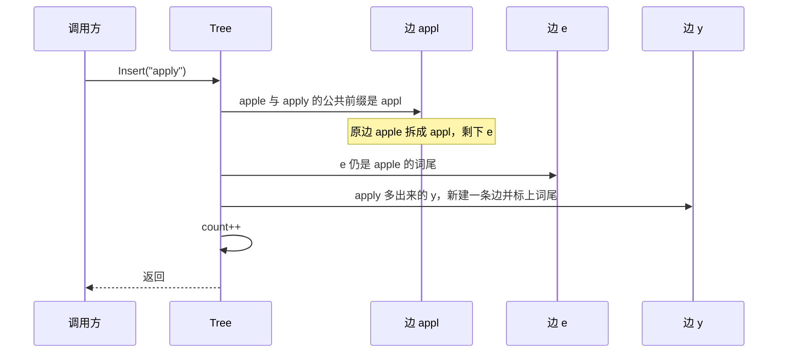
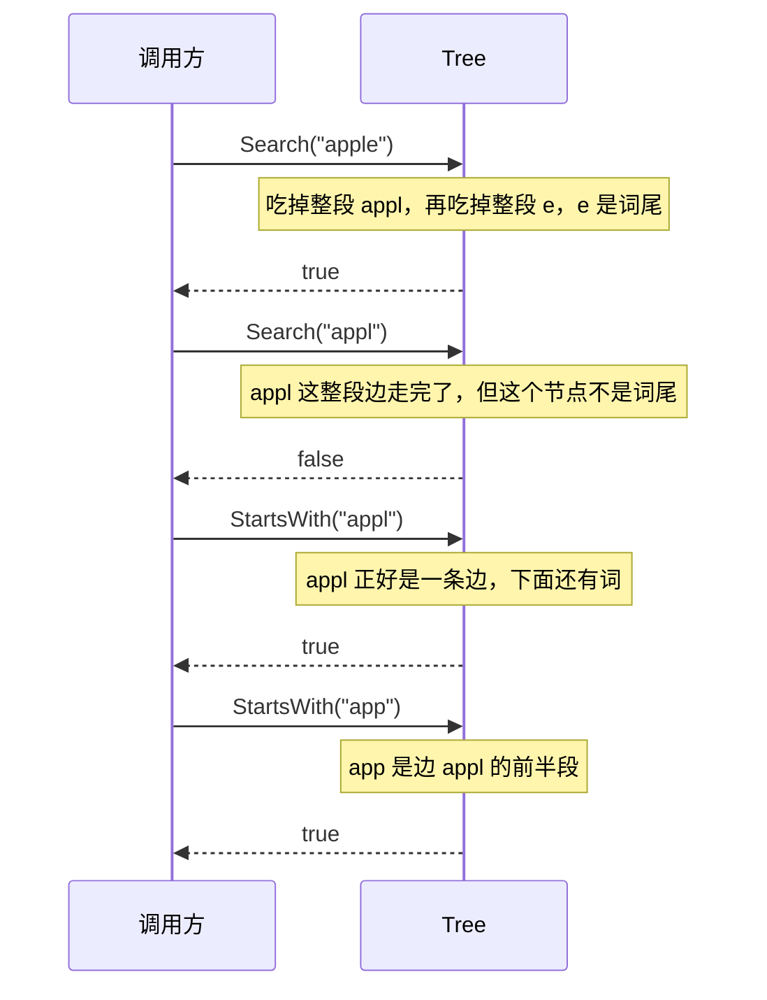
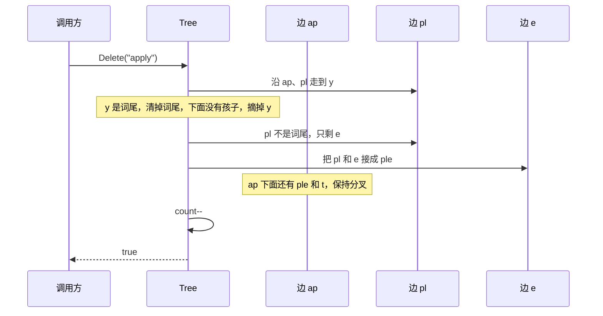

# 压缩前缀树

Patricia tree。普通字典树一条边放一个码点，压缩前缀树把中间没有分叉的路径收成一条边，边上放整段前缀。分叉或者词尾才新建节点。

放入 `app`、`apple`、`apt` 之后，字典树和压缩前缀树并排看。`*` 表示有词在这个节点结束：

```text
字典树                         压缩前缀树

        root                         root
         |                            |
         a                            ap
         |                           /  \
         p                          p*   t*
        / \                         |
       p*  t*                      le*
       |
       l
       |
       e*
```

左边 `a → p → p` 是三个节点。右边这三段没有分叉，收成一条边 `ap`，第二个 `p` 因为是 `app` 的词尾才单独停下。`apple` 比 `app` 多出来的 `le` 也是一条边。

码点的切分和 `../trie` 相同：一条边里放的是一串 `rune`，不是字节。`你好世界` 是四个码点，中间没有分叉时就是一条边。

零值是一棵空树，可以直接调用方法。`New` 只是返回 `&Tree{}`。

## 边上的规则

从根走到一个标了词尾的节点，沿途前缀拼起来就是这个词。三个规则让同样一组词只有一种形状，和放入的顺序无关：

- 除根以外，每条边的前缀都不是空的。边的第一个码点就是它在父节点里的键。
- 不是词尾的节点至少有两个孩子。根可以只有一个孩子。只有一个孩子、自己又不是词尾的节点会和那个孩子接成一条边。
- 词尾可以只有一个孩子。词在这里结束，后面还有更长的词，例如 `app` 下面接着 `le`。

一个没有分叉的词只有一条边。`Edges` 数的就是边。空树是 0。

## 方法

| 方法 | 作用 |
|---|---|
| `Insert(word)` | 放入一个词。同一个词再放一次，词数不变 |
| `Search(word)` | 这个字符串是不是一个完整的词。必须走完整段边，停在词尾上 |
| `StartsWith(prefix)` | 是否有词以这个前缀开头。前缀可以停在一条边的中间 |
| `Delete(word)` | 删掉一个词。词不存在时返回 false，树保持原样 |
| `Len()` | 词的个数。同一个词只计一次 |
| `Edges()` | 边的条数。空树是 0 |

空字符串可以作为一个词放进去，它标在根上，不增加边。空前缀停在根上，空树的 `StartsWith("")` 也是 true。

`Search("appl")` 在 `apple` 和 `apply` 的共享边 `appl` 上能走通，但 `appl` 不是词尾，返回 false。`StartsWith("appl")` 只要求沿途对得上，返回 true。

## 增删改查

下面从 `apple` 出发。调用方只和 `Tree` 说话。改一个词由 `Delete` 和 `Insert` 两步完成。

### 增

`Insert("apply")`。已有的边是整段 `apple`，和新词共享 `appl`，于是把这条边拆开。



拆完是 `appl`，下面分出 `e*` 和 `y*`。同一个词再 `Insert` 一次时，会走到已经标了词尾的节点，然后直接返回，`count` 不变，边也不拆。

### 查

下面的查询还停在 `apple` 和 `apply` 这棵树上。`Search` 每次都要吃掉整段边，最后还要落在词尾上。`StartsWith` 允许剩下的前缀是某条边的开头。



第一个码点对不上，或者中途有一个码点不同，两条查询都返回 false。

### 删

先 `Insert("apt")`。`appl` 和 `apt` 只共享 `ap`，树变成 `ap`，下面是 `pl` 和 `t*`。`pl` 不是词，它下面仍是 `e*` 和 `y*`。

`Delete("apply")`。清掉 `y` 的词尾后，这条边下面没有别的词，整段摘掉。`pl` 于是只剩 `e` 一个孩子，自己又不是词，两段接回 `ple`。



再删掉 `apt`，`ap` 也只剩 `ple`，接回一条边 `apple`。

走到一半对不上，或者走到末尾但那里不是词尾，`Delete` 返回 false。`app` 在这棵树里只是 `apple` 的前缀，不是一个词，删除它不会拆开 `apple`。

### 改

从只有 `apple` 和 `apply` 的树出发，把 `apply` 换成 `apt`：先删掉 `apply`，`e` 接回 `apple`；再插入 `apt`，按公共前缀 `ap` 拆成 `ple*` 和 `t*`。

## 用法

```go
tr := patricia.New()
tr.Insert("apple")
tr.Edges()            // 1，整段 apple 是一条边

tr.Insert("apply")
tr.Edges()            // 3：appl、e、y

tr.Search("apple")    // true
tr.Search("appl")     // false，停在边的尽头，但不是词尾
tr.StartsWith("app")  // true，停在边 appl 的中间
tr.Delete("apply")    // true，e 被接回 apple
tr.Len()              // 1
```

## 测试

在本目录执行：

```sh
go test .
```

带覆盖率：

```sh
go test -cover .
```

`tree_test.go` 除了词的增删，还检查树的形状：`app`、`apple`、`apt` 必须是 `ap(p*(le*())t*())`，同一组词正序、反序放入得到同一棵树。删除之后如果一条边不再分叉，测试要求它被接回去。
