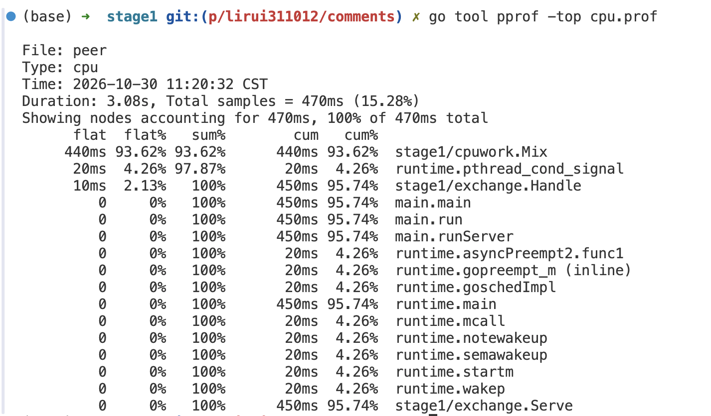

# 阶段 1：带测试的小服务

对应学习计划「阶段 1：Go 够用来改客户端」。一个标准库模块，覆盖结构体和接口、可取消的并发循环、两个进程互发 JSON，以及一次 CPU 剖面。

在本目录执行：

```sh
go test ./...
```

## 目录

| 路径 | 练习 |
|---|---|
| `envelope` | 结构体 `Message`、接口 `Checker`、用 `%w` 包装的错误 |
| `worker` | goroutine 里的循环，从 channel 收数据，`context` 取消后退出 |
| `exchange` | 一条 TCP 连接上收发一条 JSON。对端先验消息，再回复 |
| `cpuwork` | 剖面里占住 CPU 的函数 `Mix` |
| `cmd/peer` | 服务端或客户端进程。本端这一次收发失败会打印错误并退出 |

## 两个进程

开两个终端，都在本目录。

```sh
go run ./cmd/peer -mode server -pprof 127.0.0.1:6060
```

```sh
go run ./cmd/peer -mode client
```

客户端打印服务端验过之后的回复，例如：

```text
server hello 51af54f141a06fad
```

`hello` 来自 `-body`，最后一列是服务端对正文算出的 `sum`。客户端会再算一遍，对不上就退出。

默认地址是 `127.0.0.1:19091`，允许的发送方是 `alice`。换人或换正文：

```sh
go run ./cmd/peer -mode server -peers alice,bob
go run ./cmd/peer -mode client -from bob -body ping
```

## 断线

一条连接失败只结束这一条。服务端把错误打到 stderr，继续接受后面的连接。客户端自己这次拨号或读取失败，则打印错误并以状态码 1 退出。

客户端连上后立刻关掉连接：

```sh
go run ./cmd/peer -mode client -drop
```

服务端 stderr 类似，进程仍在监听：

```text
connection: read request: decode message: EOF
```

服务端没启动时，客户端退出，并打印 `connection refused`。

## 剖面

服务端加上 `-pprof` 之后，进程里多出一个 HTTP 服务。`import _ "net/http/pprof"` 只负责注册路由，真正在听端口的是 `listenPprof`。CPU 剖面不是逐行记账，而是运行时大约每秒发一百次信号。信号到来时，它记下当时正在跑的那个调用栈。一段时间内某个函数出现得越多，它占的 CPU 就越多。

`/debug/pprof/profile?seconds=3` 会让进程先采样 3 秒，再把这些调用栈交出来。请求在这 3 秒里一直不返回。`pprof` 只绑在本机。

采样要落在服务端正在处理消息的时候。三个终端都在本目录：先起服务端并留着，再让客户端和采样同时跑。

```sh
go run ./cmd/peer -mode server -pprof 127.0.0.1:6060
```

服务端一直听着。stderr 上会打出 `pprof http://127.0.0.1:6060/debug/pprof/` 和 TCP 监听地址。

```sh
go run ./cmd/peer -mode client -n 300
```

客户端连续做 300 次交换。服务端每条消息都会调用 `cpuwork.Mix`，采样窗口里才有活干。

```sh
curl -sS -o cpu.prof 'http://127.0.0.1:6060/debug/pprof/profile?seconds=3'
```

客户端还在跑的时候执行。向本机要一份 3 秒的 CPU 样本，并把返回的剖面文件写到当前目录的 `cpu.prof`。这一步会停大约 3 秒。客户端已经打完再采样，文件里就几乎没有 `Mix`。

```sh
go tool pprof -top cpu.prof
```


按函数汇总样本，打印前几名。表头从左到右：

| 列 | 含义 |
|---|---|
| `flat` | 函数自己正在执行的样本。不含它调用的函数 |
| `flat%` | `flat` 占全部样本的比例 |
| `sum%` | 从第一行累加到这一行的 `flat%`。用来看前几名合起来占了多少 |
| `cum` | 这个函数加上它调用的函数 |
| `cum%` | `cum` 占全部样本的比例 |

`flat` 和 `cum` 接近，说明时间花在这个函数自己身上。`cum` 远大于 `flat`，说明它是调用方，时间在它叫出去的函数里。抓到的样本里，时间主要在 `stage1/cpuwork.Mix`：服务端核对消息后调用它，把结果放进回复的 `sum`。一次实测这一行 `flat%` 约 92%，并且 `flat` 与 `cum` 差不多，因为 `Mix` 自己在空转，不再往下调用会占 CPU 的函数。

看火焰图：

```sh
go tool pprof -http=127.0.0.1:8080 cpu.prof
```

浏览器打开 `http://127.0.0.1:8080`。左上角 View 里切换：

- **Top**：和 `-top` 同一张表。
- **Flame Graph**：火焰图。每一块是一个函数，宽度是样本占比。下面是调用方，上面是被调用方，最底下接近 `main`，最上面是当时正在跑的函数。左右位置不表示时间先后。点一块会放大那棵子树。`cpuwork.Mix` 应是最宽的一块。页顶搜索框可以按函数名高亮。
- **Graph**：调用关系图。本机要有 Graphviz 的 `dot`，没有的话这一页是空的。火焰图不依赖它。
- **Source**：按源码行看样本落在哪一行。

看完在跑 `pprof` 的终端按 Ctrl-C。

不打开浏览器时，进交互壳：

```sh
go tool pprof cpu.prof
```

提示符里常用 `top`、`top -cum`（按 `cum` 排序）、`list Mix`（按 `Mix` 的源码行打印样本）、`web`（打开上面那套页面）。`quit` 或 Ctrl-D 退出。
