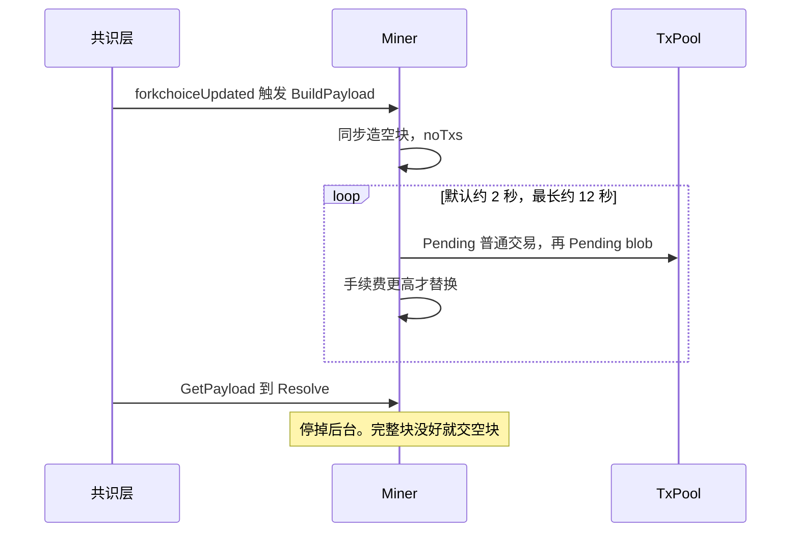

# miner：payload 构建

[返回学习总览](../LEARNING.md) · 上一篇 [consensus](../consensus/LEARNING.md) · 下一步 [p2p](../p2p/LEARNING.md)

`miner` 按共识层给的属性组执行层 payload。没有后台挖矿循环。`miner/worker.go` 里的方法挂在 `Miner` 上，按需 `generateWork`。

## 建议阅读顺序

1. `miner/payload_building.go`：`BuildPayload`、`buildPayload`、空块与后台刷新。
2. `miner/worker.go`：`generateWork`、`prepareWork`、`fillTransactions`、`commitTransactions`。
3. 对照 [eth/catalyst](../eth/catalyst/LEARNING.md) 的 `forkchoiceUpdated` 如何传入 `BuildPayloadArgs`。
4. 交易从哪来： [core/txpool](../core/txpool/LEARNING.md) 的 `Pending`。

## 构建过程

`forkchoiceUpdated` 带 `payloadAttributes` 时调用 `Miner.BuildPayload`。

1. 先同步造一个空块（`noTxs: true`），保证这个 slot 有东西可交。
2. 后台按 `Recommit`（默认约 2 秒）重打包，只保留手续费更高的版本，最长大约 12 秒。
3. `GetPayload` → `Payload.Resolve()` 把当前最好的版本交出去，并 `close(payload.stop)` 停掉后台构建。完整块还没出来时可以交空块。

`prepareWork` 从父状态出发：算 gas limit 和 base fee，`engine.Prepare`（PoS 下把 difficulty 写成 0），Cancun 填 excessBlobGas 和 parentBeaconRoot，Amsterdam 填 slot。

`fillTransactions` 两次取池：普通交易和 blob 交易。本地优先地址先打包，其余按有效 tip 交叉选取。`commitTransaction` / `commitBlobTransaction` 走 `ApplyTransaction`。执行失败会回滚该笔状态和 gas pool。`ErrNonceTooLow` 继续同一账户的后续 nonce，其它错误才跳过该账户。blob 交易放进区块的是去掉 sidecar 的版本。

`PostExecution` 收集 Prague requests，`engine.Finalize`（PoS 下为空），`AssembleBlock`。手续费更高才 `Payload.update`。

共识层 `GetPayload` 取走后自己封印，再 `NewPayload` + `ForkchoiceUpdated`，这块才成为规范头。

## 扩展点

出块策略改 `fillTransactions` 或 `core/txpool/txorder`。新的头字段在 `prepareWork` 里填写，校验放在 `consensus/beacon.verifyHeader`。`catalyst` 只负责把共识层属性传给 `BuildPayloadArgs`。

## 读的时候记住

- `miner` 不调用 `Engine.Seal`。合并后的封印在共识客户端。
- 空块优先是为了不丢 slot，不是最终块。后台刷新可以把它换成手续费更高的满块。
- 区块 body 里的 blob 交易没有 sidecar。sidecar 在 payload envelope 里。
