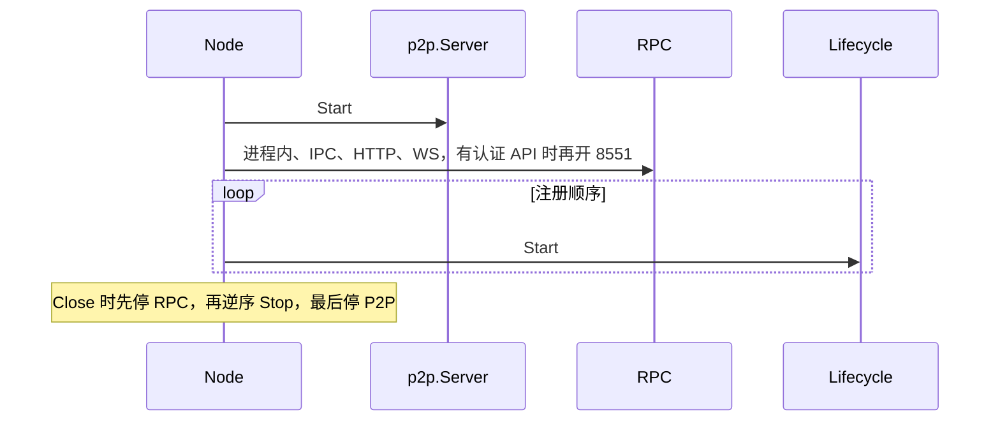

# node：服务容器

[返回学习总览](../LEARNING.md) · 上一篇 [cmd](../cmd/LEARNING.md) · 下一步 [core](../core/LEARNING.md)

`node.Node` 不认识链。它管数据目录锁、账户管理器、`p2p.Server`，以及进程内、IPC、HTTP、WebSocket、认证 Engine 这几套 RPC。链作为 `Lifecycle` 挂上来。包说明在 `node/doc.go`。

## 建议阅读顺序

1. `node/doc.go`：三态和数据目录。
2. `node/lifecycle.go`：`Start` / `Stop` 的约定。
3. `node/node.go`：`New`、`Start`、`openEndpoints`、`startRPC`、`RegisterLifecycle`。
4. `node/rpcstack.go`：HTTP 与 WebSocket 如何共用 server，module 白名单怎么滤 API。
5. `node/api.go`：节点自带的 `admin`、`debug`、`web3`。

## 生命周期

状态只能走 `initializingState` → `runningState` → `closedState`，`Start` 只能成功一次。

`Lifecycle` 只有两句：

- `Start`：所有服务已构造、网络层已初始化之后，用来起 goroutine。
- `Stop`：停掉这些 goroutine，并阻塞到它们结束。

`RegisterLifecycle`、`RegisterProtocols`、`RegisterAPIs`、`RegisterHandler` 只允许在初始化态调用，否则 panic。同一 `Lifecycle` 不能注册两次。

`Node.Start` 的顺序：

1. `openEndpoints`：先 `p2p.Server.Start`，再 `startRPC`（进程内、IPC、未认证 HTTP/WS；存在认证 API 时再用 JWT 开 8551）。
2. 按注册顺序调用每个 `Lifecycle.Start`。

`Close` 在运行态先停 RPC，再按注册逆序 `Lifecycle.Stop`，最后停 p2p。

因此 RPC 端口可以先于链的后台循环就绪。请求进来时，同步循环可能还没跑。

## 数据目录与账户

实例目录是 `DataDir/geth`（`Config.name()` 在 geth 里是 `"geth"`）。`OpenDatabase` 在该目录下建库。`DataDir == ""` 时用内存库。keystore 在 `DataDir/keystore`，同一数据目录的多个实例共享。无 datadir 时 keystore 用临时目录，`Close` 时删除。

`node.New` 只创建空的 `accounts.Manager`。后端由 `cmd/geth/config.go` 的 `setAccountManagerBackends` 后加。`AccountManager()` 是各服务拿签名账户的入口。

旧布局：`ResolvePath` 若在 datadir 根上仍看到早期的 `chaindata`、`nodekey`，会继续用旧路径并打废弃警告。

## RPC 面

`getAPIs` 把 `Authenticated == false` 的 API 放进公开端点，再按 `HTTPModules` / `WSModules` 过滤。geth 默认公开模块是 `net`、`web3`，`defaultNodeConfig` 再追加 `eth`。`debug`、`admin`、`txpool`、`miner` 默认不在 HTTP 上。IPC 和进程内会带上已注册的全部 API。

只要存在 `Authenticated: true` 的 API（正常路径下的 `engine`），`startRPC` 就用 JWT 再开一套，默认端口 8551，默认模块 `eth` 和 `engine`。

细节见 [rpc](../rpc/LEARNING.md) 和 [internal/ethapi](../internal/ethapi/LEARNING.md)。

## 扩展点

新服务实现 `Lifecycle`，在 `Start` 之前向 `Node` 注册。需要子协议就 `RegisterProtocols`，需要 RPC 就 `RegisterAPIs`。公开到 HTTP 还要把 namespace 写进模块列表。注册发生在 [cmd/geth 的 makeFullNode](../cmd/LEARNING.md)。

## 读的时候记住

- `catalyst.Register` 在普通模式下不是 `Lifecycle`。会注册成后台服务的是 `--dev` 的模拟信标和 `--beacon.api` 的 blsync。
- `dumpconfig` 会 `node.New`，因此占用实例目录锁。
