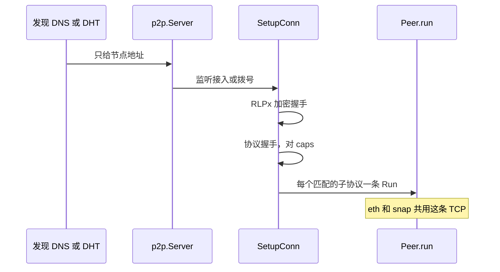

# p2p：发现与连接

[返回学习总览](../LEARNING.md) · 上一篇 [miner](../miner/LEARNING.md) · 下一步 [eth](../eth/LEARNING.md)

`p2p` 负责把节点连上，并在一条 TCP 上复用多个子协议。它不传区块语义。eth 和 snap 的消息在 [eth](../eth/LEARNING.md)。

## 建议阅读顺序

1. `p2p/server.go`：`Start`、`SetupConn`、`run`。
2. `p2p/dial.go`：拨号调度。
3. `p2p/peer.go`：`matchProtocols`、`startProtocols`。
4. `p2p/transport.go` 与 `p2p/rlpx`：加密握手和帧。
5. `p2p/enode`、`p2p/enr`：节点身份和可签名记录。
6. `p2p/discover/table.go`、`v4_udp.go`、`v5_udp.go`：Kademlia 表。bucket 容量 16，并发 α=3。
7. `p2p/dnsdisc`：EIP-1459 DNS 树。

## 连接如何建立

`node.Node.Start` 先于 eth 的 `Lifecycle` 调用 `p2p.Server.Start`：

1. `setupLocalNode`：本地 ENR 和 capability 列表。
2. `setupListening`：TCP `Accept` 后 `SetupConn`。
3. `setupDiscovery`：UDP 上 discv4 / discv5。两者都开时，v4 不认识的包交给 v5。
4. `setupDialScheduler`：从发现混合器取节点并拨号。
5. `run`：连接准入的唯一事件循环（人数、重复连接、自连）。

`setupConn` 的顺序：RLPx 加密握手（ECIES，然后 AES-CTR/MAC 帧）→ 人数检查 → 协议握手交换名字、ID、caps → 没有匹配协议则断开 → `Peer.run`。

`Peer.run` 按 capability 对齐子协议偏移，对每个匹配协议起 goroutine 调用 `Protocol.Run`。eth 和 snap 是同一条 TCP 上的两个子协议，各自一条 `Run`。

## 发现提供什么

DNS 和 DHT 只提供节点列表。区块在 RLPx 上的 eth 子协议里，或由共识客户端经 Engine API 推进来。eth 启动后把 fork ID 写进本地 ENR 的 `eth` 项，并用 `eth.NewNodeFilter` 过滤 dial 候选。

## 扩展点

新子协议实现 `p2p.Protocol`，在 `Ethereum.Protocols` 里 append。需要发现源就填 `DialCandidates` 和 ENR `Attributes`。`Protocol.Run` 自己读消息。`Server.run` 只做准入。

## 读的时候记住

- 服务器先于链的 handler 启动。握手时链的后台循环可能刚开始。
- enode 是身份和端点。ENR 是可签名、可扩展的记录。discv5 用 ENR 加 session（`v5wire`）。
- `devp2p discv4 test`、`discv5 test`、`rlpx eth-test` 对着已经跑起来的节点。同一套 eth/snap 测试也有 `TestEthSuite` 等普通 `go test`，测试里会自己拉起节点。
