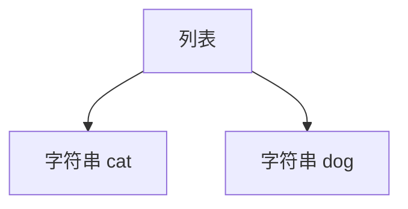
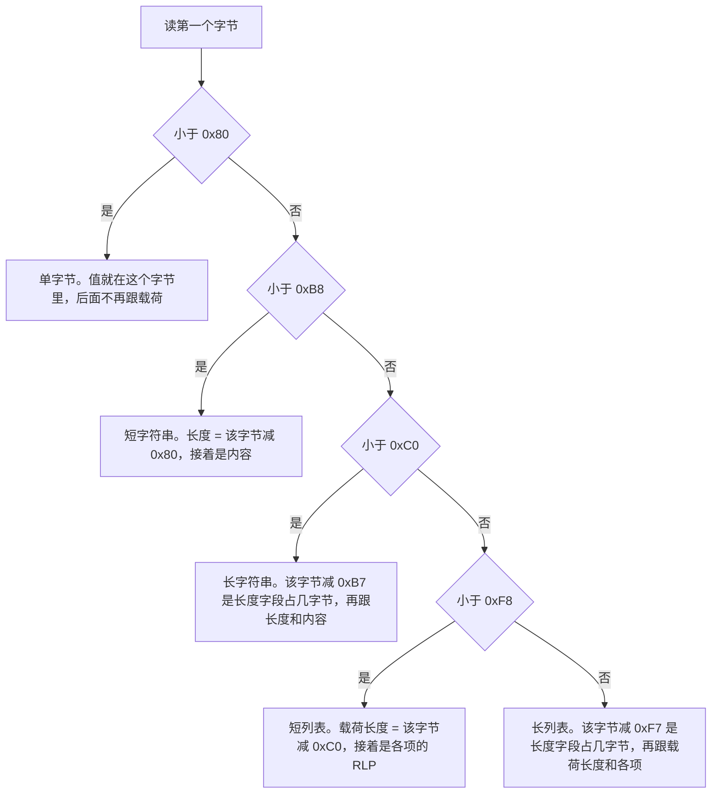
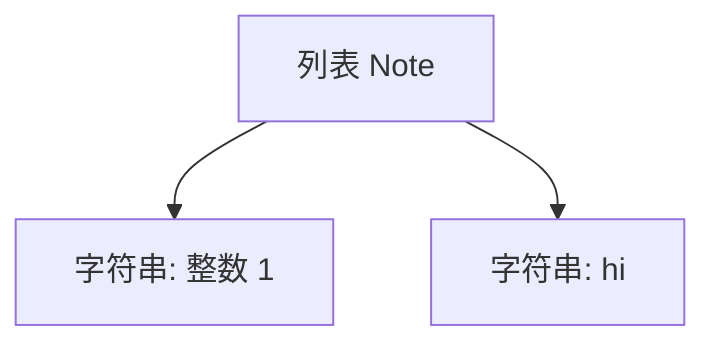
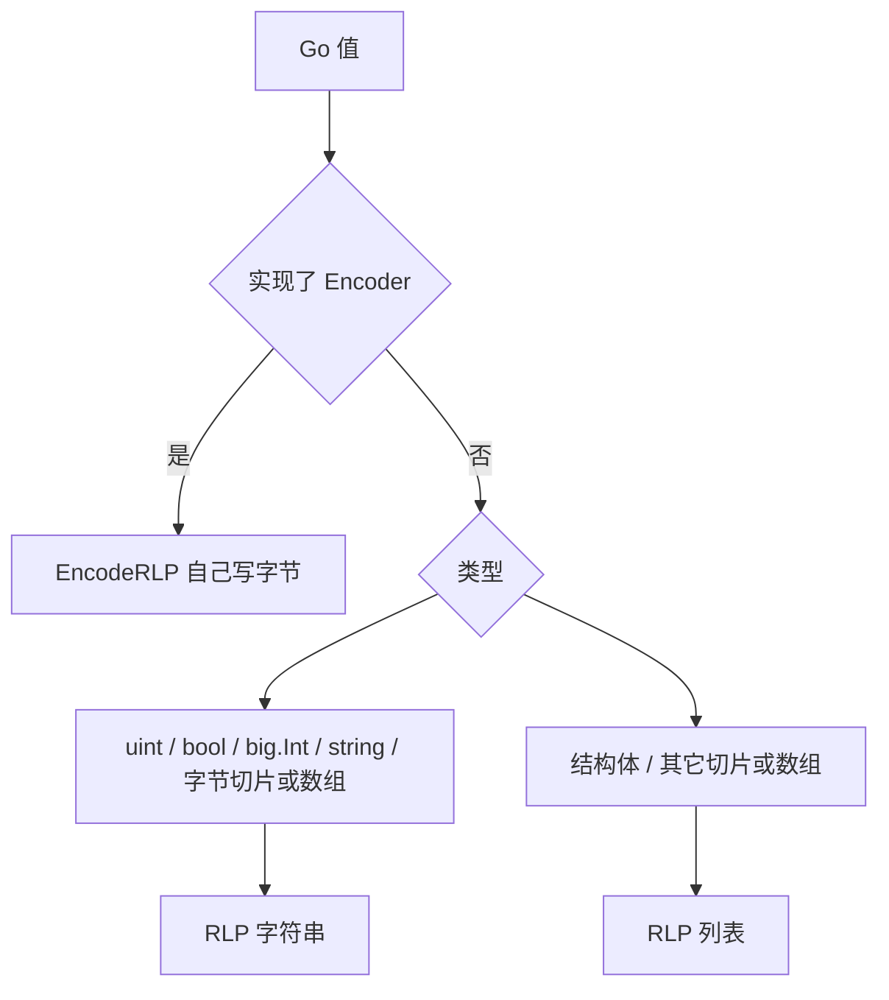
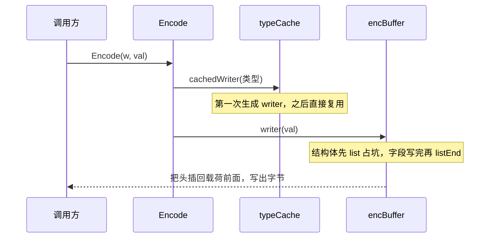
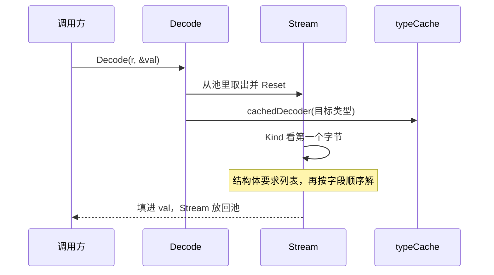

# rlp：链上对象的二进制编码

[返回学习总览](../LEARNING.md) · 上一篇 [params](../params/LEARNING.md) · 下一步 [crypto](../crypto/LEARNING.md)

RLP（Recursive Length Prefix）只编码嵌套的字节串和列表。整数的含义由上层协议决定。区块头、交易、收据、devp2p 消息都走这套编码。包说明在 `rlp/doc.go`。

## 建议阅读顺序

1. `rlp/doc.go`：类型如何映射成字符串或列表。
2. 下面这几节：先看线上字节，再看本包怎么生成编解码函数。
3. 下面的「数据结构怎么配合」：`encBuffer` 和 `Stream` 的字段在每一步之后是什么。
4. `rlp/typecache.go`：每种类型的编解码闭包只生成一次。
5. `rlp/encode.go` 的 `makeWriter`、`rlp/decode.go` 的 `makeDecoder`：同一张分派表，方向相反。不要从文件第一行通读。
6. `rlp/rlpgen`：把这张表生成成源码。默认生成 `EncodeRLP`，加 `-decoder` 才生成 `DecodeRLP`。
7. 对照 `core/types` 里的 `gen_header_rlp.go` 一类文件，看真实结构体怎么编码。

## 线上只有两种值

一个 RLP 值要么是**字符串**（一段字节），要么是**列表**（若干个 RLP 值挨在一起）。列表可以再套列表，所以叫递归。没有单独的整数类型、布尔类型，也没有 null。

以太坊把整数约定成「大端、不带前导零的字节串」。`0` 是空字符串。布尔是整数 `0` 和 `1`。这些约定在 RLP 外面，RLP 自己只负责把树写成字节。

`["cat", "dog"]` 是一个列表，里面两个字符串：



编码从最里面的字母开始，一层层往外加头。最后得到 9 个字节：`c8 83 63 61 74 83 64 6f 67`。写成一串就是 `0xc88363617483646f67`，每两位十六进制是一个字节。

先把字母换成字节。这里用的是 ASCII，一个字母一个字节：

| 字母 | 字节 |
|------|------|
| c | `63` |
| a | `61` |
| t | `74` |
| d | `64` |
| o | `6f` |
| g | `67` |

所以 `"cat"` 的内容是 `63 61 74`，`"dog"` 的内容是 `64 6f 67`。光有内容还不行，读的人不知道这一截到哪里结束，所以每段前面要加一个头，头里写着后面有几个字节。

短字符串的头从 `0x80` 起算。空字符串一个字节都没有，头就是 `0x80`。有 1 个字节，头是 `0x81`。有 3 个字节，头是 `0x83`。公式是 `0x80 + 内容长度`。

`"cat"` 和 `"dog"` 都是 3 个字节，头都是 `0x80 + 3 = 0x83`：

```text
83  63 61 74     这是 "cat"：头说后面有 3 字节，接着就是 c a t
83  64 6f 67     这是 "dog"：头同样说后面有 3 字节，接着就是 d o g
```

两项各占 4 个字节（1 个头 + 3 个字母）。拼在一起是列表的内容，一共 8 个字节：

```text
83 63 61 74   83 64 6f 67
└── "cat" ──┘ └── "dog" ──┘
        共 8 个字节
```

列表自己也要一个头，否则不知道这 8 个字节是一整个列表，还是后面还有别的东西。短列表的头从 `0xC0` 起算。空列表是 `0xC0`。内容有 8 个字节，头就是 `0xC0 + 8 = 0xC8`，写成 `c8`。

九个字节因此是：

```text
c8            83        63 61 74      83        64 6f 67
└ 列表头       └ "cat" 头 └ c a t       └ "dog" 头 └ d o g
  后面共 8 字节  后面 3 字节             后面 3 字节
```

读的时候从左往右，只看头，不看字母：

1. 第一个字节 `c8`。它落在 `0xC0` 到 `0xF7` 之间，所以是短列表。长度用减法得到：`0xC8 - 0xC0 = 8`。于是再读 8 个字节，这 8 个字节都是列表里面的东西。
2. 这 8 个字节的第一个是 `83`。它落在 `0x80` 到 `0xB7` 之间，所以是短字符串。`0x83 - 0x80 = 3`，再读 3 个字节 `63 61 74`，就是 `"cat"`。
3. 还剩 4 个字节。又是一个 `83`，同样再读 3 个字节 `64 6f 67`，就是 `"dog"`。
4. 列表答应的 8 个字节用完了，这一项结束。

`0x80` 和 `0xC0` 是两种头的起点，减法只是在问「比起点大了多少」，答案就是后面还要读几个字节。下一节把所有起点的分界画完整。

## 第一个字节决定后面是什么

每个值都以一个类型字节开头。读解码时，`Stream.Kind` 只看这一个字节，就能知道后面是单字节、短字符串、长字符串、短列表还是长列表。分界和 `rlp/decode.go` 里的 `readKind` 一致。



载荷不超过 55 字节用短形式，一个字节里同时记下种类和长度。更长才先写「长度占几个字节」，再写长度本身。空字符串是 `0x80`（短字符串，长度 0）。空列表是 `0xC0`（短列表，载荷长度 0）。

| 值 | 字节 | 怎么来的 |
|----|------|----------|
| 整数 0 | `80` | 空字符串 |
| 整数 1 到 127 | `01` … `7f` | 小于 `0x80` 的单字节 |
| 整数 128 | `8180` | 一字节内容 `0x80`，头是 `0x80+1` |
| 整数 1024 | `820400` | 大端 `04 00`，头是 `0x80+2` |
| `"dog"` | `83646f67` | 三字节，头是 `0x80+3` |
| `"cat"` 在 `"dog"` 前面组成的列表 | `0xc88363617483646f67` | 两项共 8 字节，头是 `0xC0+8` |
| 长度 ≥ 56 的字符串 | `b8` 起头 | 长度要用额外的字节写出来 |

整数有两条规范要求，解码时会拒掉：

- `0x00` 不能当成整数 0。0 只能是 `0x80`。内容里的前导零也会被拒绝。
- 能用单字节或短头就得用。把 15 写成 `0x810f`，或把不到 56 字节的串写成带长度字段的长头，都是非规范的。

## 一个结构体怎么落成字节

结构体的导出字段按定义顺序编成一个列表。字段本身再按它的 Go 类型递归编码。

```go
type Note struct {
    Version uint
    Text    string
}
```

`Version = 1`、`Text = "hi"` 时，树是这样：



字节是 `c401826869`：

```text
c4           01            82         68 69
└ 列表头      └ Version=1   └ 字符串头   └ "hi"
  载荷 4 字节                 长度 2
```

`1` 小于 128，所以就是字节 `01`。`"hi"` 两字节，头是 `0x80+2 = 0x82`。两项合起来 4 字节，列表头是 `0xC0+4 = 0xC4`。

`Text` 若带 `rlp:"optional"` 并且是零值，编码会在它前面停住。同一个类型可以读旧的短列表，也可以读新的长列表：

```text
只有 Version:     c1 01
Version 和 "hi":  c4 01 82 68 69
```

Header 上的 `BaseFee`、`WithdrawalsHash`、`BlobGasUsed` 就是用这个办法，让不同分叉共用一个 Go 类型。

## Go 类型对应哪一种 RLP

本包用反射看 Go 类型，再决定走字符串还是列表。实现了 `Encoder` 的类型不走这张表，直接调用 `EncodeRLP`。



指针编码它指向的值。指向结构体、切片、数组的 nil，写成空列表；指向字节切片或字节数组的 nil，写成空字符串；指向整数、字符串、布尔的 nil，也写成空字符串。`*big.Int` 和 `*uint256.Int` 是例外：nil 编成空字符串 `0x80`，不走「结构体指针或数组指针写成空列表」那条。

`[]byte` 和 `[N]byte` 是一条字符串。元素若是实现了 `Encoder` 的 `uint8`，就改成逐个编码的列表。有符号整数、浮点、map、channel、函数不能编码。

解码是这张表的反方向。目标是结构体，输入就必须是列表，再按字段顺序填。目标是 `[]byte`，输入就必须是字符串。空接口里，列表收成 `[]interface{}`，字符串收成 `[]byte`。带方法的接口不能解。

常用 tag：

| Tag | 作用 |
|-----|------|
| `rlp:"-"` | 忽略该字段 |
| `rlp:"tail"` | 最后一个字段。把列表尾部多出来的元素收进这个切片，不再为它包一层列表 |
| `rlp:"optional"` | 零值可以省略。它后面的字段必须是 optional，或最后一个 `tail`。同一个字段不能同时带这两个 tag |
| `rlp:"nil"` | 只用于指针。空字符串或空列表解成 nil，空值种类按元素类型选 |
| `rlp:"nilString"` / `rlp:"nilList"` | 同样允许 nil，但强制空值必须是字符串或列表 |

没有 `nil` 一类 tag 时，出现在输入里的空字符串或空列表会解成已分配的值，不会变成 nil。optional 字段若整段缺席，指针留成 nil，这不算错误。

## 代码长，是因为同一条规则写了三遍

线上规则就是「字符串或列表，前面加一个长度头」。`encode.go` 约 500 行、`decode.go` 约 1200 行，是因为每种 Go 类型各有一个函数，编码、解码、代码生成又各写一份。读的时候按层跳，不要顺着行号往下看。

```mermaid
flowchart TD
    call["Encode / Decode：借一块缓冲，调用闭包"]
    cache["typecache：这个类型的闭包生成过吗"]
    make["makeWriter / makeDecoder：按 Kind 选函数"]
    bytes["encBuffer 写字节，Stream 读字节"]
    call --> cache --> make --> bytes
```

上面三层只决定用哪个函数。真正拼出 `0x80`、`0xC0` 这些头的，是最下面那一层。

编码和解码是两列对称的函数。左边怎么写，右边就怎么读：

| 规则 | 编码 | 解码 |
|------|------|------|
| 分派表 | `encode.go` 的 `makeWriter` | `decode.go` 的 `makeDecoder` |
| 整数、布尔、字符串 | `writeUint`、`writeBool`、`writeString` | `decodeUint`、`decodeBool`、`decodeString` |
| 结构体 | `makeStructWriter` | `makeStructDecoder` |
| 切片、数组 | `makeSliceWriter` | `makeListDecoder` |
| 指针 | `makePtrWriter` | `makePtrDecoder` |
| 碰字节 | `encbuffer.go` | `Stream`，头的判断在 `readKind` |

`makeWriter` 的 `switch` 就是这张表的编码列。`writeUint`、`writeBool` 这些函数都只是表里的一行，看过 `switch` 就知道它们什么时候被选中，不必逐个往下追。

`decode.go` 从 `NewStream` 往后是另一件事：一个在字节流上走动的游标。`Kind` 看当前这项的头，`List` 进入一层列表，`ListEnd` 确认这一层读完。类型规则在文件前半的 `makeDecoder`，和 `makeWriter` 对齐着看。

行数堆在这些重复上，它们没有新的线格式：

- `big.Int` 和 `*big.Int`、`uint256.Int` 和它的指针，各写一对函数。
- 字节数组长度是 0、是 1、还是更长，三种写法。
- `nil`、`nilString`、`nilList`，以及 `optional`、`tail`。
- 实现了 `Encoder` 或 `Decoder` 的类型改走自己的方法。

`rlp/rlpgen/gen.go` 是第三份。它不生成闭包，而是生成 `EncodeRLP` 的源码。里面的 `makeStructOp` 对应 `makeStructWriter`。区块头这种热路径读 `core/types/gen_header_rlp.go` 就行，生成器可以以后再看。

`Encode` 开头的 `encBufferFromWriter` 也不是新规则。自定义 `EncodeRLP` 里常常再调用 `rlp.Encode(w, x)`，这时 `w` 已经是正在用的那块缓冲。认出来就接着往同一块里写。认不出来才新开一块，编完再拷到外面的 `io.Writer`。

可以先不读 `raw.go` 和 `iterator.go`。它们在已经编好的字节上切分、计数，不参与把 Go 值编成字节。

## 这个包里编码怎么走

`Encode` 拿一个 `encBuffer`，向类型缓存要这个类型的 `writer` 闭包，然后调用它。闭包在 `rlp/typecache.go` 里生成一次，之后同一种类型不再反射。

结构体的列表头不能先写。子项还没编码，载荷有多长还不知道。`encBuffer` 把字符串内容和列表头分开存：`list` 只记下头将来要插在哪个位置，字段写进 `str`，`listEnd` 再算出载荷长度。真正往 `io.Writer` 输出时，才把头插回对应的载荷前面。



自定义的 `EncodeRLP` 若往同一个 buffer 里写，会走这条已经开始的缓冲，避免再套一层。

## 解码怎么走

`Decode` 从池里取一个 `Stream`，向类型缓存要 `decoder` 闭包。闭包按目标类型去读。结构体先要求 `Kind` 是列表，再对每个字段调用该字段自己的 decoder。列表读完要 `ListEnd`，多出来的字节会报错。

`Kind` 会缓存当前这一项的种类和长度。单字节的值已经在类型字节里，`size` 返回 0。字符串和列表的 `size` 是后面还要读的载荷长度。输入声明的长度超过外层列表或调用方设的上限时，在分配缓冲区之前就拒绝。



递归类型（字段类型指回自己）在生成闭包时先放一个空的缓存项，避免沿类型树无限递归。真正解码时才调用里面的函数，那时函数已经填好。细节在 `typecache.go` 的注释里。

调用顺序如上。同一块状态的字段在每一步之后变成什么，见下一节。

## 数据结构怎么配合

编码和解码各有一块反复使用的状态。选哪个函数去改这块状态，是 `typeinfo` 里的闭包。闭包的两边签名就是这两块状态：

```text
writer:  func(reflect.Value, *encBuffer) error
decoder: func(*Stream, reflect.Value) error
```

`encbuffer_example_test.go` 里的 `[4, [5, 6]]` 编出来是 `C404C20506`。下面用这 5 个字节把两边的字段走一遍。


### 编码：内容和列表头拆开放

列表头里要写载荷长度，子项还没写完，这个长度还不知道。`encBuffer` 因此不按最终顺序攒字节。字符串先进入 `str`，列表头进入 `lheads`，输出时再把头插回 `str` 的对应位置。
```go
type encBuffer struct {
	str     []byte     // 字符串及其字符串头。不含列表头，列表头在输出时再插入
	lheads  []listhead // 各列表头。offset 是插入 str 的位置，listEnd 之后 size 是该列表的载荷长度
	lhsize  int        // 已经结束的列表头，编码后一共占多少字节
	sizebuf [9]byte    // 写整数和长头时的临时空间。一个头最长 9 字节
}
type listhead struct {
	offset int // index of this header in string data
	size   int // total size of encoded data (including list headers)
}
```

| 字段 | 编码过程中放什么 |
|------|------------------|
| `str` | 字符串和字符串头。列表头不在这里 |
| `lheads` | 每个列表头。`offset` 是它将来插进 `str` 的下标 |
| `lhsize` | 已经 `listEnd` 的列表头，编码后一共占多少字节 |
| `sizebuf` | 9 字节草稿。大整数和长头先写到这里，再追加进 `str`。一个头最长是 1 字节类型加 8 字节长度 |

`list` 不写头。它往 `lheads` 追加一项：`offset` 等于当时的 `len(str)`，`size` 先暂存当时的 `lhsize`。返回值是这项的下标，`listEnd` 用它找回这一项。

`listEnd` 把暂存的 `size` 换成这个列表的载荷长度：

```text
载荷 = 当前总长度 − 开始时 str 的长度 − 开始时已有列表头的总长度
```

当前总长度是 `len(str) + lhsize`。减掉的两段都是这个列表开始之前就已经存在的字节，剩下的就是本列表新写出来的字符串，加上期间结束的内层列表头。载荷不足 56 字节，头占 1 字节，`lhsize` 加 1。更长则是 1 字节类型再加上长度本身的大端字节数。外层列表结算时，靠这个 `lhsize` 把内层头算进自己的载荷。

`[4, [5, 6]]` 的字段是这样变的。`4`、`5`、`6` 都小于 128，各自就是一个字节，没有字符串头。

| 调用 | `str` | `lheads`（offset, size） | `lhsize` |
|------|-------|--------------------------|----------|
| `list` 外层 | 空 | `(0, 0)`。`size` 还是 `lhsize` 的快照 | 0 |
| 写入 4 | `04` | `(0, 0)` | 0 |
| `list` 内层 | `04` | `(0, 0)`、`(1, 0)` | 0 |
| 写入 5、6 | `04 05 06` | 同上 | 0 |
| `listEnd` 内层 | `04 05 06` | `(0, 0)`、`(1, 2)`。内层载荷是 2 | 1 |
| `listEnd` 外层 | `04 05 06` | `(0, 4)`、`(1, 2)`。外层载荷是 4 | 2 |

内层那一步的算术是 `(len(str)+lhsize) - offset - 快照 = (3+0) - 1 - 0 = 2`。外层是 `(3+1) - 0 - 0 = 4`，多出来的 1 就是内层那个 1 字节的列表头。

`copyTo` 按 `lheads` 的顺序拼接。先写 `str` 里上一个插入点到这个 `offset` 的字节，再把这个头编出来：

```text
头 size=4 → C4
str[0:1]  → 04
头 size=2 → C2
str[1:]   → 05 06
```

得到 `C404C20506`。`writeTo` 的顺序相同，只是分成多次 `Write`。`EncodeToReader` 也不先拼整块，`encReader` 按同样的顺序每次交出一小段；列表头编进 `sizebuf`，调用方必须先拷走。读到结尾时这块 `encBuffer` 放回 `encBufferPool`。

`EncoderBuffer` 是给调用方和生成代码用的一层，生成文件里的 `NewEncoderBuffer(_w)` 就是它。

| 字段 | 含义 |
|------|------|
| `buf` | 上面的 `encBuffer` |
| `dst` | `Flush` 时把编好的字节写去的 `io.Writer` |
| `ownBuffer` | 这块 `buf` 是不是自己从池里拿的 |

`Reset` 看到 `dst` 本身已经是编码缓冲时，不新开内存，三个字段写成 `{外层的 buf, nil, false}`。写入直接进外层的 `str` 和 `lheads`。`dst` 留空，`Flush` 就不会把同一段字节再 `writeTo` 一遍。`ownBuffer` 为假，内层 `Flush` 也不会把共享缓冲放回池。`dst` 是普通 `Writer` 或 `nil` 时，才从池里取一块自己的缓冲，并把这个 `dst` 记下来。

`makeStructWriter` 生成的闭包就是这套调用：先 `list`，再按字段顺序调用每个字段自己的 `writer`，最后 `listEnd`。带 `optional` 的结构体会先从尾部去掉连续的零值，再开列表。

### 解码：游标加上每层列表还剩多少

`Stream` 不把输入收成一棵树。它是一个向前走的游标，嵌套列表用栈记住每一层还剩多少字节。`Decode` 从 `streamPool` 取出一个，用完放回。

| 字段 | 解码过程中放什么 |
|------|------------------|
| `r` | 底层 `ByteReader`。输入本身没有 `ReadByte` 时，`Reset` 给它包一层 `bufio.Reader` |
| `remaining` | 调用方设了输入上限，或输入是 `bytes.Reader` 一类时，还允许再读多少字节 |
| `limited` | `remaining` 是否生效 |
| `kind`、`size`、`byteval`、`kinderr` | 已经看过、还没被消费的下一项。`kind < 0` 表示下一次 `Kind` 要重新读头 |
| `stack` | 每一层打开的列表还剩多少载荷。栈顶是当前最内层 |
| `uintbuf` | 32 字节草稿。不超过这么长的整数放这里，避免再分配。更长的 `big.Int` 另开一块临时缓冲 |

`Kind` 只在 `kind < 0` 时读一个新头，读完把结果留在这四个字段里。后续再次调用直接返回缓存，输入位置不动。真正把值读走之前，`willRead` 把 `kind` 设回 `-1`。单字节的值已经在类型字节里，`size` 是 0，`byteval` 就是这个值，后面不再跟载荷。字符串和列表的 `size` 是头后面还要读的载荷长度。这个长度超过当前列表剩余或输入上限时，在分配缓冲区之前就拒绝。

每读 `n` 个字节，`willRead` 从栈顶减去 `n`，有输入上限时也从 `remaining` 减去 `n`。`List` 在压入内层长度之前，先从外层剩余里扣掉内层载荷。这样内层 `ListEnd` 弹出之后，外层剩余已经不含内层那些字节。`ListEnd` 要求栈顶是 0，否则这一层还有没读完的字节。

还是 `C404C20506`。从 `bytes.Reader` 解码时，`remaining` 一开始是 5。

| 动作 | 栈（外层在左，数字是该层还剩的载荷） |
|------|--------------------------------------|
| 读到 `C4`，`List`。载荷 4 | `[4]` |
| 读到 `04`。这一个字节既是头也是整数 4，栈顶减 1 | `[3]` |
| 读到 `C2`。头占掉 1 字节后外层剩 2；内层载荷 2，从外层扣掉再压栈 | `[0, 2]` |
| 读到 `05` | `[0, 1]` |
| 读到 `06` | `[0, 0]` |
| 内层 `ListEnd`。栈顶是 0，弹出 | `[0]` |
| 外层 `ListEnd`。栈顶是 0，弹出 | `[]` |

`makeStructDecoder` 生成的闭包就是这套调用：先 `List`，再按字段顺序调用每个字段自己的 `decoder`，最后 `ListEnd`。某个 optional 字段读到 `EOL` 时，它和后面的字段填零，然后结束这一层。非 optional 字段提前结束则报「元素太少」。

两边因此是同一棵结构的两个方向。编码用 `lheads` 把还不知道长度的头留到最后插回去。解码用 `stack` 把已经知道的长度当成每层的剩余额度，读一块减一块。

## 生成代码

热路径上的类型不走上面的反射。典型指令写在类型旁边：

```text
go:generate go run ../../rlp/rlpgen -type Header -out gen_header_rlp.go
```

生成文件头是 `Code generated by rlpgen. DO NOT EDIT.` 手改会被 `go run ./build/ci.go check_generate` 打回。安装生成器见根目录 [准备改代码时](../LEARNING.md#准备改代码时) 里的 `make devtools`。

JSON 编解码是另一条线，多用 `github.com/fjl/gencodec` 生成 `gen_*_json.go`，并用 `-field-override` 把字段换成 hex 类型。

## 和其它模块的边界

- 共识对象的字段取舍在 [core](../core/LEARNING.md)。RLP 只负责把 Go 值写成字节。
- RPC 的 `0x` 十六进制在 `common/hexutil`，见 [params 笔记](../params/LEARNING.md)。
- `cmd/rlpdump` 把 RLP 十六进制转成可读树，适合对照一笔抓到的消息。

## 读的时候记住

- 收据落盘用的结构和 RPC 返回的 `Receipt` 不是同一份字段集合。磁盘上的编码更短，不存 Bloom，读出来时由日志重算。共识 RLP 仍然带着 Bloom。
- 改结构体字段顺序就是改线格式。加在末尾并用 `optional`，才能和旧数据兼容。
