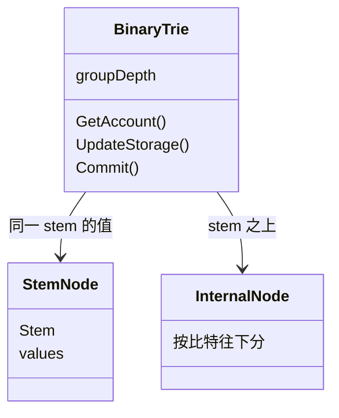

# trie/bintrie：统一二叉树

[返回 trie](../LEARNING.md) · [返回学习总览](../../LEARNING.md) · 迁移门面 [transitiontrie](../transitiontrie/LEARNING.md) · 进度 [core/overlay](../../core/overlay/LEARNING.md)

`BinaryTrie` 实现 [EIP-7864](https://eips.ethereum.org/EIPS/eip-7864)。账户、存储槽和代码块在同一棵树上。节点哈希和树键用 SHA-256。MPT 的账户 trie 加每合约一棵存储 trie、叶子哈希用 keccak，是另一套布局。

## 建议阅读顺序

1. `key_encoding.go`：一个地址的 basic data、code hash、存储槽、代码块各自落在哪个 32 字节键。
2. `trie.go` 的 `ChunkifyCode`：字节码按 31 字节切块，块首 1 字节记录前一块 PUSH 数据伸进来多少。
3. `stem_node.go`、`internal_node.go`：叶子组和内部节点。
4. `binary_node.go`：序列化类型字节，`DeserializeAndHash`。
5. `trie.go` 的 `BinaryTrie`：`GetAccount`、`UpdateStorage`、`Commit`。
6. `store_commit.go`：`Commit` 只 `collectNodes`，磁盘仍交给 [pathdb](../../triedb/pathdb/LEARNING.md)。

## 键

`GetBinaryTreeKey` 用 SHA-256 混合地址和 32 字节偏移，结果的最后一字节取偏移的最后一字节，前面 31 字节是 stem。同一 stem 下最多 256 个值，放在一个 `StemNode` 里。

| 数据 | 键 |
|------|----|
| 账户 basic data（nonce、余额、代码长度） | 后缀 `0` |
| code hash | 后缀 `1` |
| 槽号小于 64 | 放进账户头区域，偏移 `64 + 槽号` |
| 其余存储槽 | 主存储区，基址是 `1 << 248`，再加上槽号 |
| 代码块 | 从偏移 128 起，每块 32 字节（1 字节 PUSH 元数据 + 31 字节代码） |

`OpenStorageTrie` 在 UBT 上返回同一棵树。`StateDB` 看到 `TypeUBT` 时不再按账户各开一棵存储 trie，存储更新直接写进这棵树。

## 节点

`StemNode` 保存 31 字节 stem 和最多 256 个值。`dirty` 表示磁盘上的 blob 过期，`mustRecompute` 表示缓存的哈希过期。内部节点按键的比特往下走。序列化时把 `groupDepth` 层打成一组。构造函数接受 1 到 `MaxGroupDepth`（8）。`triedb.Config` 的默认值是 `DefaultBinTrieGroupDepth`（5）。改这个深度会改变节点 blob，从而改变 state root。

pathdb 在 UBT 模式下把库包进 `VerklePrefix`（`"v"`），节点哈希走 `DeserializeAndHash`。

## 读的时候记住

- 树键是 SHA-256，账户地址本身不是 MPT 里的 `keccak(address)`。
- `Commit` 收进 `NodeSet` 就结束。刷盘在 pathdb。
- 代码块的第 0 字节是 PUSH 元数据。按普通字节码去切 32 字节会把跳转目的地判错。
- 迁移期的读写不直接碰这棵树的「没有就当删除」。那一层在 [transitiontrie](../transitiontrie/LEARNING.md)。
