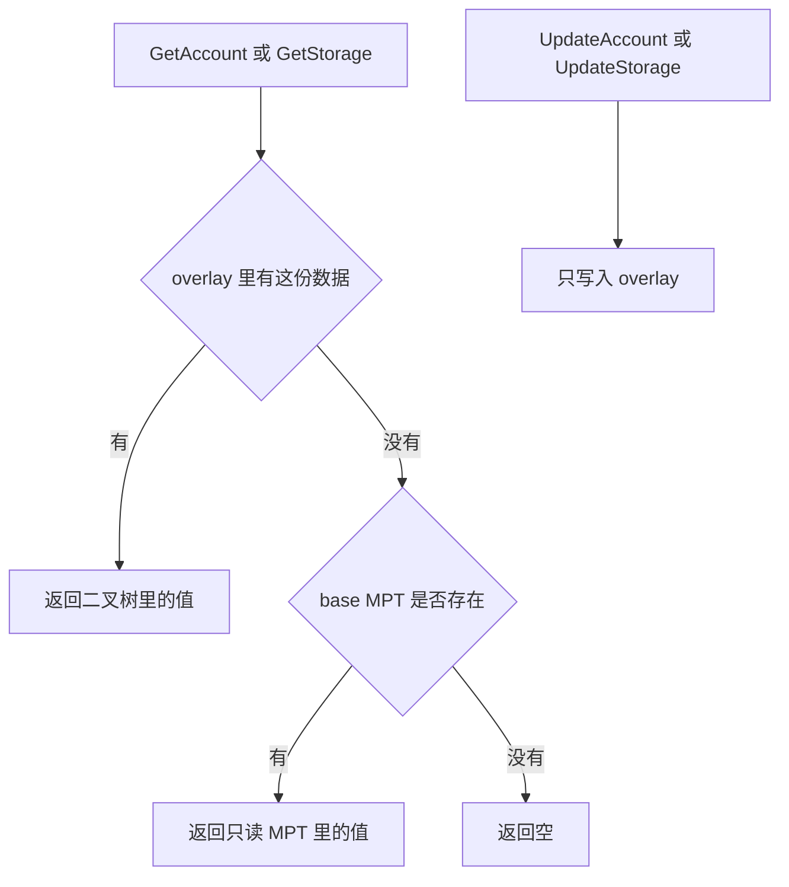

# trie/transitiontrie：MPT 到 UBT 的门面

[返回 trie](../LEARNING.md) · [返回学习总览](../../LEARNING.md) · 树本身 [bintrie](../bintrie/LEARNING.md) · 进度 [core/overlay](../../core/overlay/LEARNING.md)

`TransitionTrie` 对外仍是一棵 `Trie`。读先问 overlay（`*bintrie.BinaryTrie`），overlay 里没有再问 base（`*trie.SecureTrie`，只读的 MPT）。写只进 overlay。

## 建议阅读顺序

1. `transition.go` 的 `NewTransitionTrie`、`GetAccount`、`GetStorage`。
2. 同文件的 `UpdateAccount`、`UpdateStorage`、`DeleteAccount`。
3. `core/state/reader.go` 的 `newUBTTrieReader`：什么时候 base 是真的 MPT，什么时候 base 是 nil。

## 谁构造它

`newUBTTrieReader` 先按状态根打开 `BinaryTrie`，再 `overlay.LoadTransitionState`。

- `InTransition()` 为真：用 `TransitionState.BaseRoot` 打开只读 MPT，做成 `NewTransitionTrie(mpt, binTrie, false)`。
- 迁移已经结束，或者库从一开始就是 UBT：`NewTransitionTrie(nil, binTrie, false)`。这里的 nil base 是为了避开 `trie` 和 `trie/bintrie` 的导入环，让 `BinaryTrie` 能当成 `Trie` 用。此时没有 MPT 可以回退。

`GetStorage` 把 overlay 的空字节切片当成未命中，再问 base。`UpdateStorage` 把短值左填充成 32 字节后写入 overlay。overlay 未命中、改从 base 读到值时，目前不会把这份值写回 overlay。

删除账户只记在 overlay。迁移完成后的树上不再用墓碑表示「MPT 里有、overlay 里删了」；`GetAccount` 从 overlay 得到错误就是真的错误。

## 读的时候记住

- 写 base 会让迁移期的 MPT 和 UBT 各改各的，state root 对不齐。
- `base == nil` 表示这棵门面只是 UBT 的包装，不表示迁移进行中。进行中看 `TransitionState.InTransition`。
- `Commit` 收的是 overlay 的脏节点。base 在迁移期保持只读。
