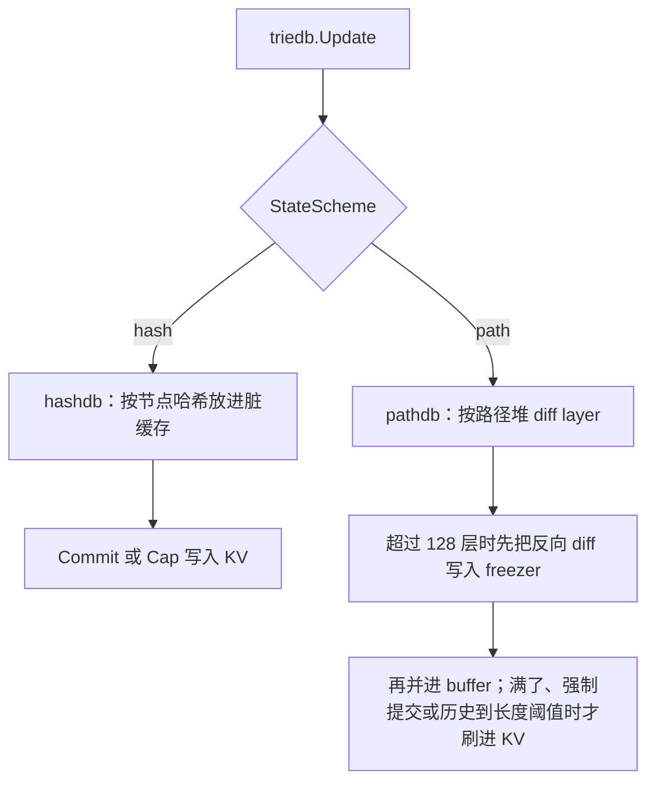

# triedb：trie 节点库

[返回学习总览](../LEARNING.md) · 上一篇 [trie](../trie/LEARNING.md) · 下一步 [ethdb](../ethdb/LEARNING.md)

`triedb` 决定 trie 节点怎么进 [ethdb](../ethdb/LEARNING.md)。`triedb.NewDatabase` 在配置了 `PathDB` 时用 pathdb，否则用 hashdb。空数据目录默认 path 方案。已经建好的库不能中途换方案。

## 建议阅读顺序

1. `triedb/database.go`：backend 分发，`Update` / `Commit` / `StateReader`。
2. `triedb/hashdb/database.go`：按节点哈希存储，引用计数修剪。
3. `triedb/pathdb/database.go`、`difflayer.go`：路径键、diff layer、buffer flush。详解 [pathdb](pathdb/LEARNING.md)。
4. `core/rawdb/accessors_trie.go`：两种 key 的前缀。
5. `core/blockchain.go` 的 `writeBlockWithState`：hash 模式下谁调用 `Cap` / `Commit` / `Dereference`。

## hashdb

节点 key 是 keccak(RLP)，无路径前缀。同一路径的历史版本可以共存，所以 archive（`NoPruning`）自然：每个状态根的节点都留在 KV 里。代价是没有路径局部性，修剪靠引用计数。

`Update` 把非删除节点放进脏缓存，并用账户叶子里的存储根做引用，把存储 trie 挂到账户节点上。删除在这里被丢掉。真正写入 KV 是之后的 `Commit`（从根递归）或 `Cap`（按内存上限刷最老的脏节点）。不再被引用的根通过 `Dereference` 回收。

hashdb 的 `StateReader` 不提供扁平账户。扁平读要另挂 `core/state/snapshot`。

## pathdb

磁盘上每个路径只有一个节点：账户 trie 是 `"A"+hexPath`，存储 trie 是 `"O"+accountHash+hexPath`。账户和槽的扁平值沿用 `"a"` / `"o"` 前缀。内存里是一棵 diff layer 树，底层一个 disk layer。超过 128 层时先把反向 diff 写入 freezer，再并进 disk layer 的 buffer。buffer 满、强制提交或历史到长度阈值时才刷进 KV。

历史不是再存一整棵 trie，而是 freezer 里的反向 diff。默认状态历史深度跟 `FullImmutabilityThreshold`（90000）走。trie 节点历史默认不保留。`HistoricStateReader` 只有 pathdb 提供。

UBT 把 diskdb 包进 `VerklePrefix`（`"v"`）。snap sync 期间 pathdb 会 `Disable`，避免读到半成品持久状态。

## 和上层的关系

[StateDB.Commit](../core/state/LEARNING.md) 调用 `triedb.Update`。path 模式到这里，区块写入就返回。hash 模式由 `BlockChain` 决定刷盘和 GC。

区块头体在 [core/rawdb](../core/LEARNING.md) 的 chain freezer。trie 节点用哈希 key 或 `A`/`O`。两边用 header 的 state root 关联。

## 读的时候记住

- `StateDB.Commit` 返回之后，hash 模式的节点仍可能在脏缓存里。
- path 方案磁盘上没有「每个区块一棵完整 trie」。活状态一份，历史是 diff。
- snap sync 依赖按路径和扁平 key 的顺序迭代。pathdb 自带这层；hash 模式靠独立 snapshot。
