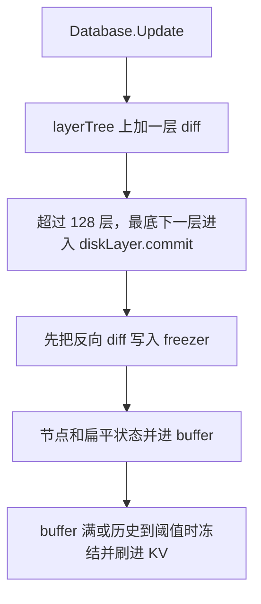

# triedb/pathdb：按路径存的状态层

[返回 triedb](../LEARNING.md) · [返回学习总览](../../LEARNING.md) · 相关 [trie](../../trie/LEARNING.md)、[core/state](../../core/state/LEARNING.md)

空数据目录默认走 pathdb。磁盘上每个路径只留一份活节点，历史是 freezer 里的反向 diff。内存里是一棵可以分叉的 diff layer，底下只有一个 disk layer。全进程同时只能打开一个可写的 pathdb。

## 建议阅读顺序

1. `config.go`：`Defaults`、`maxDiffLayers`、`sanitize`。
2. `database.go`：`New`、`Update`、`Commit`、`Disable`、`Recover`。
3. `layertree.go`：按状态根索引层，并记录谁是谁的后代。
4. `difflayer.go`、`disklayer.go`：读节点时先查内存层，再查 buffer，最后查磁盘。
5. `buffer.go`、`flush.go`：多层 diff 并成一次 KV batch。
6. `history.go`、`history_state.go`、`history_trienode.go`：反向 diff 怎么进 freezer。
7. `journal.go`：停机时把还没压平的层写下来。

## 一层怎么叠上去

`Database.Update` 要求新根能接到已有的父根。它把 `StateDB.Commit` 交来的节点和扁平变更留在新的 diff layer 里，然后 `layerTree.cap`，内存里最多留 `maxDiffLayers`（128）层 diff。disk layer 是第 129 层，对应链头往回 128 块的状态（`HEAD-128`）。

压进 disk layer 时，`diskLayer.commit` 先把这一层的反向 diff 写入 freezer，再把节点和扁平账户、槽并进 `buffer`。buffer 默认上限 `WriteBufferSize`（64 MiB，`sanitize` 封顶 256 MiB）。buffer 满、调用方强制提交，或某一种历史写到了自己的长度阈值，就把 buffer 冻住并刷进 KV。刷盘可以在后台进行；`NoAsyncFlush` 会等到写完。

停机时 `BlockChain` 调用 `triedb.Journal`，把当前链头之下的 diff 层写进 journal，避免为了退出把整棵层树压平。下次 `New` 对得上磁盘层就恢复这些层，对不上就丢掉 journal。`Close` 只等后台 flush 结束并关掉 freezer，自己不负责 journal。

## 历史

默认 `StateHistory` 等于 `params.FullImmutabilityThreshold`（90000）。`0` 表示整条链都留。这是账户和存储槽的反向 diff，用来把 disk layer 回滚到比内存层更深的根。`Recover` 只在这个窗口里成立。

`TrienodeHistory` 默认是 `-1`，trie 节点历史关闭。`Update` 在这个值小于 0 时不保留节点的 origin。把它设成 `0` 表示整条链的节点历史，正数表示最近多少块。节点历史和状态历史长度可以不同，任何一边写到阈值都会触发 buffer flush。`FullValueCheckpoint` 默认 8，表示大约 1/8 的节点按 FNV(root, owner, path) 抽样存完整值。账户 trie 路径长度小于 2 的节点总是完整编码。diff 编码失败也退回完整值。

`EnableStateIndexing` 默认关闭。`AccountHistory` / `StorageHistory` 直接扫 freezer，不靠状态索引。索引没开时 `HistoricReader` 不可用；回滚用的 freezer 仍在。

## 键和 UBT

账户 trie 节点键是 `"A"+hexPath`，存储 trie 是 `"O"+accountHash+hexPath`。扁平账户和槽沿用 `"a"` / `"o"`。`isUBT` 为真时，`New` 把 diskdb 包进 `rawdb.VerklePrefix`（`"v"`），节点哈希改走 `bintrie.DeserializeAndHash`（SHA-256）。MPT 和 UBT 的字节因此落在不同前缀下。

snap sync 把状态标成 `StateSyncRunning` 时，`New` 会 `Disable`：disk layer 标成 stale，读持久状态会失败，避免半成品被当成活状态。同步结束走 `Enable` 或 `AdoptSyncedState`。

## 读的时候记住

- `StateDB.Commit` 返回后，path 模式的这一块已经在 diff layer 里。它进 KV 要等 cap 和 buffer flush。
- 磁盘上没有「每个区块一棵完整 trie」。活状态一份，能回滚的窗口由 freezer 里的反向 diff 决定。
- 改 `maxDiffLayers`、buffer 上限或两种 history 的长度，会改变崩溃后能恢复到哪，以及 flush 停顿有多长。
- 回滚比 disk layer 更深、又超出 state history 时，`Recover` 失败。这和 hashdb 靠引用计数留旧节点不是同一条路。
