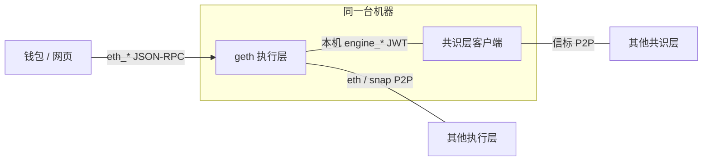
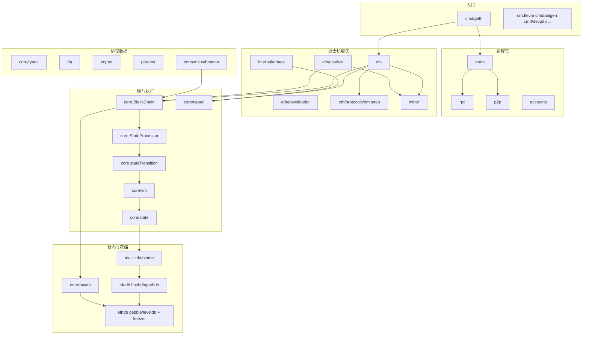
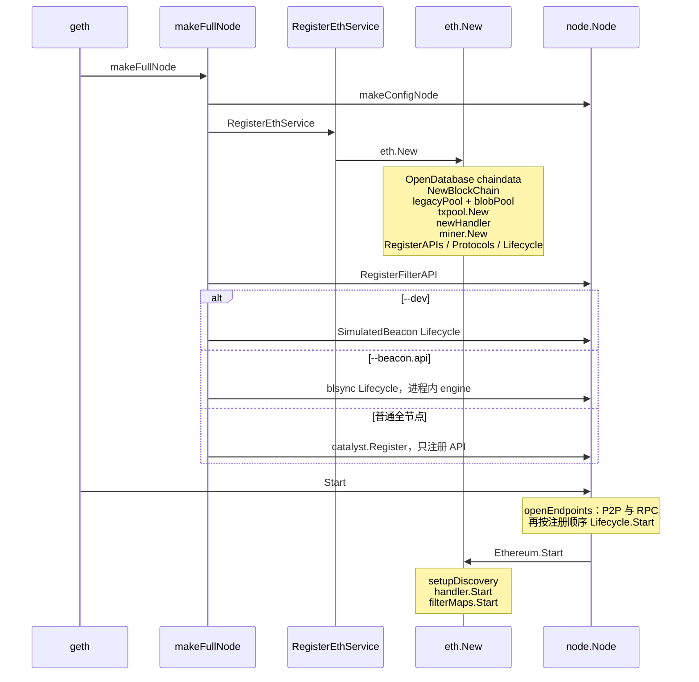
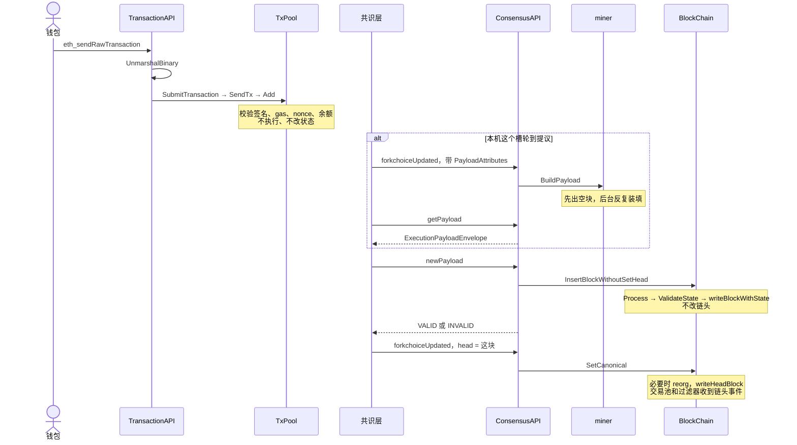
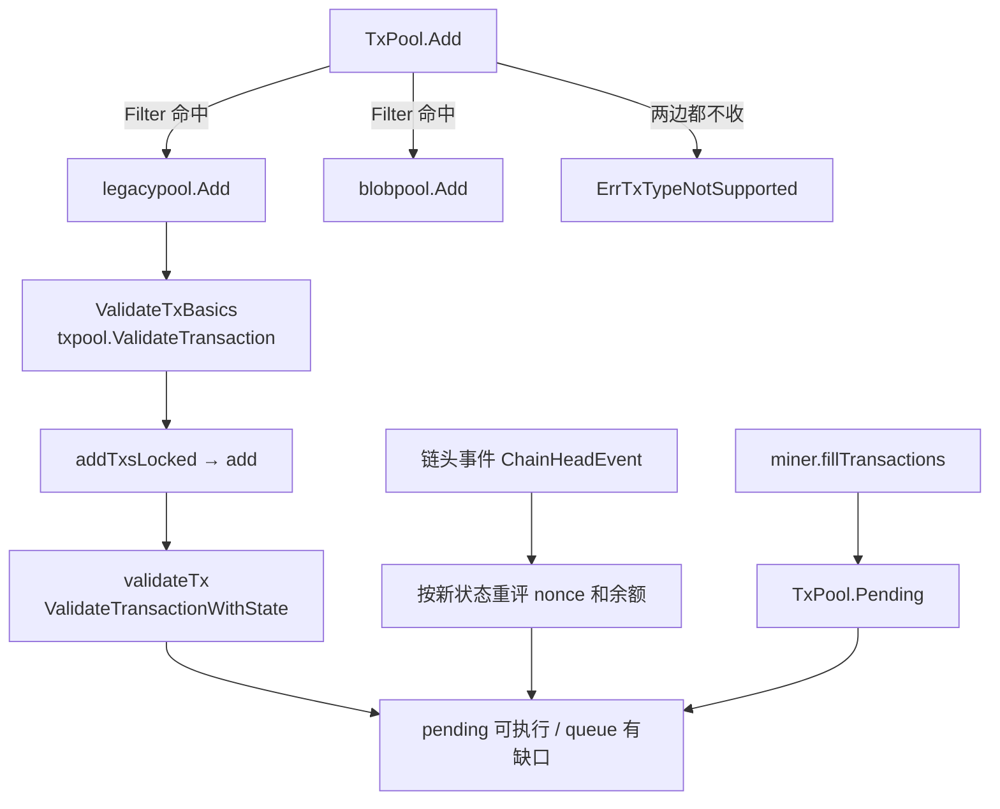
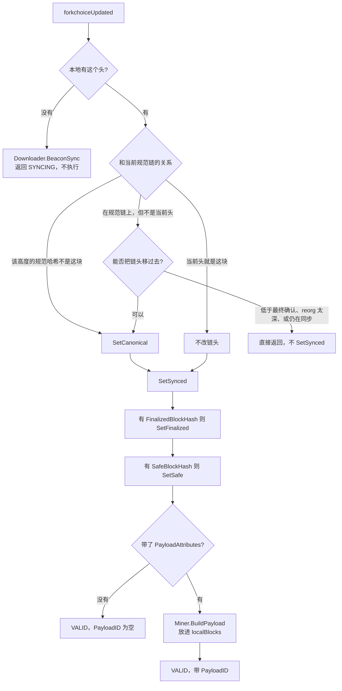
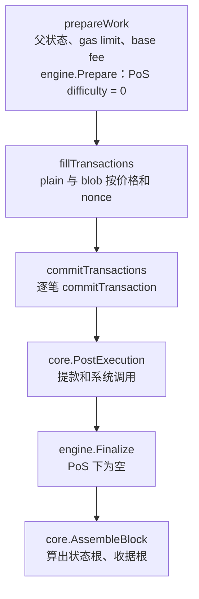
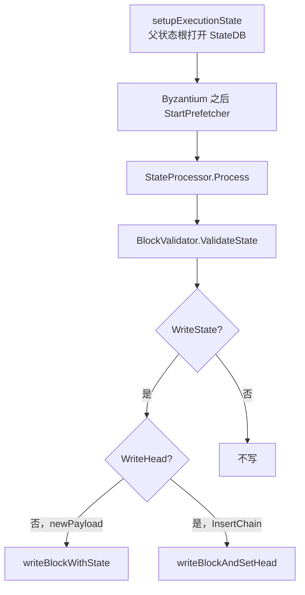
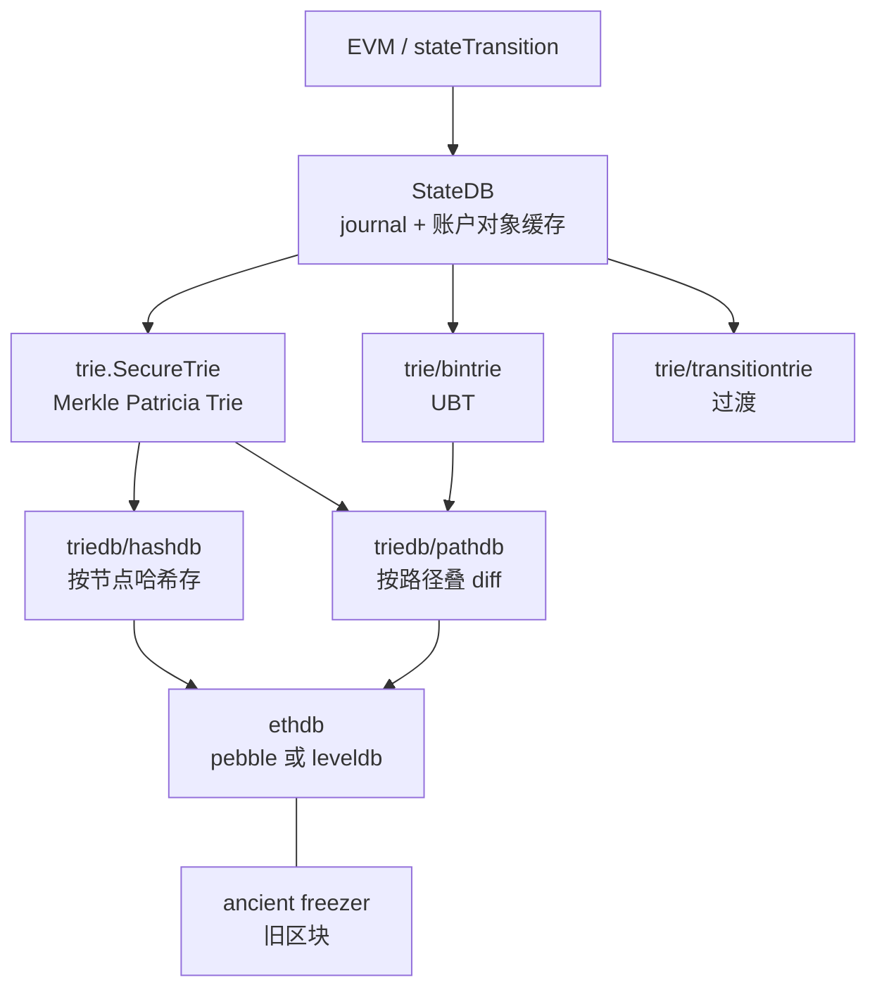
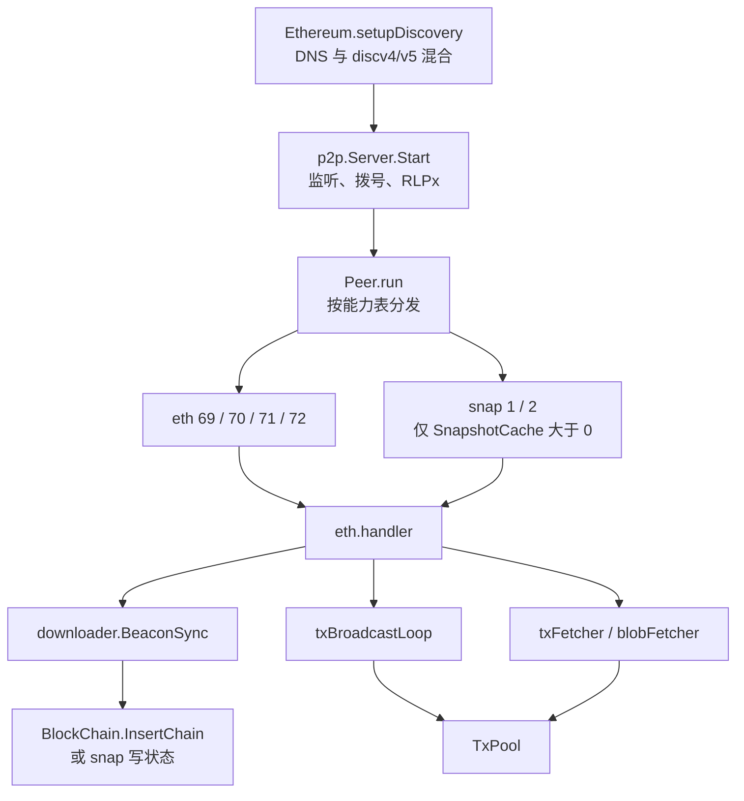

# go-ethereum 代码架构报告

这份报告按当前工作区源码整理，描述 `geth` 作为以太坊执行层客户端时，进程怎么装起来，以及一笔交易从 RPC 进入、进交易池、被装进块、执行、写成状态根的实现路径。图里的函数名都对得上仓库里的定义。合并之后，执行层不自己决定链头；链头由共识层经 Engine API 指定。

范围是执行层主路径。共识层客户端（Lighthouse、Prysm 等）不在本仓库。`cmd/` 下的 `evm`、`abigen`、`devp2p` 等是旁边的工具，文末只给入口，不展开。

对照阅读：根目录 [LEARNING.md](LEARNING.md) 是入门路线，各目录的 `LEARNING.md` 是第二遍笔记。本报告是把那些路径收成一张总图。

## 1. 进程外面：一台节点在系统里的位置

2022 年合并之后，接入主网要同时跑两个程序。

- 执行层，本仓库编出来的 `geth`。收交易、跑 EVM、维护账户状态，并和别的执行层交换区块与交易。
- 共识层，另一个进程。用质押和投票决定下一槽的提议者，以及当前链头、安全块、最终确认块。

两边用本机 Engine API 通信，要 JWT，默认端口 8551。钱包不连这个端口，钱包连 JSON-RPC（HTTP / WebSocket / IPC）。



`geth --dev` 不连主网，也不启动外部共识客户端。`cmd/geth/config.go` 的 `makeFullNode` 在 `--dev` 时构造 `catalyst.NewSimulatedBeacon`，并 `stack.RegisterLifecycle(simBeacon)`，由进程内的模拟信标按周期调用同一套 Engine API。

普通主网路径不注册这个 Lifecycle。`catalyst.Register` 只挂上要认证的 `engine` API 和未认证的 testing API，然后等外部共识客户端来调。

## 2. 仓库分层

`go.mod` 的模块路径是 `github.com/ethereum/go-ethereum`，Go 版本 1.25.0。



顶层目录和主路径的关系：

| 目录 | 在主路径上干什么 |
|------|------------------|
| `cmd/geth` | 解析 flag，`makeFullNode` 组装节点，`geth()` 里 `startNode` 然后 `stack.Wait()` |
| `node` | 数据目录、数据库句柄、P2P `Server`、RPC 端点、`Lifecycle` 启停 |
| `rpc` | JSON-RPC 编解码。`Server.ServeCodec` 把请求交给 `handler.handleMsg` |
| `internal/ethapi` | `eth_`、`txpool_` 等命名空间。`TransactionAPI.SendRawTransaction` 在这里 |
| `eth` | 全节点服务 `Ethereum`。持有链、交易池、handler、miner，并注册协议和 API |
| `eth/catalyst` | Engine API。`ConsensusAPI.forkchoiceUpdated` / `newPayload` |
| `miner` | 按共识层给的属性从交易池装填 payload。不负责 PoS 封印 |
| `core` | `BlockChain`、`StateProcessor`、`stateTransition`、区块校验 |
| `core/txpool` | 聚合 `legacypool` 与 `blobpool` |
| `core/types` | 区块、交易、收据、提款 |
| `core/vm` | EVM。`EVM.Call` 转账并进入 `EVM.Run` |
| `core/state` | 账户缓存、journal、`Commit` |
| `core/rawdb` | 链数据在 KV 和 ancient freezer 里的键布局 |
| `trie` / `triedb` | Merkle Patricia Trie，以及 path / hash 两种节点库；`trie/bintrie` 是 UBT |
| `ethdb` | `pebble`（新库默认）、遗留 `leveldb`、freezer |
| `p2p` | devp2p。`Server.Start` 只做监听、拨号和加密握手 |
| `eth/protocols` | 握手之后的 `eth`（69–72）和 `snap`（1、2） |
| `eth/downloader` | 信标同步。模式是 `FullSync` 或 `SnapSync` |
| `consensus` | `Engine` 接口。生产引擎是 `consensus/beacon.Beacon` |
| `params` | Chain ID、分叉时间。`ChainConfig.Rules` 把区块号和时间折成一组布尔开关 |
| `accounts` | keystore、USB 钱包、外部签名器。节点签名用，不负责校验别人的交易 |
| `rlp` / `crypto` | 编码和哈希、secp256k1。交易、区块、trie 节点都经过这里 |

旁边的包：`eth/filters` 做日志过滤，`core/filtermaps` 做日志索引，`eth/tracers` 做执行跟踪，`graphql` 是另一套查询接口，`beacon/blsync` 是轻量信标同步客户端，`signer` 是独立的签名守护进程。

## 3. 进程怎么装起来

入口在 `cmd/geth/main.go` 的 `geth`。没有子命令时：

1. `prepare` 打印主网 / Sepolia / Hoodi。
2. `makeFullNode` 把组件挂上，此时还不 `Start`。
3. `startNode` 调到 `node.Node.Start`。
4. `stack.Wait` 阻塞到退出。

`makeFullNode`（`cmd/geth/config.go`）的装配顺序：



`eth.New`（`eth/backend.go`）里对象的依赖是单向的：先有 `chainDb` 和 `consensus.Engine`，再有 `BlockChain`，再有两个子池合成的 `TxPool`，然后 handler 和 miner 都拿着这几样东西。`stack.RegisterLifecycle(eth)` 让 `Ethereum` 成为后台服务。`catalyst.Register` 不注册 Lifecycle，所以普通节点不会自己按槽出块。

共识引擎在 `eth/ethconfig/config.go` 的 `CreateConsensusEngine`。创世配置没有 `TerminalTotalDifficulty` 就直接报错，这份代码只跑已经合并的网络。有 Clique 配置时用 `beacon.New(clique.New(...))`，否则用 `beacon.New(ethash.NewFaker())`。内层 ethash 是占位，不是 PoW 挖矿。PoS 头上 `Beacon.Prepare` 把 difficulty 写成 0，`Beacon.Finalize` 是空操作（没有出块奖励），`Beacon.Seal` 直接返回，不往结果通道里塞块。封印在共识层。

`node.Node.Start`（`node/node.go`）先 `openEndpoints`，再逐个 `lifecycle.Start()`。因此 `Ethereum.Start` 跑起来时，P2P 监听已经开了。`Ethereum.Start` 自己做三件事：节点发现、`handler.Start`（交易广播、tx fetcher、blob fetcher）、`filterMaps` 日志索引。

## 4. 一笔交易的两条路

交易有两个入口，执行规则是同一套。

- 本机被选为提议者：共识层 `forkchoiceUpdated` 带上 payload 属性，执行层从交易池组块，`getPayload` 把块交回去。之后共识层仍会用 `newPayload` 把这块送回来再执行一遍，再用 `forkchoiceUpdated` 把它设成链头。
- 别人提议：共识层从自己的 P2P 收到块，`newPayload` 要求执行层再算一遍。状态根对得上才是 `VALID`。`VALID` 还不等于链头，链头要等下一次 `forkchoiceUpdated` 里的 `SetCanonical`。



进池失败和执行回滚是两种失败。

| | 发生在哪 | 交易进不进块 | 状态改不改 | gas |
|--|----------|--------------|------------|-----|
| 进池拒绝 | `ValidateTransaction` / `ValidateTransactionWithState` | 不进 | 不改 | 不扣 |
| 共识错误 | `ApplyMessage` 返回 `error`，例如 nonce、余额、intrinsic gas | 整块无效 | 这块不能留下 | 不作为有效块结算 |
| EVM revert | `ExecutionResult.Err`，`ApplyMessage` 本身不返回 error | 留在块里 | 这笔的状态回滚到快照，nonce 仍增加 | 仍消耗，收据状态是失败 |

`ApplyMessage` 的注释写明：返回的 `error` 表示这块不该被接受；EVM revert 记在 `ExecutionResult.Err`，交易仍留在块里。

## 5. JSON-RPC 与交易提交

`rpc.Server.ServeCodec` 读一条 JSON-RPC，`handler.handleMsg` 按命名空间和方法分发。以太坊命名空间来自 `eth.APIs`，其中 `ethapi.GetAPIs` 提供交易相关方法，`filters` 另挂一套日志过滤。

`eth_sendRawTransaction` 对应 `TransactionAPI.SendRawTransaction`（`internal/ethapi/api.go`）：

1. `tx.UnmarshalBinary`。节点不在这里签名。
2. Osaka 之后，带 version 0 sidecar 的 blob 交易会尝试 `ToV1`。
3. `SubmitTransaction`。

`SubmitTransaction` 先做两道 RPC 层检查，再交给后端：

- `checkTxFee`：手续费超过 `RPCTxFeeCap` 就拒绝。这是节点自保，不是共识规则。
- `tx.Protected()`：默认只收 EIP-155 重放保护交易。`--rpc.allow-unprotected-txs` 才会放开。
- `b.SendTx`。

`EthAPIBackend.SendTx`（`eth/api_backend.go`）调用 `txPool.Add`。若配置了本地交易跟踪器（默认开着，除非 `TxPool.NoLocals`）：

- 永久性错误返回给调用方。
- 暂时性拒绝（池满一类）对调用方返回成功，并由 `locals.TxTracker.Track` 稍后重试。
- 成功进入池的本地交易也会被跟踪。

`eth_sendTransaction` 走另一条路：用 `accounts.Manager` 找到钱包，`wallet.SignTx` 之后再 `SubmitTransaction`。这条路径拒绝 blob 交易（`errBlobTxNotSupported`）。blob 必须走已经签好的 raw 交易。

能不能进池，由交易池里的 `types.Sender` 决定。`ValidateTransaction` 用 `types.MakeSigner(chainConfig, head.Number, head.Time)`，按当前头的分叉选签名规则。`SubmitTransaction` 在 `SendTx` 成功之后还会再恢复一次发送方，只为打提交日志；恢复失败会把错误返回给 RPC，但交易已经进过池。

## 6. 交易池

`txpool.TxPool` 是聚合器，不是单一内存池。`eth.New` 把两个 `SubPool` 交进去：

- `legacypool.LegacyPool`：legacy、access-list、dynamic-fee、set-code。
- `blobpool.BlobPool`：blob 交易。sidecar 主要在磁盘上，并有 `blobpool.Cache`。



`TxPool.Add` 按 `SubPool.Filter` 把一批交易拆开。类型对不上任何子池，错误是 `ErrTxTypeNotSupported`。

`legacypool.Add` 分两段，锁的粒度不同：

1. 不持池锁。已存在则 `ErrAlreadyKnown`。否则 `ValidateTxBasics` → `txpool.ValidateTransaction`。这里检查类型是否已被当前头的分叉打开、尺寸、gas 上限、value 非负、fee cap 与 tip 的关系、签名能恢复出 sender、nonce 不超过 2^64-1、intrinsic gas、Prague 的 calldata floor、tip 下限。blob 类型还会查 sidecar，但 legacy 池的 `Accept` 掩码不包含 `BlobTxType`。
2. 持 `pool.mu`。`add` 再调 `validateTx` → `ValidateTransactionWithState`：nonce 不低于账户当前值、余额盖得住已在池中的花费加上这笔、以及授权相关的 `validateAuth`。legacy 池允许 nonce 有缺口（`FirstNonceGap` 为 nil），缺口交易进 `queue`，紧挨着账户 nonce 的进 `pending`。替换同一 nonce 要付更高的价格。

进池不调用 EVM，不改 `StateDB`。`TxPool` 自己持有一份头状态，只用来做上述查询。链头前进时它订阅 `ChainHeadEvent`，重置这份状态。

`Pending` 把各子池里当前可执行的交易按账户和 nonce 交出来，供组块使用。

## 7. Engine API 与组块

`eth/catalyst/api.go` 的 `ConsensusAPI` 是执行层对共识层的全部入口。版本化方法（`ForkchoiceUpdatedV1` 到 `V4`，`NewPayloadV1` 到 `V5`，`GetPayloadV1` 到 `V6`）最后都进两个内部函数：`forkchoiceUpdated` 和 `newPayload`。

### 7.1 forkchoiceUpdated：改链头，可选地开始组块

持 `forkchoiceLock`。`HeadBlockHash` 为空直接 `INVALID`。



本地没有这个头时，函数只触发同步，不在这里执行块。规范头要等块到达之后的下一次调用。第三支是把链头退回到规范链上的某个祖先；提前返回不会走到 `SetSynced`。

`PayloadAttributes` 出现时才组块。属性包括父哈希、时间戳、手续费接收地址、`prevRandao`、提款、信标根、slot、目标 gas。`miner.BuildPayloadArgs.Id` 作为 payload id。同一个 id 已经在建，就直接返回，不另起一份工作。

`SetFinalized` 只标记最终确认块，不负责把链头向前推。链头是 `HeadBlockHash` 那一次 `SetCanonical`。

### 7.2 newPayload：执行并落库，不改链头

持 `newPayloadLock`，避免共识层超时重试时并发插入同一块。

1. `engine.ExecutableDataToBlock` 把执行负载还原成 `types.Block`。还原失败即 `INVALID`。
2. 本地已有该哈希：直接 `VALID`，不再执行。
3. 父块不在本地，或 `ConfigSyncMode()` 仍是 `SnapSync` 且块高不是 1：`delayPayloadImport`，把头放进 `remoteBlocks`，尽量 `BeaconExtend`，返回 `SYNCING`。这里故意不因为缺父块就启动一次会打乱链的同步。
4. 父块在，但父状态不在：返回 `ACCEPTED`。
5. `BlockChain.InsertBlockWithoutSetHead`。成功才是 `VALID`。

`InsertBlockWithoutSetHead` 的注释写明它和 `InsertChain` 的差别：`setHead` 传 `false`，不更新规范链头。

### 7.3 miner：先保证有一块，再往里装交易

`Miner.BuildPayload` → `buildPayload`（`miner/payload_building.go`）：

1. `generateWork`，`noTxs: true`。马上得到一个不含交易的块，避免这个槽交不出东西。
2. 后台循环在大约 12 秒的窗口里反复 `generateWork`，`noTxs: false`。`Recommit` 计时到了就打断本轮装填。

`GetPayloadV1` 到 `GetPayloadV6` 都把 `full` 传成 `false`，因此走 `Payload.Resolve`。满块已经造好就交满块，否则交一开始那块空块，并停下后台装填。`ResolveFull` 会等到满块，当前这些 `GetPayloadV*` 不调用它。

`generateWork`（`miner/worker.go`）：



`prepareWork` 从指定父块取出状态。交易还没装进来。`fillTransactions` 向 `TxPool.Pending` 要可执行交易，分成普通交易和 blob 交易，按价格与 nonce 挑选，直到 gas、blob gas 或区块大小装不下，或被 recommit 打断。

组块和稍后的 `newPayload` 是两次执行。第一次产生块头里的状态根；第二次在 `InsertBlockWithoutSetHead` 里重放。两边规则必须算出同一个根，否则本机刚组出来的块会在导入时被记成坏块（`rawdb.WriteBadBlockWithDetails`）。

## 8. 区块插入、执行、校验、落盘

`BlockChain.insertChain`（`core/blockchain.go`）是导入一批块的公共路径。`InsertChain` 用 `setHead=true`，`InsertBlockWithoutSetHead` 用 `setHead=false`。

单块处理在 `ProcessBlock`：



`StateProcessor.Process`（`core/state_processor.go`）：

1. `supportsParallelExecution` 为真时走 `processParallel`：Amsterdam 已激活、块上带 access list、没有 tracer、没有 witness，且没有显式关掉并行。否则顺序执行。下面按顺序路径说。
2. DAO 分叉块上调用 `misc.ApplyDAOHardFork`。
3. `vm.NewEVM`，块上下文来自块头。
4. `PreExecution`：Cancun 起 `ProcessBeaconBlockRoot`（EIP-4788）；Prague 或 UBT 起 `ProcessParentBlockHash`（EIP-2935）。这些是系统调用，不走 `OnTxStart`。
5. 对每笔交易：`TransactionToMessage`，`statedb.SetTxContext`，`applyTransactionWithEVM`。
6. `PostExecution`：Shanghai 起把提款从 Gwei 换成 Wei 加进余额；Prague 起解析存款日志、处理提款队列和合并队列；Amsterdam 起还有 builder 存款与退出队列。
7. `Engine.Finalize`。PoS 头上为空。
8. 收据 bloom 在旁边的 `digestPipeline` 里算，和执行重叠。

`BlockValidator.ValidateState` 在写盘之前比较：

- `GasUsed`
- logs bloom
- 收据根
- Prague 起的 requests hash
- Amsterdam 起的 block access list 哈希
- `statedb.IntermediateRoot` 与块头 `Root`

根不一致就返回错误，`ProcessBlock` 不会进入 `writeBlockWithState`。块因此不能留下。`reportBadBlock` 会把这种块记下来供排查。

`writeBlockWithState` 做两件事，并行：

- 一个 goroutine 把块头、块体、收据、preimage 经 `rawdb` 写入链数据库。
- 当前 goroutine `statedb.Commit` 或 `CommitWithUpdate`，把状态写进 trie 数据库。

`writeBlockAndSetHead` 在写完之后更新规范链头。`newPayload` 不走这一步。`forkchoiceUpdated` 发现目标块已经在库里、但还不是规范头时，调用 `SetCanonical`：父块不是当前头就先 `reorg`，然后 `writeHeadBlock`，并发出链头事件。交易池靠这个事件丢掉已经入块的交易，并按新状态重新排队。

## 9. 单笔交易怎么改状态

`applyTransactionWithEVM` 调 `ApplyMessage`。`ApplyMessage` 构造 `stateTransition` 并 `execute`。

`execute`（`core/state_transition.go`）的顺序：

```mermaid
flowchart TB
    pre["preCheck：nonce、余额上限、buyGas"]
    gas["IntrinsicGas，Prague 再加 FloorDataGas"]
    prep["StateDB.Prepare<br/>访问列表、清空 TSTORE"]
    top{"To 为空?"}
    create["executeCreate → EVM.Create"]
    call["executeCall：nonce+1 → EVM.Call"]
    settle["settleGas：退未用 gas"]
    tip["AddBalance(coinbase, tip)"]
    receipt["makeReceipt"]

    pre --> gas --> prep --> top
    top -->|是| create --> settle
    top -->|否| call --> settle
    settle --> tip --> receipt
```

`preCheck` 最后调用 `buyGas`。余额要盖住最坏情况：`GasLimit × GasFeeCap + Value`，Cancun 起再加上 `blobGas × BlobGasFeeCap`。实际扣款是 `GasLimit × GasPrice`（再加 blob base fee）。扣款记账原因是 `BalanceDecreaseGasBuy`。base fee 没有一笔单独的“销毁转账”：发送方按 gas price 预付，结算时只把 tip（`GasPrice - BaseFee`）加给 coinbase，base fee 那一部分不再付给任何人。

`StateDB.Prepare` 在每笔交易开始时调用。Berlin 起重建访问列表（EIP-2929，以及交易自带的 EIP-2930 列表）；Shanghai 起把 coinbase 标成 warm（EIP-3651）；并清空 transient storage（EIP-1153）。上一笔的 `TSTORE` 从这里消失。Amsterdam 起开始收集 block access list（EIP-7928）。

普通转账走 `executeCall`：

1. `SetNonce(from, nonce+1)`，原因 `NonceChangeEoACall`。`EVM.Call` 的快照在这之后才拍，revert 会退回转账和存储，不会把 nonce 退回去。
2. 应用 EIP-7702 授权（`applyAuthorizations`）。Amsterdam 上授权失败，或 `chargeCallRecipientEIP2780` 失败，会回滚到 nonce 增加之后的快照，并返回 out-of-gas。
3. `EVM.Call`。非系统调用时 `Context.Transfer` 总会执行，包括 value 为 0，以便走状态清理。目标是预编译就走 `RunPrecompiledContract`；否则有代码才 `EVM.Run`。

合约创建走 `executeCreate` → `EVM.Create`。nonce 增加通常发生在 `Create` 内部。Amsterdam 上如果账户创建费用本身就不够 gas，会在进 `Create` 之前手动把创建者 nonce 加一，保证这笔已经进块的交易仍然消耗 nonce。

`EVM.Call`（`core/vm/evm.go`）在转账和执行之前做深度检查（超过 1024 层返回 `ErrDepth`）和余额检查。执行前 `Snapshot`，失败则 `RevertToSnapshot`。预编译走 `contracts.go` 里的 `Run`，不进解释器。普通合约进入 `EVM.Run`（`core/vm/interpreter.go`）：取指、按 `JumpTable` 分发、改栈和内存、通过 `StateDB` 读写存储。`ErrExecutionReverted` 保留剩余 gas，其他解释器错误烧掉剩余执行 gas。

Byzantium 及之后，`applyTransactionWithEVM` 对每笔交易调用 `StateDB.Finalise`，把这笔的脏账户折叠进对象缓存，不在每笔之后算整棵树的根。块结束时 `ValidateState` 才 `IntermediateRoot`。收据的 `PostState` 留空，成败看 `Receipt.Status`。Byzantium 之前才会把每笔交易的 `IntermediateRoot` 写进 `PostState`。

`makeReceipt` 填写：状态、`CumulativeGasUsed`、`GasUsed`、blob 交易的 `BlobGasUsed` 和 `BlobGasPrice`、合约地址（`crypto.CreateAddress(origin, nonce)`）、日志、交易索引。块处理器把 bloom 交给流水线，单笔 `ApplyTransactionWithEVM` 则当场 `CreateBloom`。

## 10. 状态、树和数据库

账户不是一张平表。读路径是 `StateDB` 的缓存，未命中才进 trie，trie 节点再进 `triedb`，最后进 KV。



`core/state/database.go` 把后端分成 `TypeMPT` 和 `TypeUBT`。MPT 是现行主网状态树：账户地址和存储键先做 Keccak，再走 hexary Patricia trie。`StateDB.Commit` 的注释说明写入分三拍：

1. `trie.Commit` 收集脏节点。
2. `triedb.Update`：hash 模式放进脏缓存；path 模式叠一层 diff。
3. 真正写 KV 还要再等 `Cap`、`Commit`，或 pathdb 把 buffer 刷出。

所以 `ValidateState` 里根已经算出来，并不等于节点已经在磁盘上。落盘发生在随后的 `writeBlockWithState` → `Commit`。

`triedb.Config` 同时带 `HashDB` 和 `PathDB`。新节点常用 path scheme：最近的状态是多层 diff，底层是磁盘层，历史可以按策略修剪。hash scheme 用节点哈希当键，归档节点配合 `NoPruning` 把脏缓存预算并进干净缓存。`eth.New` 在 hash scheme 且 `NoPruning` 时会把 `TrieDirtyCache` 挪到 clean cache 和 snapshot cache。

`params.ChainConfig.IsUBT` 打开统一二叉树（代码里的 verkle 分叉时间）。`trie/bintrie` 是这棵树，`trie/transitiontrie` 负责从 MPT 过渡。`TxPool.HeadState` 在头状态还不可用时，UBT 用 `types.EmptyBinaryHash` 做空根，MPT 用 `types.EmptyRootHash`。

链数据本身不进状态树。`core/rawdb` 把规范哈希、块头、块体、收据、交易查找索引写在 `chaindata`。更老的区块可以进 ancient freezer（`eth.New` 里 `DatabaseOptions.AncientsDirectory`）。KV 引擎在 `node/database.go`：已有库沿用原来的引擎；没有库时默认 Pebble v2，旧 Pebble v1 文件仍能打开并提示离线升级；也可以显式选 LevelDB。

日志索引是另一条管道。`eth.New` 建 `filtermaps.FilterMaps`，`Ethereum.Start` 订阅链头并 `filterMaps.Start`。它不参与状态根。

## 11. P2P、协议和同步



`p2p.Server.Start` 不认识交易和区块。它建立加密连接，跑 devp2p 握手。`eth.Protocols` 始终注册 `eth`，只有 `SnapshotCache > 0` 才附加 `snap`。子协议在能力协商之后由 `Peer.run` 分发。

`eth/protocols/eth/protocol.go` 当前版本常量是 `ETH69`、`ETH70`、`ETH71`、`ETH72`，`ProtocolVersions` 从 72 排到 69。`protocolLengths` 是 69/70 为 18 条、71 为 20 条、72 为 22 条。71 多出的是 `GetBlockAccessLists` / `BlockAccessLists`，72 多出的是 `GetCells` / `Cells`。`eth/69` 起消息号里仍留着 `NewBlock` 和 `NewBlockHashes`，handler 不再分发，收到会落到 `errInvalidMsgCode`。新块从共识层经 `eth/catalyst` 进来。`snap` 是 `SNAP2` 和 `SNAP1`。

`handler.Start`：

- 订阅交易池的新交易（不要 reorg 时复活的那些），`txBroadcastLoop` 向邻居宣布。
- 启动 `txFetcher` 和 `blobFetcher`，把别人宣布的交易拉回来再 `Add`。
- `txTracker` 记录哪些 peer 实际把交易送进了块，供连接淘汰使用。

同步由共识层带动，而不是执行层自己按 total difficulty 选头。`Downloader.BeaconSync` 按配置进入 `FullSync` 或 `SnapSync`：

- Full：下块头、块体、收据，逐块 `InsertChain`（`setHead` 为 true），每块都执行并写成规范头。
- Snap：pivot 之前只写收据、不执行，账户和存储范围靠 `snapSyncer` 拉取。`fsMinFullBlocks` 是 64，pivot 之后这一小段才执行。同步完成且头状态存在后，`syncModer` 会切到 `FullSync`。`newPayload` 看的是 `ConfigSyncMode()`：模式仍是 snap 且块高不是 1 时，`delayPayloadImport`，不把块直接写进库。

`forkchoiceUpdated` 发现头未知时调用 `BeaconSync`。`newPayload` 缺父块时最多 `BeaconExtend`，不另起一轮会 reorg 的同步。

## 12. 共识、账户和编码

### 共识

`consensus.Engine` 是算法无关接口：`VerifyHeader`、`VerifyHeaders`、`Prepare`、`Finalize`、`Seal`。插入路径用 `VerifyHeaders` 并行检查块头，再用 `Finalize` 做共识相关的状态收尾。合并后的实现是 `beacon.Beacon`，它按块头判断还在不在 PoS：PoS 头自己处理，更早的头转给内层 ethone（Clique 或 ethash faker）。执行层不在这条接口里投票，也不在这里选择链头。

### 账户

`accounts.Manager` 由 `node.Node` 持有。`cmd/geth/config.go` 的 `setAccountManagerBackends` 在外部签名器和本地后端之间二选一。本地路径挂 keystore，并按配置挂 Ledger / Trezor。`startNode` 订阅 `WalletEvent`，钱包打开后按路径派生账户。这些账户只用于本机 `eth_sendTransaction` 一类需要节点签名的 RPC。网络上来的交易已经带签名，不经过这里。

### 类型、RLP、密码学、分叉

`core/types.Transaction` 是外壳加 `inner TxData`。类型常量：

| 类型 | 值 | 谁收 |
|------|----|------|
| Legacy | `0x00` | legacypool |
| Access list | `0x01` | legacypool |
| Dynamic fee | `0x02` | legacypool |
| Blob | `0x03` | blobpool。进块的交易不带 sidecar |
| Set code | `0x04` | legacypool |

区块在网络上和数据库里都是 RLP。`rlp` 包按类型缓存编解码。哈希是 Keccak-256，签名是 secp256k1，都在 `crypto`。

分叉不散落在各个 `if` 的时间戳里。调用点拿 `params.ChainConfig.Rules(number, isMerge, time)`，得到 `IsLondon`、`IsShanghai`、`IsCancun`、`IsPrague`、`IsOsaka`、`IsAmsterdam`、`IsBogota`、`IsUBT` 等布尔值。当前源码里的 Amsterdam、Bogota、UBT 是否在某条链上生效，看那条链的创世配置，不看这些函数是否存在。`--dev` 使用的创世会打开一批分叉，具体开到哪一个以启动日志和 `params` 里的 dev 配置为准。

## 13. 数据落在哪

| 数据 | 写入点 | 存储 |
|------|--------|------|
| 尚未入块的普通交易 | `legacypool.add` | 内存。本地交易另有 journal |
| blob sidecar | `blobpool` | 数据目录下的 blobpool 目录 |
| 区块、收据、规范哈希 | `rawdb.WriteBlock` / `WriteReceipts` | `chaindata` KV，旧数据可进 freezer |
| 状态根所代表的账户和存储 | `StateDB.Commit` → `triedb` | KV 中的 trie 节点。path 模式还有 diff 层和 journal（`triedb/merkle.journal` 或 `verkle.journal`） |
| 坏块 | `newPayload` 导入失败且本地曾组出同根的块 | `rawdb.WriteBadBlockWithDetails` |
| 日志索引 | `filtermaps` | 链数据库中的过滤器映射，不进状态根 |
| 密钥 | keystore 或外部 signer | `keystore` 目录或外部进程，不进链数据库 |

## 14. 建议从哪读

顺着一笔普通转账，按这个顺序打开文件即可，不必先读 P2P。

1. `internal/ethapi/api.go`：`SendRawTransaction`、`SubmitTransaction`。
2. `eth/api_backend.go`：`SendTx`。
3. `core/txpool/txpool.go`：`Add`。
4. `core/txpool/validation.go`：`ValidateTransaction`、`ValidateTransactionWithState`。
5. `core/txpool/legacypool/legacypool.go`：`ValidateTxBasics`、`validateTx`、`add`。
6. `eth/catalyst/api.go`：`forkchoiceUpdated`、`newPayload`。
7. `miner/payload_building.go`：`buildPayload`。`miner/worker.go`：`generateWork`、`fillTransactions`。
8. `core/blockchain.go`：`InsertBlockWithoutSetHead`、`ProcessBlock`、`writeBlockWithState`、`SetCanonical`。
9. `core/state_processor.go`：`Process`、`applyTransactionWithEVM`。
10. `core/state_transition.go`：`ApplyMessage`、`execute`、`buyGas`、`executeCall`。
11. `core/vm/evm.go`：`Call`。`core/vm/interpreter.go`：`Run`。
12. `core/block_validator.go`：`ValidateState`。
13. `core/state/statedb.go`：`Prepare`、`Finalise`、`Commit`。

组块和导入是两条入口，执行都汇合到 `StateProcessor` 和 `stateTransition`。读的时候不要把 `miner.generateWork` 当成最终落盘：它产出的块还要经过 `newPayload` 再执行一次，链头还要再等 `forkchoiceUpdated`。
